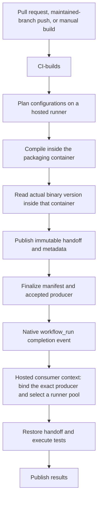
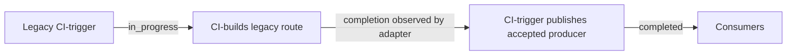

# CI execution flow

## Current source callers

The build command must succeed; `pipefail` prevents `tee` from hiding a failed producer. The existing container-success log check is also retained because older product Makefiles do not propagate the container exit status. Source checkout uses the pull request head SHA, not the merge SHA. Planning, finalization and binding do not queue on the self-hosted test pool.

The producer publishes acceptance only after required builds and manifest publication succeed. Consumers validate the source repository, source revision and producer run. A failed-job rerun may accept the original immutable execution; the acceptance artifact is associated with the new completion attempt while its producer binding still names the retained build. Explicit manual consumer dispatch continues to require an exact producer run and attempt.

Consumers identify native completion by the workflow file path, not the dynamic run title. Superseded and closed-PR cancellation recognizes both entry workflows.

## Legacy callers

Older maintained branches still start `CI-trigger`, so the shared adapter remains available:

The default build workflow retains its legacy subscription. Consumers listen to both entry workflows, but skip completion of a build whose own event was `workflow_run`: that legacy build is followed by acceptance on `CI-trigger`. This prevents duplicate fanout while letting current source callers avoid the polling runner entirely.

Deploy the shared engine PR before the paired source-caller PR. Do not remove the legacy adapter until the remaining maintained callers have migrated.

## Runner and runtime responsibilities

One selector runs within the existing hosted consumer context. It observes pool demand; it does not reserve capacity. The previous hosted image choices and API-failure policies are preserved. Test userspace belongs to the container image, not this capacity decision.

Current exceptions remain explicit: MySQLX end-to-end testing installs MySQL runtime libraries and starts dbdeployer on the hosted VM; its setup expects Ubuntu's time64 libaio package. Sanitizer workflows also adjust the host kernel's ASLR setting. These are existing runtime requirements, not reasons for the generic hosted fallback to require a particular Ubuntu release.

## Artifact guarantees

Handoffs, manifests and consumer bindings have matching retention. Compiled test executables are retained; applicability is handled by the runner.

Restoration deliberately retains its two streaming passes. The first rejects unsafe members and corrupt trailing compressed data before anything is installed in the checkout; the second extracts with path and link filtering. Removing the first pass would weaken the existing reject-before-write guarantee, while staging a complete build for later publication would introduce additional filesystem and disk-budget complexity. Checksums and execution/source/tier binding remain enforced.
