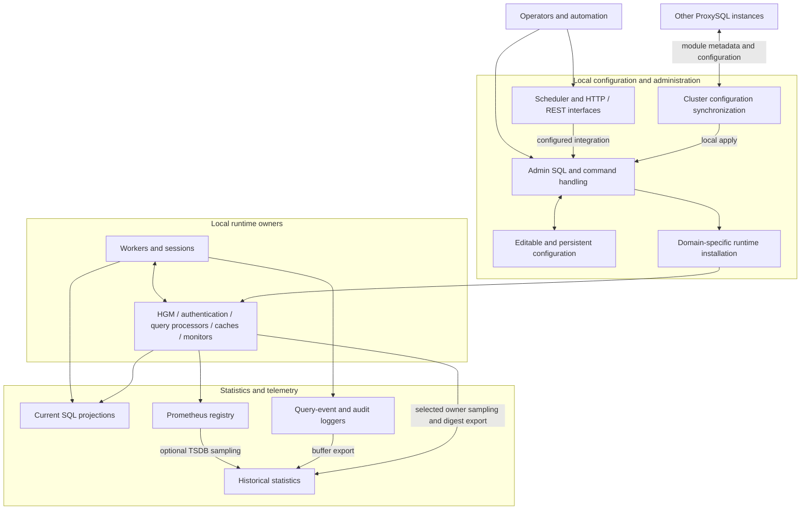
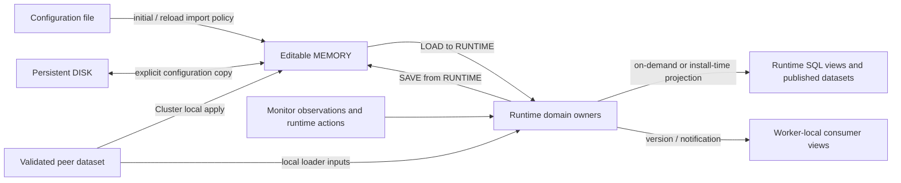
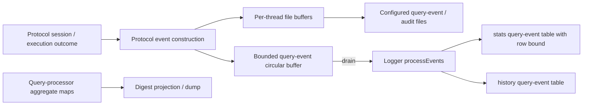

# Administration, configuration, and statistics

Source-verified architecture analysis, 2026-10-18, against `f8ada9117`. This chapter describes
current mechanisms and their architectural consequences; it does not ratify new product invariants.
Maintainer-approved contracts remain in [the invariants catalogue](../../agents/invariants.md).

## Responsibilities and boundaries

Configuration and administration provide the management path for a local ProxySQL instance.
Operators edit configuration, choose when to activate it, choose when to persist it, and inspect the
resulting runtime. ProxySQL Cluster belongs within this area: it is another producer of local
configuration through **peer configuration synchronization**. It does not coordinate client
execution, distribute transactions, or create a shared backend-connection pool across instances.

Statistics is a substantial cooperating subsystem. It gathers measurements from runtime owners,
makes current activity available through SQL and Prometheus, and stores selected history. Its
instrumentation spans traffic handling, authentication, backend management, monitors, caches, and
administration. Calling all of this simply “the Admin database” hides different owners, collection
costs, and data lifetimes.

The principal responsibilities are:

| Responsibility | Implementation owners | Boundary |
| --- | --- | --- |
| Management protocol and commands | `ProxySQL_Admin`, `Admin_Handler.cpp` | Terminates management sessions locally; interprets special administrative commands and executes supported SQL against SQLite. |
| Configuration storage and bootstrap | `Admin_Bootstrap.cpp`, `ProxySQL_Config`, Admin database/copy paths | Maintains editable and persistent representations; imports initial configuration; creates/upgrades schemas. |
| Runtime installation | Admin loaders plus the relevant HGM, authentication manager, query processor, or thread handler | Translates configuration into the data structures actually used by execution. |
| Peer configuration synchronization | `ProxySQL_Cluster`, its node set and per-peer activity | Compares published module metadata, fetches supported datasets, applies them locally, optionally persists them. |
| External management integrations | Admin scheduler, REST route registry/server, HTTP server | Runs configured programs or exposes local management/telemetry interfaces. |
| Current SQL statistics | Runtime producers plus `ProxySQL_Admin_Stats.cpp` | Observes producer state and materializes SQL representations on demand. |
| Historical statistics | `ProxySQL_Statistics` | Samples selected producers, stores series/dumps, aggregates selected series, and applies their retention rules. |
| Query-event and audit logging | `MySQL_Logger`, `PgSQL_Logger` | Constructs events, owns buffers/files/rotation, and exports retained query events to SQL history. |
| Metrics exposition and optional TSDB | Shared Prometheus registry, Admin serial exposer, `ProxySQL_Statistics` | Exposes module measurements; optional TSDB samples the registry into labelled time series. |

These are responsibilities, not equal-sized processes or independent services. Source entry points:
[Admin bootstrap](../../../lib/Admin_Bootstrap.cpp#L656), [command
handler](../../../lib/Admin_Handler.cpp#L1538), [statistics
projection](../../../lib/ProxySQL_Admin_Stats.cpp#L579), [statistics
class](../../../include/ProxySQL_Statistics.hpp#L112), [Cluster
interface](../../../include/ProxySQL_Cluster.hpp#L591).

The diagram shows responsibility and data flow. It does not promise one transaction across
installation, worker refresh, SQL projection, and persistence.

## Admin execution and SQL database topology

Admin has a listener/service loop and separate client-handling threads. The loop accepts management
clients, starts handlers, services the external scheduler, and performs periodic statistics work. It
is distinct from the protocol worker loops serving application traffic. The management handler
reuses protocol/session machinery but routes management operations to Admin rather than to a
database server. [Listener/service loop](../../../lib/ProxySQL_Admin.cpp#L2650), [client
dispatch](../../../lib/ProxySQL_Admin.cpp#L2700), [MySQL management-session
dispatch](../../../lib/MySQL_Session.cpp#L7874), [PostgreSQL management-session
dispatch](../../../lib/PgSQL_Session.cpp#L4118).

SQLite is an embedded management and observation substrate. It does not execute the proxied
application's database queries. Admin opens several separate database handles:

| Handle / surface | Storage and purpose | Principal authority |
| --- | --- | --- |
| `admindb`, SQL `main` | Shared in-memory database, `mem_admindb`; editable configuration and administrative/runtime projections | Admin for configuration rows; domain modules for projected runtime truth |
| `configdb`, SQL `disk` attachment | Persistent configuration file, `GloVars.admindb` | Configuration explicitly persisted to this file |
| `statsdb`, SQL `stats` attachment | Shared in-memory database, `mem_statsdb`; current statistics and bounded query-event tables | Producers own measurements; Admin owns SQL materialization |
| `monitordb`, SQL `monitor` attachment | Shared in-memory monitor database | Protocol monitor observation/history paths |
| `statsdb_disk`, SQL `stats_history` attachment | Persistent statistics file, `GloVars.statsdb_disk` | Historical samples, digest dumps, and exported query events |
| `ProxySQL_Statistics::statsdb_mem` | Separate internal in-memory statistics database | Statistics implementation; not Admin's `mem_statsdb` |
| `ProxySQL_Statistics::statsdb_disk` | Another handle to the configured persistent statistics file | Statistics sampler/storage implementation |

[Admin handles](../../../lib/Admin_Bootstrap.cpp#L737),
[attachments](../../../lib/Admin_Bootstrap.cpp#L1160), [Statistics
handles](../../../lib/ProxySQL_Statistics.cpp#L138). Multiple handles opening one filename do not
become one C++ owner or one connection. SQLite's internal connection synchronization and a
higher-level multi-statement operation's serialization are separate questions.

Admin sessions execute ordinary supported management SQL against `admindb`; attached databases allow
qualified access to statistics and history. Statistics sessions use `statsdb` with `PRAGMA
query_only` enabled for their SQL execution. Admin rejects `PRAGMA` and `ATTACH` requests from the
statistics session path. Special commands, refresh dispatch, and protocol compatibility translations
are handled before ordinary SQLite execution, so “the management interface is just SQLite” is
incomplete. [Session-specific execution](../../../lib/Admin_Handler.cpp#L5535), [statistics refresh
before execution](../../../lib/Admin_Handler.cpp#L3865).

Management credentials are installed by Admin into protocol authentication structures, with reserved
Admin/Stats hostgroup values selecting management-session behavior. They are separate policy from
application users. `ADMIN_CRED_SCOPE` selects a separate `USERNAME_ADMIN` namespace in `PROXYSQL31`
builds and the existing `USERNAME_FRONTEND` namespace in Stable; code must use its interface's scope.
The HTTP UI explicitly looks up the stats account in the management namespace for that reason.
[Credential scope](../../../include/proxysql_structs.h#L810),
[credential installation](../../../lib/ProxySQL_Admin.cpp#L4438), [credential
update](../../../lib/ProxySQL_Admin.cpp#L4512), [HTTP credential
lookup](../../../lib/ProxySQL_HTTP_Server.cpp#L382).

## Configuration is a set of explicit transitions

The architecture separates the configuration an operator can edit, the configuration saved for a
future start, and the state execution currently uses. The labels MEMORY, DISK, and RUNTIME refer to
those roles; they do not describe three equivalent SQLite copies that every module continuously
reads.

The arrows are module-specific. An arbitrary combination of arrows is not a global atomic
reconfiguration operation.

### Bootstrap and persistence

Admin first creates database handles and schemas, upgrades compatible persistent structures, seeds
variable defaults, and copies persisted configuration into MEMORY. If an existing persistent
configuration database is present, it normally takes precedence over the text configuration file.
Initial/reload modes and absence of a database take the explicit configuration-file import path.
Importing the file also copies the imported configuration into DISK in that path. [Schema/bootstrap
sequence](../../../lib/Admin_Bootstrap.cpp#L1140), [default and DISK
import](../../../lib/Admin_Bootstrap.cpp#L1212), [configuration-file
conditions](../../../lib/Admin_Bootstrap.cpp#L1243).

These are startup-source choices, not runtime polling of the text file. Generic MEMORY/DISK copy
paths select the configuration family and direction explicitly. For variables, prefix-specific
copying preserves unrelated variable families. Copying rows into MEMORY does not by itself install a
query processor or replace backend objects. Conversely, successful runtime activation does not
automatically make every change persistent. [Family copy](../../../lib/ProxySQL_Admin.cpp#L6493),
[variable persistence](../../../lib/ProxySQL_Admin.cpp#L6510).

### Runtime installation is delegated to the owner

| Family | Installed runtime owner | Consumer visibility / publication |
| --- | --- | --- |
| MySQL/PostgreSQL servers, hostgroup attributes, topology, TLS parameters | Protocol Hostgroups Manager | Staged inputs are committed into backend-management structures; monitor targets and published datasets are updated as appropriate. |
| MySQL/PostgreSQL users and user policy | Protocol authentication manager | Admin serializes user installation; authentication structures contain active runtime entries. |
| MySQL/PostgreSQL query rules and fast routing | Protocol query processor | Shared policy version advances; workers refresh their local rules when they process subsequent queries. |
| MySQL/PostgreSQL variables | Protocol threads handler | Setter/commit path updates handler state and version; workers refresh thread-local variables at their loop boundary. |
| Admin variables | `ProxySQL_Admin` and affected services | Admin setters apply settings and may reconfigure listeners or management services. |
| Scheduler and REST routes | External scheduler / REST route registry | Loader replaces installed entries and runtime projections for those integrations. |
| Optional TSDB variables | `ProxySQL_Statistics` | Compile-guarded setters configure sampling, retention, and separate telemetry probes. |

[Server loader](../../../lib/ProxySQL_Admin.cpp#L9123), [HGM
commit](../../../lib/MySQL_HostGroups_Manager.cpp#L1735), [user
installation](../../../lib/ProxySQL_Admin.cpp#L6552), [rule
commit](../../../lib/Query_Processor.cpp#L1616), [worker rule
refresh](../../../lib/Query_Processor.cpp#L2850), [variable
publication](../../../lib/Admin_FlushVariables.cpp#L584), [worker variable
refresh](../../../lib/MySQL_Thread.cpp#L4438), [PostgreSQL
refresh](../../../lib/PgSQL_Thread.cpp#L3547), [scheduler
loading](../../../lib/ProxySQL_Admin.cpp#L9107), [REST
loading](../../../lib/ProxySQL_Restapi.cpp#L80).

This delegation matters: the table storing a value is not automatically the owner of the active
value. A worker deciding how to execute a query does not generally query editable SQLite rows. It
consumes its protocol's runtime structures and its own installed/cached views. Likewise, selecting
`runtime_*` tables can trigger an owner-to-SQL refresh; those tables are administrative
representations rather than an alternative runtime that can be edited to change execution. [Runtime
refresh dispatch](../../../lib/ProxySQL_Admin.cpp#L1460).

Module installation also publishes synchronization metadata. For example, MySQL variable loading
commits the handler, then updates published runtime rows and the checksum while respecting the
handler-before-checksum lock order. That is evidence for a particular publication boundary; it is
not a promise of instantaneous observation by every worker or an atomic switch across unrelated
modules. [Variable publication boundary](../../../lib/Admin_FlushVariables.cpp#L622).

### Configured intent and operational state have different writers

HGM retains configured server information and manages changing backend operational state. Monitors
and traffic failures can change backend availability without an operator editing MEMORY. MySQL
server publication explicitly distinguishes the `mysql_servers_v2` promoted-configuration family
from the runtime server dataset; there is a runtime-only commit mode. PostgreSQL has corresponding
published families. [MySQL separate commit paths](../../../lib/MySQL_HostGroups_Manager.cpp#L1983),
[published MySQL datasets](../../../lib/MySQL_HostGroups_Manager.cpp#L3755), [published PostgreSQL
datasets](../../../lib/PgSQL_HostGroups_Manager.cpp#L3335).

An implementation must first identify whether it is changing operator intent, operational
conditions, or a representation of either. Making every runtime action rewrite persistent
configuration would collapse these distinct responsibilities. Optional managed-runtime/discovery
paths can also install configuration through supported owner paths; a statement that SQL `LOAD` is
the only runtime writer is therefore too broad. [Managed variable
publication](../../../lib/ProxySQL_ManagedRuntime.cpp#L928), [Admin discovery
drain](../../../lib/ProxySQL_Admin.cpp#L3540).

### Validation and failure policies belong to specific boundaries

SQLite schemas already constrain many configuration domains: Boolean/range checks, keys, and JSON
syntax for selected attributes. Runtime setters and semantic loaders handle the additional meaning
needed by their owners, including cross-variable interactions and effective-value publication.
Parsing JSON to interpret an attribute is different from independently validating its syntax again.
[Schema constraints](../../../include/ProxySQL_Admin_Tables_Definitions.h#L279), [PostgreSQL
configuration schemas](../../../include/ProxySQL_Admin_Tables_Definitions.h#L327), [variable
commit/rejection accounting](../../../lib/Admin_FlushVariables.cpp#L584).

No universal “all-or-nothing validation” rule follows. The ratified `LOAD ... SERVERS` contract logs
SQLite extraction errors and skips affected tables while preserving successful LOAD command
behavior. Variable setters have their own acceptance, rejection, and effective-value reporting.
Architecture review must use the contract of the affected family and trace all supported input paths
before introducing a new validation or failure gate. [Server loader error
handling](../../../lib/ProxySQL_Admin.cpp#L9147), [ratified LOAD
contract](../../agents/invariants.md#i-1-load--servers-to-runtime-never-fails-or-gets-vetoed).

## Cluster is configuration synchronization within administration

`ProxySQL_Cluster` maintains peer membership, observes peer checksums/versions/epochs and
health/status metadata, and fetches eligible configuration. Peer monitoring uses MySQL client
connections to the peers' Admin interface, including when synchronizing PostgreSQL configuration.
That transport choice does not turn a PostgreSQL data-plane session into a MySQL session or merge
the protocols' runtime owners. [Per-peer activity](../../../lib/ProxySQL_Cluster.cpp#L170), [peer
thread creation](../../../lib/ProxySQL_Cluster.cpp#L4156), [PostgreSQL-user
pull](../../../lib/ProxySQL_Cluster.cpp#L3101).

Supported families are explicit: protocol variables, users, query rules/fast routing,
server/topology/TLS families, Admin variables, peer membership, and optional LDAP variables. They
have module-specific checksums and sync settings. The wire queries deliberately preserve filtering
and ordering compatible with checksum computation. There is no general assumption that every Admin
table, runtime object, plugin table, or statistic participates in synchronization. [Dataset query
definitions](../../../include/ProxySQL_Cluster.hpp#L45), [sync
settings](../../../include/ProxySQL_Cluster.hpp#L626).

### A module synchronization cycle

1. A peer connection observes module checksum, version, epoch, and repeated difference
   counts. A configured difference threshold determines whether pulling is enabled
   and when an eligible difference has persisted long enough.
2. Eligibility compares local/remote metadata. The variables and query-rule paths,
   for example, refuse source version 1, allow a newly booted local version 1 to
   acquire promoted configuration, and otherwise prefer a newer epoch.
3. A pull selects a suitable source, fetches the supported datasets, and computes the
   corresponding checksum. A payload inconsistent with the expected checksum is
   rejected rather than blindly promoted.
4. Local apply invokes the relevant Admin/runtime installation path, carrying source
   metadata where supported. MEMORY updates depend on the family and apply mode.
5. The family-specific `cluster_*_save_to_disk` option governs persistence.

[Decision loop](../../../lib/ProxySQL_Cluster.cpp#L798), [query-rule fetch and
checksum](../../../lib/ProxySQL_Cluster.cpp#L1177), [query-rule local
install](../../../lib/ProxySQL_Cluster.cpp#L1333), [server local
apply/persist](../../../lib/ProxySQL_Cluster.cpp#L2657), [variables
apply/persist](../../../lib/ProxySQL_Cluster.cpp#L2860).

This is a local decision and apply process for each module. Version and epoch do not establish a
consensus log, a distributed transaction, or a single ordered configuration commit spanning nodes
and families. Equal epochs with differing checksums are explicitly reported as conflicts in the
inspected paths rather than resolved by a majority vote. An unpromoted source at version 1 is also
reported as ineligible. [Conflict/version-one handling](../../../lib/ProxySQL_Cluster.cpp#L826).

### Server synchronization has two relevant representations

Server synchronization distinguishes last-promoted configuration from operational runtime servers.
MySQL's selectable synchronization algorithm can fetch the former, the latter, or both;
auto-selection considers whether local monitoring is enabled. That supports instances that derive
operational backend state locally and instances that consume an upstream runtime view. It remains
configuration/state synchronization, not traffic ownership shared with peers. [Algorithm
selection](../../../lib/ProxySQL_Cluster.cpp#L882), [server pull
rationale](../../../lib/ProxySQL_Cluster.cpp#L2131).

Runtime-only server pulls stage and commit HGM directly; they need not update editable MEMORY.
When persistence is enabled, that path first copies the resulting runtime servers into MEMORY and
then saves them to DISK. Treating every Cluster pull as MEMORY followed by LOAD would misdescribe
this supported path. [Runtime-only MySQL apply](../../../lib/ProxySQL_Cluster.cpp#L2077),
[PostgreSQL equivalent](../../../lib/ProxySQL_Cluster.cpp#L3633).

Special Cluster server queries obtain HGM-retained published resultsets instead of assembling
arbitrary reads of editable MEMORY. Their checksum and projection form one interface contract.
Retained resultsets still have replacement/lifetime rules: the fact that data is precomputed settles
what is being read, not every question about protecting pointers while publishers replace them.
[Admin special queries](../../../lib/Admin_Handler.cpp#L3369), [HGM
replacement/getters](../../../lib/MySQL_HostGroups_Manager.cpp#L3714).

Variable synchronization also has deliberate exclusions. For example, MySQL thread count is
excluded, and interface settings can be preserved locally according to `cluster_sync_interfaces`.
Copying all variables because their names share a prefix would bypass those deployment boundaries.
[Variable query filtering](../../../lib/ProxySQL_Cluster.cpp#L2797).

### Extension boundaries and historical rationale

Plugin schema registration, runtime-view projection, and configuration synchronization are separate
services. Admin merges registered Admin/config/stats schemas during bootstrap and refreshes
registered views on matching queries. Those mechanisms do not imply automatic Cluster
synchronization for every registered table. [Schema merge](../../../lib/Admin_Bootstrap.cpp#L1102),
[view refresh](../../../lib/ProxySQL_Admin.cpp#L1780).

The removal in
[`4e957ac3f`](https://github.com/sysown/proxysql/commit/4e957ac3f42b1646d664959a45506c13ef2ef43e) is
an explicit architectural limit: unused plugin server-module synchronization machinery was removed
because no in-tree plugin registered those tables. A documented extension should identify its
shipped producer and consumer before additional protocol, checksum, schema, and synchronization
machinery is inferred to be needed.

## Other management interfaces and automation

The SQL Admin listener, legacy HTTP statistics UI, REST service, external scheduler, and optional
plugin management endpoints are related but distinct interfaces. They have different transports,
execution models, and authentication behavior. Their existence does not imply one universal HTTP
management API or one common identity check around all endpoints.

| Surface | Execution model and purpose | Source |
| --- | --- | --- |
| Admin SQL, MySQL/PostgreSQL listeners | Management sessions/handlers; configuration SQL, activation/persistence commands, statistics, administrative actions | [Admin loop](../../../lib/ProxySQL_Admin.cpp#L2650), [command handling](../../../lib/Admin_Handler.cpp#L1538) |
| Legacy HTTP UI | `libmicrohttpd` handler; digest-authenticated stats account; reads historical series for charts | [HTTP handler](../../../lib/ProxySQL_HTTP_Server.cpp#L373), [history consumption](../../../lib/ProxySQL_HTTP_Server.cpp#L521) |
| REST `/sync` routes | Configured method/URI resolves to an active runtime route and script; request handler executes the script with timeout/error/output processing | [route selection](../../../lib/ProxySQL_RESTAPI_Server.cpp#L34), [script execution](../../../lib/ProxySQL_RESTAPI_Server.cpp#L130) |
| REST `/metrics` | Admin serial exposer refreshes module metrics and serves the shared Prometheus registry | [REST construction](../../../lib/ProxySQL_Admin.cpp#L4015) |
| Optional TSDB REST/dashboard | Queries time series/status; serves dashboard and JavaScript on the REST origin | [TSDB resources](../../../lib/ProxySQL_RESTAPI_Server.cpp#L348), [resource registration](../../../lib/ProxySQL_RESTAPI_Server.cpp#L529) |
| External scheduler | Admin loop checks installed schedule; due jobs fork/exec external programs, with detached reapers | [scheduler](../../../lib/ProxySQL_Admin_Scheduler.cpp#L120) |

REST route definitions have editable and runtime representations. A load installs active route data
and writes `runtime_restapi_routes`; the server resolves requests against that installed table.
`/sync` is script integration, so the invoked script determines any downstream Admin actions. The
HTTP handler itself is not a generic replacement for all SQL LOAD/SAVE semantics. [Route
registry](../../../lib/ProxySQL_Restapi.cpp#L26), [route
loader](../../../lib/ProxySQL_Restapi.cpp#L80).

The REST server has its own thread and platform-dependent request-serving mode; the source notes
blocking script calls and limited concurrency in its simplest mode. The external scheduler differs:
its parent schedules and starts children without waiting for the external program to finish in the
Admin service loop. Neither integration should be confused with the protocol workers' asynchronous
query engine. [REST thread/mode](../../../lib/ProxySQL_RESTAPI_Server.cpp#L505), [scheduler
fork/exec/reaper](../../../lib/ProxySQL_Admin_Scheduler.cpp#L163).

## Statistics producers retain ownership of execution state

The measurement path begins in the subsystem doing the work. Central presentation and history do not
move session, connection, authentication, or policy ownership into Admin or `ProxySQL_Statistics`.

| Producer | Runtime data / measurements | SQL or metrics consumer |
| --- | --- | --- |
| Workers and sessions | Active client activity, query/session counters, per-thread/global status | Processlist, PostgreSQL `stat_activity`, protocol globals, Prometheus refresh |
| HGM and connection pools | Used/free connections, backend status, borrow/create/destroy counts, latency, hostgroup-level measurements | Pool/free-connection/global projections and module metrics |
| Query processors | Rule hits, command counters/timing buckets, digest aggregates and memory | Rule/command/digest tables, history export |
| Authentication and admission paths | User connection counts, client-host cache, passthrough cache and authentication measurements | User/cache/metric projections |
| Prepared-statement managers | Client/backend statement inventory, cache and memory use | Prepared-statement tables and global/memory metrics |
| Query caches | Entries, bytes, hits/misses, cache activity | Globals/module metrics, selected historical sampling |
| Protocol monitors | Probe outcomes and monitor history | Monitor tables; MySQL monitor metrics; PostgreSQL monitor counters through protocol SQL global status |
| Cluster | Peer status, checksum/epoch differences, pull/conflict/error counters | Peer/checksum/message tables and metrics |
| Loggers | Event count/drop/buffer use, copy/flush timing and file activity | Logger metrics and query-event export |
| Admin/process utilities | Process/global status, memory, TLS certificate projections, management activity | Shared/global/memory/TLS tables and metrics |

[Stats schema inventory](../../../lib/Admin_Bootstrap.cpp#L1037), [global
aggregation](../../../lib/ProxySQL_Admin_Stats.cpp#L579), [PostgreSQL activity
projection](../../../lib/ProxySQL_Admin_Stats.cpp#L1086), [user and statement
projections](../../../lib/ProxySQL_Admin_Stats.cpp#L2376), [module metrics
refresh](../../../lib/ProxySQL_Admin.cpp#L2970).

### Query statistics are more than one counter

The query processor's rule-hit view records matched rules; its command counters classify operations
and accumulated timing buckets; its digest aggregation identifies normalized query shapes together
with dimensions such as user, database/schema, hostgroup, and optional client address. Counts,
timing, first/last-seen times, rows affected and rows sent are execution aggregates, not a log of
each query text. [Rule/command projection](../../../lib/ProxySQL_Admin_Stats.cpp#L1523), [digest
model](../../../include/query_processor.h#L62), [digest
updates](../../../lib/Query_Processor.cpp#L3499).

Rule hits accumulate in worker-local rule copies and are merged into the shared parent rule. Digest
entries live in query-processor maps: the map lock protects entry lifetime, while individual
accumulated fields use atomics. Those atomics make field updates safe; they do not make all fields
of an observed row a simultaneous transactional snapshot. A sorting/top-k consumer therefore
snapshots the values used for ordering rather than repeatedly reading a changing comparator input.
[Rule-hit merge](../../../lib/Query_Processor.cpp#L3381), [documented digest
concurrency](../../../include/query_processor.h#L62), [snapshot/top-k
machinery](../../../lib/Query_Processor.cpp#L855).

This has an architectural implication: presentation code cannot infer a stronger consistency model
simply because the output is eventually placed in one SQL table. The producer determines what kind
of observation it can provide.

## Current SQL statistics are refreshed projections

Before executing a query, Admin examines references to supported statistics/runtime tables and
invokes the corresponding refresh routines. These routines request data from runtime owners and
populate SQLite tables, often replacing a table's rows in a local SQLite transaction. A SELECT can
therefore trigger collection work; these tables are not all continuously maintained replicas of live
C++ objects. [Refresh dispatch](../../../lib/ProxySQL_Admin.cpp#L1410), [refresh
execution](../../../lib/ProxySQL_Admin.cpp#L1800), [example command
projection](../../../lib/ProxySQL_Admin_Stats.cpp#L1523).

Global status is itself an aggregation: MySQL combines threads-handler output, HGM counters,
statement-manager metrics, allocator/SQLite statistics, and other values. Current sessions and pools
have their own extraction routines. A join across those tables is useful operationally, but its rows
need not describe one instant across all workers and services. [MySQL global
aggregation](../../../lib/ProxySQL_Admin_Stats.cpp#L579),
[processlist](../../../lib/ProxySQL_Admin_Stats.cpp#L936), [connection
pool](../../../lib/ProxySQL_Admin_Stats.cpp#L1228).

### Read and reset operations have distinct semantics

The `_reset` tables and explicit TRUNCATE/PURGE operations call producer APIs rather than merely
clearing an inert SQLite cache. Digest-reset extraction swaps the live maps under their write lock,
allowing new events to accumulate while detached data is serialized. Non-reset v2 extraction also
uses map swapping and merging to reduce time spent preventing updates; preserving accumulation is
different from resetting it. [Digest projection modes](../../../lib/ProxySQL_Admin_Stats.cpp#L2021),
[non-reset extraction](../../../lib/Query_Processor.cpp#L2179), [reset
extraction](../../../lib/Query_Processor.cpp#L2604), [administrative
reset/purge](../../../lib/Admin_Handler.cpp#L3653).

Pool, error, and client-host-cache projections likewise distinguish ordinary from resetting
collection where supported. A statistics consumer must choose that API deliberately. SQL read-only
access controls writes through SQLite; they do not make all preparatory runtime refreshes
side-effect-free. [Reset dispatch](../../../lib/ProxySQL_Admin.cpp#L1809), [stats execution
mode](../../../lib/Admin_Handler.cpp#L5592).

## Historical statistics: concrete class, storage, and schedule

`ProxySQL_Statistics` owns historical-storage routines and timer state. It opens its own internal
memory/disk handles, creates history schemas, converts producer resultsets into stored rows, and
serves history queries to the HTTP UI. Admin's history handle exposes the same persistent file
through `stats_history`. [Class and timers](../../../include/ProxySQL_Statistics.hpp#L112),
[construction](../../../lib/ProxySQL_Statistics.cpp#L138), [history
initialization](../../../lib/ProxySQL_Statistics.cpp#L274).

The Admin service loop actually runs the periodic collection work. At configured intervals it
requests MySQL global/pool/cache statistics, invokes digest-to-disk export, drains protocol event
buffers, samples process CPU/memory, and executes optional TSDB
sampling/downsampling/probe/retention operations. A statistics class does not imply that each
operation runs in a dedicated background thread. [Periodic
caller](../../../lib/ProxySQL_Admin.cpp#L2747), [interval
checks](../../../lib/ProxySQL_Statistics.cpp#L465).

| Historical data | Mechanism / consumer | Important boundary |
| --- | --- | --- |
| MySQL connection/global and HGM/cache series | Admin samples owners; Statistics writes fixed series and selected dynamic-name history | Historically MySQL-oriented; not an automatically symmetric PostgreSQL sampler |
| CPU and allocator memory | Process sampling; raw/hourly history; UI retrieval | Allocator memory path is guarded when jemalloc is omitted |
| Dynamic status-variable history | Variable-name lookup maps names to IDs; timestamp/value rows stored by Statistics | Series identity is stored separately from values |
| Query digests | Explicit Admin save for both protocols; periodic MySQL path | A historical dump of aggregates, distinct from individual query events |
| Query events | Logger circular-buffer drain to selected destination(s) | Buffer ownership transfers during drain; later dumps do not see the same drained events |
| Optional TSDB | Prometheus registry samples and labelled points | Separate schema, collection path, and retention policy |

[Status-name lookup/history](../../../lib/ProxySQL_Statistics.cpp#L1116), [lookup
API](../../../lib/ProxySQL_Statistics.cpp#L1394), [explicit protocol digest
saves](../../../lib/Admin_Handler.cpp#L1889), [periodic digest
save](../../../lib/ProxySQL_Admin.cpp#L2787), [historical
schemas](../../../lib/ProxySQL_Statistics.cpp#L274).

Historical schema presence alone does not prove active scheduled collection. The source creates
PostgreSQL digest/status/event schemas, and exposes explicit PostgreSQL digest export and periodic
PostgreSQL event drain; the inspected recurring global/pool/cache/digest path is still
MySQL-specific. In release builds, extended dynamic MySQL status/pool history also has a
`web_interface_plugin` condition, with debug builds exercising those paths unconditionally.
[Periodic protocol selection](../../../lib/ProxySQL_Admin.cpp#L2747), [conditional status
history](../../../lib/ProxySQL_Statistics.cpp#L1104), [conditional pool
history](../../../lib/ProxySQL_Admin.cpp#L2759).

Selected legacy series compute hourly aggregates and delete old raw/hourly rows. For example, CPU
sampling removes raw rows after seven days and hourly rows after 365 days; MySQL connections uses
the same horizons but different per-column aggregation functions. Tables named `_day` exist in
initialization, which alone does not establish that every series populates daily rows. Digest/event
history and the newer status tables require inspection of their own purge/retention paths; legacy
series retention is not a universal history policy. [CPU
storage/retention](../../../lib/ProxySQL_Statistics.cpp#L810), [MySQL
aggregate/retention](../../../lib/ProxySQL_Statistics.cpp#L1248), [schema
creation](../../../lib/ProxySQL_Statistics.cpp#L274).

“On disk” here names a persistent storage destination, not a stronger crash-durability promise: both
inspected persistent statistics handles explicitly use `PRAGMA synchronous=0`. Retention and
durability should be assessed per storage path. [Statistics handle
policy](../../../lib/ProxySQL_Statistics.cpp#L138), [Admin history handle
policy](../../../lib/Admin_Bootstrap.cpp#L850).

## Query-event and audit logging

Protocol loggers are execution-path producers with their own state and lifecycle. They construct
query/authentication/audit events, serialize configured event/audit files, buffer output, rotate
files, and maintain metrics. Query-event circular buffers are another destination, with bounded
capacity and explicit dropped-event measurements. They are not the query-digest maps and not the
file-output buffers. [MySQL logger responsibilities](../../../include/MySQL_Logger.hpp#L323),
[PostgreSQL logger](../../../include/PgSQL_Logger.hpp#L232), [MySQL request
logging](../../../lib/MySQL_Logger.cpp#L1698).

The event and digest paths are parallel observations with different purposes. `processEvents()`
drains the circular buffer, writes disk first when requested, and then writes the configured bounded
in-memory table when requested. It records copy and drain metrics. An explicit DUMP can choose
MEMORY, DISK, or BOTH; periodic drains write the disk destination. A MEMORY dump followed by a DISK
dump is therefore not equivalent to a single BOTH dump of the original batch. [MySQL
drain/export](../../../lib/MySQL_Logger.cpp#L2264), [PostgreSQL
drain/export](../../../lib/PgSQL_Logger.cpp#L1649), [DUMP
routing](../../../lib/Admin_Handler.cpp#L3314), [periodic
destination](../../../lib/ProxySQL_Admin.cpp#L2795).

There are protocol-specific differences in event fields, prepared/extended-query representation, and
buffer/table handling. Similar class names do not establish identical schemas, row-selection
behavior, or exact event timing. Audit output is a separate stream managed by the logger; the
query-event SQL export does not establish an equivalent audit-history database. [MySQL event
API](../../../include/MySQL_Logger.hpp#L537), [PostgreSQL event
API](../../../include/PgSQL_Logger.hpp#L311).

Fast Forward Traffic Observer (FFTO), compiled in the Innovative/Plugin Chassis tiers, observes
framed fast-forward traffic and reports query digests and errors to the same protocol query
processors/HGMs. It provides measurements where the normal query-interposition pipeline is bypassed;
it is not a second query-routing engine. Its framing/observation limits and bypass state mean its
telemetry coverage must be established from that protocol's observer, rather than assumed equal to
normal session execution or logger coverage. [MySQL FFTO
reporting](../../../lib/MySQLFFTO.cpp#L258), [PostgreSQL FFTO
reporting](../../../lib/PgSQLFFTO.cpp#L267), [tier implication](../../../Makefile#L63).

## Prometheus and optional time-series storage

Prometheus metrics live in a shared registry constructed with global process state. Individual
modules register and update their own families. Admin's serial exposer calls
`update_modules_metrics()` before collection: it invokes both protocols' threads-handler, HGM,
cache and logger refresh callbacks, plus MySQL Monitor, Cluster, and Admin. This avoids treating
a scrape as a passive read of permanently
up-to-date SQL statistics tables. [Registry construction](../../../lib/ProxySQL_GloVars.cpp#L213),
[refresh callback](../../../lib/ProxySQL_Admin.cpp#L2970), [exposer
wiring](../../../lib/ProxySQL_Admin.cpp#L3022).

The callback does not invoke a PostgreSQL monitor metrics updater. PostgreSQL monitor counters are
assembled by the protocol threads handler for SQL global status. Similar producer roles therefore
do not establish identical Prometheus coverage across protocols.
[PostgreSQL monitor counters](../../../lib/PgSQL_Thread.cpp#L5114),
[SQL global projection](../../../lib/ProxySQL_Admin_Stats.cpp#L694).

The same registry can be exposed at `/metrics` on the REST service. Plugin Chassis plugins can
obtain this registry through the plugin services API and register measurements that appear at the
existing endpoint. That interface explicitly documents registry lifetime and matching C++ ABI
requirements; it does not introduce an independently owned plugin metrics server. [Metrics HTTP
callback](../../../lib/ProxySQL_Admin.cpp#L4015), [plugin registry
service](../../../include/ProxySQL_Plugin.h#L358).

### TSDB is an optional consumer of the registry

With `PROXYSQLTSDB`, `ProxySQL_Statistics` can sample the shared registry into SQLite rows keyed by
timestamp, metric name, and serialized labels. Runtime `tsdb-enabled` controls sampling. Its sampler
refreshes module metrics before collecting; counters, gauges, summaries, and histograms are
converted into stored labelled series, including the derived `_sum`, `_count`, quantile, and bucket
representations. [TSDB schema](../../../include/ProxySQL_Statistics.hpp#L103), [runtime
defaults/settings](../../../lib/ProxySQL_Statistics.cpp#L166), [sampler
conversion](../../../lib/ProxySQL_Statistics.cpp#L1913).

Downsampling computes completed hourly buckets with average/minimum/maximum/count, reprocessing the
last completed bucket to include late arrivals. Retention removes raw metric and backend-probe data
according to configured days and hourly data after 365 days. Compound TSDB database operations use a
dedicated mutex; callers cannot infer that SQLite's FULLMUTEX serializes the whole logical
collection by itself. [Downsampling](../../../lib/ProxySQL_Statistics.cpp#L1588),
[retention](../../../lib/ProxySQL_Statistics.cpp#L1641), [TSDB operation
lock](../../../include/ProxySQL_Statistics.hpp#L282).

The optional TSDB backend-health monitor makes independent TCP reachability probes and records probe
duration/up state. It is historical telemetry, separate from the protocol monitors that decide
database role, replication health, or HGM availability. Enabling TSDB probes does not replace
database monitoring. Probe tasks run in bounded asynchronous batches, and results are gathered
before the TSDB database lock is acquired. [TSDB probe](../../../lib/ProxySQL_Statistics.cpp#L1992), [probe
target/collection loop](../../../lib/ProxySQL_Statistics.cpp#L2046).

TSDB history/status/query endpoints and the dashboard are registered on the REST server. Dashboard
HTML, JavaScript, and relative API requests share that origin; the old HTTP web port is a separate
service. This wiring is pinned by the regression for issue #5684. [REST
registrations](../../../lib/ProxySQL_RESTAPI_Server.cpp#L529), [dashboard/API
regression](../../../test/tap/tests/test_tsdb_api-t.cpp#L1).

## Lifecycle, concurrency, and interpretation limits

Administration and telemetry have lifecycle dependencies on runtime producers. Core initialization
constructs Cluster and Statistics before initializing Admin; Admin initialization creates their SQL
schemas. Runtime server/user/rule installation and protocol service startup happen in later phases.
HTTP/REST start is gated until the modules they inspect exist. Thus “object constructed,” “schema
available,” “runtime installed,” and “interface accepting work” are different milestones. [Admin
construction phase](../../../src/main.cpp#L1048), [runtime installation
phase](../../../src/main.cpp#L1803), [HTTP/REST activation](../../../src/main.cpp#L2002), [service
gate](../../../lib/ProxySQL_Admin.cpp#L4015).

Shutdown stops Admin ingress, drains web services, joins the Admin thread and waits for detached
Admin clients before dependent runtime modules are joined/destroyed. Loggers outlive their worker
callers in the inspected teardown. These dependencies follow actual consumers; they are more useful
than declaring all constructed modules globally ready at one point. [Admin
shutdown/drain](../../../lib/ProxySQL_Admin.cpp#L3417), [shutdown
phase](../../../src/main.cpp#L2020), [worker/logger teardown](../../../src/main.cpp#L1373).

Several concurrency domains coexist: SQL operation serialization, SQLite connection locks,
configuration-family locks, domain-owner locks, worker-local copies, digest-map lifetime locks,
atomic measurement fields, and TSDB compound-operation serialization. They protect different things.
For example, the core-owned per-thread nesting depth for Admin's global SQL lock lets plugin
callbacks and core Admin paths share one reentrant ownership protocol; private depth copies would
falsely claim ownership of a lock held elsewhere. [Shared lock
protocol](../../../include/proxysql_admin_global_sql_lock.h#L1), [historical fix
#6468](https://github.com/sysown/proxysql/commit/69e13bc3e2657ab004632aff2859bad96919a44e).

Architectural consequences for implementation and review:

- Locate the domain owner before changing a SQL projection or adding another store.
  Current presentation, configured intent, persistence, and operational state have
  different authorities and lifetimes.
- Trace installation through publication and the affected consumer refresh boundary.
  A handler version increment, a SQLite transaction, and a new Cluster checksum are
  related steps with different guarantees.
- Identify the actual producer/consumer and reachable input path for added validation,
  locks, synchronization, or extension machinery. Respect existing upstream schema
  guarantees and supported module-specific failure behavior.
- Determine whether telemetry collection observes, resets, swaps, drains, or persists
  producer data. A nominal read or diagnostic operation can have collection cost and
  producer-side effects.
- Verify protocol and tier coverage explicitly. PostgreSQL schema existence does not
  establish the MySQL sampler's scheduling, and FFTO/TSDB/plugin support is conditional.

These consequences describe the evidence-backed model; new externally promised guarantees still need
a maintainer decision. No runtime behavior was changed or runtime tests executed for this chapter.

## Verification references

The analysis traced owning implementations rather than relying on the earlier overview's claims.
Existing tests useful for future behavioral verification include:

| Area | Existing verification entry |
| --- | --- |
| Historical status lookup/sampling intervals | [test_admin_stats-t.cpp](../../../test/tap/tests/test_admin_stats-t.cpp#L1) |
| Digest extraction and accumulation | [test_digest_umap_aux-t.cpp](../../../test/tap/tests/test_digest_umap_aux-t.cpp#L1), [digest_stats_unit-t.cpp](../../../test/tap/tests/unit/digest_stats_unit-t.cpp#L1) |
| Query-digest purge | [test_purge_query_digest-t.cpp](../../../test/tap/tests/test_purge_query_digest-t.cpp#L1) |
| MySQL server synchronization | [test_cluster_sync_mysql_servers-t.cpp](../../../test/tap/tests/test_cluster_sync_mysql_servers-t.cpp#L1) |
| PostgreSQL synchronization | [test_cluster_sync_pgsql-t.cpp](../../../test/tap/tests/test_cluster_sync_pgsql-t.cpp#L1) |
| REST route/script lifecycle | [test_load_restapi_from_config_startup-t.cpp](../../../test/tap/tests/test_load_restapi_from_config_startup-t.cpp#L1), [restapi_server_unit-t.cpp](../../../test/tap/tests/unit/restapi_server_unit-t.cpp#L1) |
| TSDB variables and dashboard/API | [test_tsdb_variables-t.cpp](../../../test/tap/tests/test_tsdb_variables-t.cpp#L1), [test_tsdb_api-t.cpp](../../../test/tap/tests/test_tsdb_api-t.cpp#L1) |
| Shared Admin SQL-lock ownership | [admin_global_sql_lock_unit-t.cpp](../../../test/tap/tests/unit/admin_global_sql_lock_unit-t.cpp#L1) |
| PostgreSQL FFTO error measurements | [test_ffto_pgsql_error_stats-t.cpp](../../../test/tap/tests/test_ffto_pgsql_error_stats-t.cpp#L1) |

The test inventory identifies where behavior is exercised; it is not a claim that these tests were
run or prove every architecture statement. Linked source locations and local Markdown targets were
checked during this documentation refresh.
