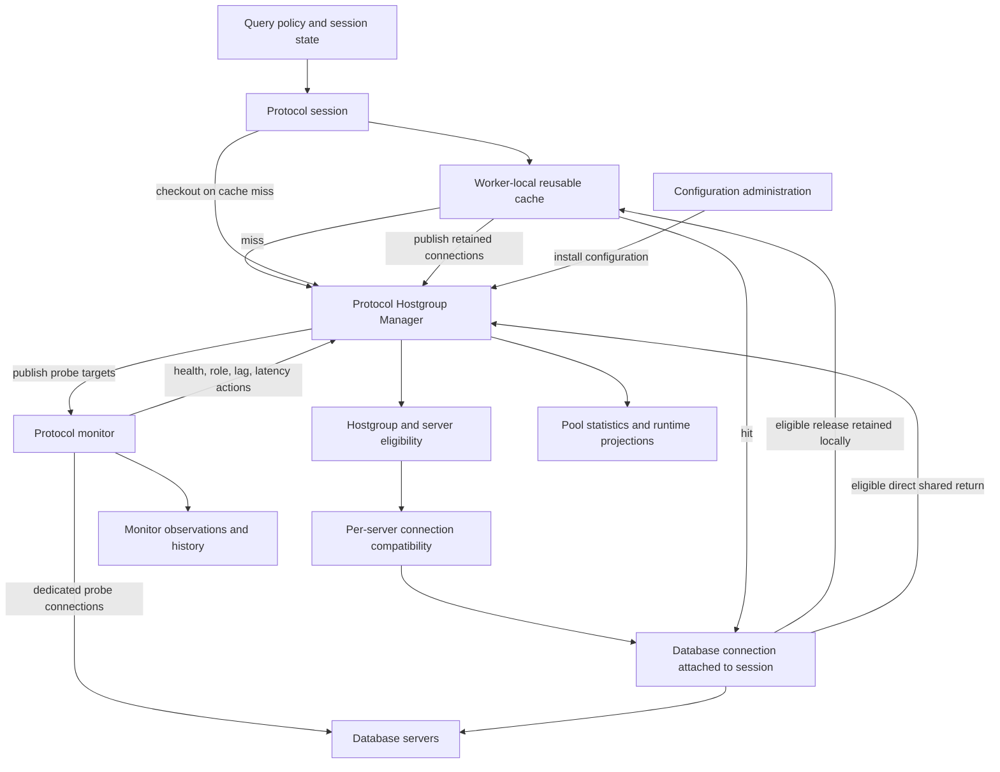

# Backend management, pooling, and monitoring

**Source baseline:** `f8ada9117`, inspected 2026-10-18. This chapter describes verified implementation
and build-specific capabilities; it does not ratify new invariants. Source links identify the inspected implementation; line numbers can move.

## 1. Architectural responsibility

Backend management turns a hostgroup choice into a usable database connection and maintains
reusable inventory, incorporating database health and topology observations into selection. The session owns the client's
execution context and decides when its attached connection can be released.
The Hostgroup Manager (HGM) owns the shared backend inventory and pool accounting.
The monitor owns probes and observation history and invokes supported HGM actions.

These are related responsibilities within traffic serving and its supporting
services. They are not independent routing engines. Query processing chooses or
modifies policy, including destination hostgroup and consistency constraints;
backend selection satisfies that policy against currently eligible servers.
Configuration administration installs the server and topology configuration.
Peer configuration synchronization supplies configuration through local apply
paths; it does not lend sockets or transactions between ProxySQL processes.

The distinction is visible in the session checkout paths: each first checks its
worker's cache, then calls the protocol HGM with the selected hostgroup and
applicable constraints. [MySQL checkout](../../../lib/MySQL_Session.cpp#L10042),
[PostgreSQL checkout](../../../lib/PgSQL_Session.cpp#L5525).

The local-cache arrow represents a fast path; HGM remains the server-configuration owner.
Connection ownership and shared pool accounting continue across that path.

The similarly named caches hold different objects: traffic pools cache database
connections, monitor pools cache probe connections, DNS caches hold addresses,
and the query cache holds query results. A result-cache hit can answer a request
without borrowing a database connection. Result-cache keys, TTL, and response
handling belong to query execution; they do not establish pool reuse safety.
[MySQL cache lookup](../../../lib/MySQL_Session.cpp#L9640), [PostgreSQL lookup](../../../lib/PgSQL_Session.cpp#L5471).

## 2. Modules and interfaces

| Component | Responsibility and principal interfaces | Source |
| --- | --- | --- |
| `Base_HostGroups_Manager<HGC>` | Hostgroup lookup/creation, common mutex and internal SQLite access; optional hostgroup pool statistics | [Header](../../../include/Base_HostGroups_Manager.h#L187), [implementation](../../../lib/Base_HostGroups_Manager.cpp#L79) |
| `MySQL_HostGroups_Manager`, `PgSQL_HostGroups_Manager` | Install runtime servers, maintain backend inventory, checkout/return/destroy, monitor actions, runtime/statistics projections | [MySQL interface](../../../include/MySQL_HostGroups_Manager.h#L941), [PostgreSQL interface](../../../include/PgSQL_HostGroups_Manager.h#L721) |
| `MyHGC`, `PgSQL_HGC` | Hostgroup attributes and server candidate selection through `get_random_MySrvC()` | [MySQL selector](../../../lib/MyHGC.cpp#L107), [PostgreSQL selector](../../../lib/PgSQL_HostGroups_Manager.cpp#L2274) |
| `MySrvC`, `PgSQL_SrvC` | One hostgroup membership for an endpoint: status, configured limits, observed latency/lag, counters, free/used connection lists | [MySQL container](../../../include/MySQL_HostGroups_Manager.h#L202), [PostgreSQL container](../../../include/PgSQL_HostGroups_Manager.h#L179) |
| `MySrvConnList`, `PgSQL_SrvConnList` | Select compatible free connections, choose reuse versus creation, keep list membership | [MySQL selection](../../../lib/MySrvConnList.cpp#L118), [PostgreSQL selection](../../../lib/PgSQL_HostGroups_Manager.cpp#L2655) |
| Protocol worker and session | Attach sockets, reconcile borrower state, run protocol state machines, retain affinity, release or destroy | [MySQL local pool](../../../lib/MySQL_Thread.cpp#L7246), [PostgreSQL local pool](../../../lib/PgSQL_Thread.cpp#L6201) |
| `MySQL_Monitor`, `PgSQL_Monitor` | Schedule probes, use dedicated monitor connections, store observations, invoke HGM actions | [MySQL controller](../../../lib/MySQL_Monitor.cpp#L5182), [PostgreSQL scheduler](../../../lib/PgSQL_Monitor.cpp#L2728) |
| `DNS_Cache` and resolver workers | Cache hostname addresses for connection setup; each protocol monitor owns its own instance | [Shared interface](../../../include/DNS_Cache.hpp#L4), [resolver implementation](../../../lib/DNS_Cache.cpp) |
| MySQL GTID service | Maintain endpoint execution knowledge used by causal-read eligibility | [HGM GTID API](../../../lib/MySQL_HostGroups_Manager.cpp#L2158), [GTID data](../../../include/GTID_Server_Data.h) |

The shared base does not make the protocols interchangeable. MySQL server and connection
selection have separate source files; much of PostgreSQL selection remains in its HGM file.
Methods retaining MySQL names in PostgreSQL code are not evidence of MySQL
protocol semantics. For example, PostgreSQL `return_MySQL_Connection_To_Pool()`
returns a `PgSQL_Connection`.

## 3. The object and ownership model

### 3.1 Endpoint, membership, connection, and frontend are different objects

A hostgroup is a numbered backend selection domain whose server list contains membership objects. The same `hostname:port` may occur in several hostgroups, with
separate membership status, limits, weights, and connection lists. It is therefore
incorrect to treat a `MySrvC` or `PgSQL_SrvC` as the unique process-wide object for
a database endpoint. Monitor actions that apply to a physical endpoint often
scan its memberships across hostgroups.
[MySQL endpoint action](../../../lib/MySQL_HostGroups_Manager.cpp#L4373), [PostgreSQL endpoint action](../../../lib/PgSQL_HostGroups_Manager.cpp#L3926).

Each pooled backend connection points to its parent membership. A protocol
session attaches a borrowed connection to its backend data stream. The frontend
session and the database server session have different lifetimes: multiplexing
can release a database connection while the frontend remains connected.
Conversely, a frontend can retain a backend across several operations because
of a transaction or another affinity requirement.
[MySQL attachment](../../../lib/MySQL_Session.cpp#L10127), [PostgreSQL attachment](../../../lib/PgSQL_Session.cpp#L5615), [MySQL release](../../../lib/mysql_data_stream.cpp#L1862),
[PostgreSQL release](../../../lib/PgSQL_Data_Stream.cpp#L1383).

### 3.2 Free and used are inventory categories

Under the HGM lock, checkout removes or creates a connection, places it in its
parent's `ConnectionsUsed`, and returns it. Shared return removes it from
`ConnectionsUsed`, then either puts it in `ConnectionsFree` or destroys it.
[MySQL checkout](../../../lib/MySQL_HostGroups_Manager.cpp#L3021), [return](../../../lib/MySQL_HostGroups_Manager.cpp#L2834),
[PostgreSQL checkout](../../../lib/PgSQL_HostGroups_Manager.cpp#L2899), [return](../../../lib/PgSQL_HostGroups_Manager.cpp#L2220).

`ConnectionsUsed` does not mean that every listed connection is executing a
client query. A released socket in a worker's local cache remains on that list
until the worker publishes it to the shared free pool. Idle-ping maintenance
also temporarily moves a free connection to the used list. This accounting
keeps connections unavailable to a second global borrower while another
execution context holds them.
[MySQL cache publication](../../../lib/MySQL_Thread.cpp#L7549), [PostgreSQL cache publication](../../../lib/PgSQL_Thread.cpp#L6293),
[MySQL idle checkout](../../../lib/MySQL_HostGroups_Manager.cpp#L3584), [PostgreSQL idle checkout](../../../lib/PgSQL_HostGroups_Manager.cpp#L3197).

Consequently, a `ConnUsed` observation is a pool inventory measurement, not a
direct measurement of simultaneously executing statements. Reviews of capacity,
statistics, and shutdown must account for local caches and maintenance holders.

### 3.3 Ownership boundaries

| State | Owner and mutation boundary | Important consumers |
| --- | --- | --- |
| Hostgroup membership, server limits, shared free/used lists | Protocol HGM and its existing lock | Workers, monitor actions, runtime dumps |
| Current frontend operation and backend attachment | Owning protocol worker/session | Protocol state machine, cancellation, teardown |
| Released worker-local sockets | The owning worker until publication | The same worker's matching checkout path |
| Backend session settings and transaction/protocol progress | Connection plus session tracking; updated by protocol handling | Compatibility selection and release decisions |
| Probe targets | HGM publishes retained target resultsets under target-specific mutexes | Monitor schedulers and DNS refresh |
| Probe connection pool and observations | Protocol monitor | Subsequent probes, policy actions, Admin observation |
| GTID execution knowledge | MySQL HGM GTID map and `GTID_Server_Data` | MySQL causal-read selection |
| Configured and published server datasets | HGM installation/publication paths; editable MEMORY is owned by Admin | Cluster queries and runtime inspection |

The HGM lock is a process-local mutex in the shared base, not one lock per hostgroup.
Additional locks protect other ownership domains, including monitor targets and the GTID map. Introducing a lock must follow
the actual owner and reader/writer relationship rather than the presence of a
shared-looking data structure.
[Common mutex](../../../lib/Base_HostGroups_Manager.cpp#L79), [monitor publication](../../../lib/MySQL_HostGroups_Manager.cpp#L2720),
[GTID lookup](../../../lib/MySQL_HostGroups_Manager.cpp#L2158).

## 4. Connection acquisition is two-stage selection

### 4.1 The worker-local fast path

Normal checkout first searches connections released by the same worker. The
local path requires a matching hostgroup and compatible connection options,
identity/reset requirements, and tracked session variables. MySQL additionally
compares schema, requested backend authentication type, and its enforced
session-tracking capability backoff. Applicable consistency/lag constraints are
also checked. A rule requiring a new connection or session fast-forward bypasses
ordinary local reuse.
[MySQL search](../../../lib/MySQL_Thread.cpp#L7246), [PostgreSQL search](../../../lib/PgSQL_Thread.cpp#L6201), [MySQL caller](../../../lib/MySQL_Session.cpp#L10042),
[PostgreSQL caller](../../../lib/PgSQL_Session.cpp#L5544).

The local search is not a full rerun of the global server-selection lottery.
It is a locality and lock-amortization optimization over inventory the worker
already holds. Its predicates and global eligibility are separate code paths;
changes to constraints require checking both actual paths.

Local releases are deliberately shared: ordinary release caches one in every
`num_threads` connections locally and returns the others to HGM. In
`PROXYSQL31` builds, waiting sessions further inhibit local retention. Workers
publish remaining local connections in their loop. These policies matter to
fairness because a locally held socket is unavailable to sibling workers.
[MySQL release policy](../../../lib/MySQL_Thread.cpp#L7497), [PostgreSQL release policy](../../../lib/PgSQL_Thread.cpp#L6257).

### 4.2 Choose an eligible server

On a cache miss, HGM selects a server in the requested hostgroup before choosing
a connection from that server. The normal MySQL candidate scan checks:

1. `ONLINE` status and any enforced session-tracking capability backoff.
2. The hostgroup's online-server-count constraint and the server's used-count
   capacity against `max_connections`.
3. Observed latency against the configured per-server or default ceiling.
4. Required GTID execution, when supplied; otherwise the per-query Aurora lag
   constraint, when supplied.
5. Optional primary/backup weight policy, latency awareness, and AWS locality
   weighting before the final weighted draw.

The algorithm is a weighted random selection over eligible candidates. It is
not round-robin and does not select the least-connected server: an older
load-based candidate adjustment is commented out in the inspected implementation.
The final draw uses two 32-bit random values to cover the 64-bit weight sum.
[MySQL selector](../../../lib/MyHGC.cpp#L107).

PostgreSQL has the same main pattern of `ONLINE`, used-capacity, latency ceiling,
optional backup policy, optional latency awareness, and weighted random choice.
Its inspected selector does not enforce MySQL's hostgroup online-count gate,
session-tracking capability backoff, or AWS locality overlay. Although its method
signature contains GTID/Aurora-shaped parameters, the GTID eligibility code is
compiled out and normal session checkout supplies no GTID. Those inherited names
must not be documented as working PostgreSQL causal-read support.
[PostgreSQL selector](../../../lib/PgSQL_HostGroups_Manager.cpp#L2274), [normal PostgreSQL checkout](../../../lib/PgSQL_Session.cpp#L5525).

Both selectors also contain automatic recovery attempts for automatically
shunned servers after a configured delay, including an accelerated attempt
when normal selection finds no weight. Administrative/manual shunning is
distinguished by `shunned_automatic`. Selection therefore includes controlled
availability recovery, rather than merely reading an immutable health list.
[MySQL recovery](../../../lib/MyHGC.cpp#L198), [PostgreSQL recovery](../../../lib/PgSQL_HostGroups_Manager.cpp#L2337).

### 4.3 Additional weighting and consistency mechanisms

| Mechanism | Architectural effect | Verified scope |
| --- | --- | --- |
| Positive configured weight | Probability in the final candidate lottery; zero weight supplies no lottery weight | Both protocols |
| Latency ceiling | Excludes a server whose observed latency exceeds its accepted threshold | Both selectors |
| Latency awareness | When enough candidates have nonzero latency, remove candidates slower than the candidate average, then recompute weights | Both selectors |
| `backup_weight_threshold` | Partitions positive weights into primaries and backups; use backups according to configured primary availability definition | Both, `PROXYSQL31` |
| `backup_availability` | Defines primary presence by selectable candidates, `ONLINE` status, or `ONLINE` plus capacity; a primary excluded by a different predicate can still inhibit backups in some modes | Both, `PROXYSQL31` |
| GTID requirement | Requires endpoint execution knowledge for MySQL causal reads | MySQL; active PostgreSQL implementation not present |
| Per-query `max_lag_ms` | Constrains MySQL Aurora candidates using observed Aurora lag, with optional writer exclusion when enough replicas qualify | MySQL Aurora path |
| AWS locality | Scales configured weight from a published metadata snapshot after ordinary candidate filtering | MySQL, `PROXYSQL40` |

[MySQL primary/backup policy](../../../lib/MyHGC.cpp#L16), [PostgreSQL policy](../../../lib/PgSQL_HostGroups_Manager.cpp#L126), [MySQL latency and draw](../../../lib/MyHGC.cpp#L405),
[PostgreSQL latency and draw](../../../lib/PgSQL_HostGroups_Manager.cpp#L2551).

### 4.4 Choose or create a connection for the selected server

The free-list search ranks connections by compatibility, starting at a random
index and wrapping. This is not another server lottery. Both implementations
use a four-level quality model:

| Quality | Meaning | Consequence |
| --- | --- | --- |
| 0 | No compatible connection-level options found | Create a new connection; possibly evict stale free inventory |
| 1 | Connection-level options match, but identity/reset work is required | Reuse or create according to pool state and protocol policy |
| 2 | Identity/reset requirements already match, but tracked session state differs | Reuse the best candidate; session execution reconciles required state |
| 3 | Connection-level and tracked session state match | Reuse directly |

MySQL uses `requires_CHANGE_USER()` and includes schema in its fit score;
PostgreSQL uses `requires_RESETTING_CONNECTION()`. Their actual identity and
connection-option rules remain protocol-specific: PostgreSQL's option match
requires the same username and database, and its reset predicate detects extra
tracked variables. Reset does not make an arbitrary PostgreSQL username/database
pair compatible. The common `evaluate_pool_state()` helper also considers
free/used pressure and eviction. Warming may create connections until the warm
inventory is reached instead of reusing a matching free connection.
[MySQL quality search](../../../lib/MySrvConnList.cpp#L118), [pool-state decision](../../../lib/MySrvConnList.cpp#L74),
[PostgreSQL search and allocation](../../../lib/PgSQL_HostGroups_Manager.cpp#L2655), [identity/reset predicates](../../../lib/PgSQL_Connection.cpp#L5163).

A newly allocated `*_Connection` object is not yet an established database
session. The worker/session performs asynchronous network connection,
authentication, and required session synchronization. HGM allocation and
successful network connection are different boundaries.
[MySQL checkout and state continuation](../../../lib/MySQL_Session.cpp#L10127), [PostgreSQL checkout](../../../lib/PgSQL_Session.cpp#L5615).

Reset is therefore not an unconditional prerequisite to reuse. Compatible
borrowers can share an eligible backend sequentially without resetting it.
Tracking and reproducing supported settings is part of ordinary reuse; reset
and destruction cover different incompatibility and cleanup cases.

## 5. Capacity, waiting, release, and retirement

### 5.1 Capacity and creation pressure

`max_connections` is attached to a hostgroup membership. Candidate admission
uses its used count; free inventory is subsequently pruned against total
free-plus-used limits and the configured retained-free percentage. The free-list
creation path also applies a hostgroup connection-creation throttle, using
hostgroup attributes when configured and protocol defaults otherwise.
[MySQL creation/throttle](../../../lib/MySrvConnList.cpp#L290), [PostgreSQL creation/throttle](../../../lib/PgSQL_HostGroups_Manager.cpp#L2814),
[MySQL pruning](../../../lib/MySQL_HostGroups_Manager.cpp#L3521), [PostgreSQL pruning](../../../lib/PgSQL_HostGroups_Manager.cpp#L3134).

Pool acquisition can fail because no server is eligible, capacity is in use,
creation is throttled, or an execution-specific consistency constraint has no
candidate. It is not necessarily a TCP connection failure. The session retains
the operation and retries acquisition within its connection deadline; separate
failure/retry rules govern an operation already sent to a backend.

In `PROXYSQL31`, both protocols use worker-owned, per-hostgroup waiter lists.
Entering a waiter list removes the session's streams from ordinary polling;
leaving restores the client when needed. Workers process backend holders and
then waiters, so current holders can release inventory before more acquisition
attempts. A still-blocked ordinary checkout can stop its hostgroup walk, while
constraint-specific checkouts retain their separate classification. This is
worker-local scheduling, not a distributed or process-wide strict FIFO promise.
[MySQL waiter admission](../../../lib/MySQL_Thread.cpp#L4025), [MySQL processing](../../../lib/MySQL_Thread.cpp#L5174), [PostgreSQL admission](../../../lib/PgSQL_Thread.cpp#L3207),
[PostgreSQL processing](../../../lib/PgSQL_Thread.cpp#L4275).

### 5.2 Eligibility to release belongs to session/protocol handling

An attached socket can be usable by its present frontend while unsuitable for
another borrower. This applies to both protocols. Transaction state, session
affinity, multiplexing restrictions, protocol progress, health, and reuse flags
determine whether it can be detached. A complete response buffered for frontend
delivery is different from an unfinished backend exchange.

The data-stream cleanup paths check multiplexing, health, reuse eligibility,
transaction state, multiplexing restrictions, and asynchronous idle state.
PostgreSQL additionally checks pipeline activity. These checks precede pool
return; `push_MyConn_to_pool()` is not the complete proof of safe release.
[MySQL stream cleanup](../../../lib/mysql_data_stream.cpp#L1936), [PostgreSQL stream cleanup](../../../lib/PgSQL_Data_Stream.cpp#L1458).

Shared return then applies inventory policy: an eligible idle connection on an
online server can become free; non-online membership, oversized retained query
buffers, excess prepared-statement inventory, or other protocol-specific
conditions can lead to reset or destruction. Expired connections are retired on
return, including after idle pings. The age limit is not implemented as a timer
that arbitrarily interrupts a running query.
[MySQL return](../../../lib/mysql_data_stream.cpp#L1862), [PostgreSQL return](../../../lib/PgSQL_Data_Stream.cpp#L1383),
[MySQL global return](../../../lib/MySQL_HostGroups_Manager.cpp#L2834), [PostgreSQL global return](../../../lib/PgSQL_HostGroups_Manager.cpp#L2220).

### 5.3 Cleanup paths differ by protocol

MySQL can queue an otherwise destroyable healthy idle connection for background
`COM_CHANGE_USER` cleanup. The HGM reset worker checks authentication policy and
connection age, performs the exchange, and pools only successful results;
failures and timeouts destroy the connection. Other cases use session-driven
reset, depending on configuration. The HGM's `init()`/`shutdown()` explicitly
start and join the reset worker and the GTID service.
[Reset worker](../../../lib/MySQL_HostGroups_Manager.cpp#L227), [destroy/queue decision](../../../lib/MySQL_HostGroups_Manager.cpp#L3063),
[service lifecycle](../../../lib/MySQL_HostGroups_Manager.cpp#L952).

PostgreSQL's data-stream path can create a session to reset an eligible healthy
connection; its HGM destroy path does not implement the MySQL reset queue. It
can terminate a busy backend through a separate kill operation when configured.
Native connections supply the backend PID/secret captured from
`BackendKeyData`, rather than assuming a libpq handle owns that identity.
[PostgreSQL cleanup decision](../../../lib/PgSQL_Data_Stream.cpp#L1428), [HGM destruction](../../../lib/PgSQL_HostGroups_Manager.cpp#L2922).

### 5.4 Server status is not a linear lifecycle

The older overview's `ONLINE -> SHUNNED -> OFFLINE_SOFT -> OFFLINE_HARD` sequence
is misleading. These are different administrative/operational conditions:

| Condition | Meaning in the inspected paths |
| --- | --- |
| `ONLINE` | Candidate admission can proceed subject to other predicates |
| `SHUNNED` | New selection normally excludes the server; automatic recovery depends on the automatic-shun flag and timing |
| `SHUNNED_REPLICATION_LAG` | Lag policy excluded the server; recovery follows lag observations rather than generic shun timing |
| `OFFLINE_SOFT` | New shared selections exclude the membership; existing attachments can drain, subject to other failures |
| `OFFLINE_HARD` | New selection excludes the membership and connection execution checks reject it; removal drops free inventory |
| Shunned with kill-all flag | Health action additionally invalidates use of existing connections; free inventory is dropped |

The endpoint can recover, change role, or be reconfigured without progressing
through all these states. A removed server container stays alive while its used
or free lists retain connections and is purged only after both lists empty.
[MySQL hard-offline check](../../../lib/mysql_connection.cpp#L2424), [PostgreSQL check](../../../lib/PgSQL_Connection.cpp#L4283),
[MySQL removal/purge](../../../lib/MySQL_HostGroups_Manager.cpp#L1790), [purge condition](../../../lib/MySQL_HostGroups_Manager.cpp#L2311),
[PostgreSQL removal](../../../lib/PgSQL_HostGroups_Manager.cpp#L1668), [purge condition](../../../lib/PgSQL_HostGroups_Manager.cpp#L1947).

## 6. Monitoring: observation, decision, action

### 6.1 Separate probes and connection inventories

Monitor credentials and connections are separate from client traffic sockets.
MySQL has `MySQL_Monitor_Connection_Pool`; PostgreSQL has its own `mon_conn_pool`.
They reuse suitable probe connections between checks, while connect probes
exercise new connection establishment. An empty traffic pool does not imply
monitoring cannot connect, and a healthy monitor connection does not satisfy a
client's authentication or session-state requirements.
[MySQL monitor pool](../../../lib/MySQL_Monitor.cpp#L385), [PostgreSQL monitor pool](../../../lib/PgSQL_Monitor.cpp#L980),
[PostgreSQL connect-probe exception](../../../lib/PgSQL_Monitor.cpp#L1068).

HGM publishes monitor target resultsets and wakes DNS refresh after server
installation. Basic probe target lists group endpoint memberships and omit hard
offline entries. Topology probes use their topology-specific target/configuration
datasets. Probe targets, desired server configuration, and completed probe logs
are distinct datasets with different producers and readers.
[MySQL target publication](../../../lib/MySQL_HostGroups_Manager.cpp#L2720), [PostgreSQL target publication](../../../lib/PgSQL_HostGroups_Manager.cpp#L2142).

### 6.2 Different execution machinery

MySQL runs scheduler/control threads for connect, ping, read-only, replication
lag, Group Replication, Galera, Aurora, and RDS blue/green handling. Current basic
ping/read-only/lag and topology paths include asynchronous poll-based batches;
completed work is processed through monitor workers. `run()` maintains a worker
queue and adjusts its worker inventory with queue pressure. Aurora and some
topology work also have hostgroup-specific threads. Old helper functions remain
in this large translation unit, so tracing the live scheduler call is more
reliable than inferring execution from an attractive helper name.
[Controller/thread creation](../../../lib/MySQL_Monitor.cpp#L5182), [live ping scheduling](../../../lib/MySQL_Monitor.cpp#L3286), [async ping](../../../lib/MySQL_Monitor.cpp#L9016),
[completion queue](../../../lib/MySQL_Monitor.cpp#L9007).

PostgreSQL uses one scheduler to build timed batches for four task types:
connect, ping, readonly, and replication lag. Tasks are distributed among monitor
workers, which progress nonblocking libpq operations through polling, record
results, and run actions. Workers refresh protocol variables because some HGM
actions consume thread-local values. Disabling monitoring ends that enabled
period, joins workers, and clears probe connections; the scheduler stays alive
to observe re-enabling. DNS management has an independent loop.
[Task types](../../../lib/PgSQL_Monitor.cpp#L282), [batch scheduling](../../../lib/PgSQL_Monitor.cpp#L2382), [worker execution](../../../lib/PgSQL_Monitor.cpp#L2063),
[enabled-period lifecycle](../../../lib/PgSQL_Monitor.cpp#L2488), [scheduler](../../../lib/PgSQL_Monitor.cpp#L2728).

### 6.3 Observations alter specific runtime properties

| Observation | Decision/action | Scope |
| --- | --- | --- |
| Connect success/error | Record connect history; traffic connection failures also feed membership failure counters | Both; error classifications differ |
| Repeated ping failure | HGM `shun_and_killall()` excludes the endpoint and marks existing connections for retirement | Both |
| Successful ping timing | Average recent successful timings and update HGM latency used by selection | Both |
| Read-only/recovery role | `read_only_action_v2()` changes memberships in configured writer/reader mappings; optional writer-as-reader behavior | Both, with different probes |
| Replication lag | After configured consecutive threshold violations, use `SHUNNED_REPLICATION_LAG`; recover on accepted lag | Both |
| Group Replication viability, role, transactions behind | Maintain writer, backup-writer, reader, and offline placement for the configured topology | MySQL |
| Galera primary/state/readiness/receive queue | Maintain topology placement and writer limits according to Galera policy | MySQL |
| Aurora role/replica lag/discovery | Update Aurora endpoint placement and lag eligibility | MySQL |
| RDS blue/green topology and switch state | Dedicated migration state machine manages affected memberships, DNS pins, and old-connection draining | MySQL |

[MySQL ping decisions](../../../lib/MySQL_Monitor.cpp#L3286), [PostgreSQL ping decisions](../../../lib/PgSQL_Monitor.cpp#L1731),
[MySQL role actions](../../../lib/MySQL_HostGroups_Manager.cpp#L4203), [PostgreSQL role actions](../../../lib/PgSQL_HostGroups_Manager.cpp#L3769),
[MySQL lag action](../../../lib/MySQL_HostGroups_Manager.cpp#L3255), [PostgreSQL lag action](../../../lib/PgSQL_HostGroups_Manager.cpp#L3046),
[GR actions](../../../lib/MySQL_Monitor.cpp#L9420), [Galera actions](../../../lib/MySQL_Monitor.cpp#L9909), [Aurora evaluation](../../../lib/MySQL_Monitor.cpp#L8312),
[RDS blue/green state machine](../../../lib/MySQL_Monitor.cpp#L7571).

PostgreSQL's role probe is `pg_is_in_recovery()`, not MySQL `@@read_only`.
Its normal lag probe compares WAL receive/replay progress and replay timestamp;
its configured heartbeat-query branch is disabled and currently uses the same
WAL-based query instead. A database being writable in
other circumstances is not equivalent to the topology role ProxySQL obtains
from this probe. MySQL read-only configuration supports several server-variable
forms and compound variants. The two protocols share architectural purpose,
not identical health signals or topology support.
[PostgreSQL probes](../../../lib/PgSQL_Monitor.cpp#L40),
[disabled PostgreSQL heartbeat branch](../../../lib/PgSQL_Monitor.cpp#L825),
[MySQL probe construction](../../../lib/MySQL_Monitor.cpp#L682).

Monitor failure handling is policy-driven. Read-only timeouts can become an
assumption of read-only only after the configured consecutive timeout threshold;
they are not an unconditional role change on any error. MySQL additionally
distinguishes stale-IP timeouts and suppresses competing ordinary read-only
actions during an RDS blue/green switch.
[MySQL result classification](../../../lib/MySQL_Monitor.cpp#L9156), [PostgreSQL result actions](../../../lib/PgSQL_Monitor.cpp#L1839),
[MySQL switch filtering](../../../lib/MySQL_HostGroups_Manager.cpp#L4203).

Monitoring observes database topology and changes local routing eligibility.
The cited paths do not make ProxySQL the database replication or leader-election
authority. Moving a membership to a writer hostgroup does not promote a database
server or reconstruct a transaction that ran on a different server.

### 6.4 Observation storage and operational statistics

MySQL monitor owns shared in-memory SQLite databases for observation logs and
internal targets; Admin attaches the observation database. Basic check logs are
inserted as results complete and pruned according to monitor history. Some
topology logs are materialized from retained monitor structures on request.
PostgreSQL similarly creates its own connect, ping, read-only, and lag logs and
performs scheduled history maintenance.
[MySQL database construction](../../../lib/MySQL_Monitor.cpp#L1133), [MySQL ping retention](../../../lib/MySQL_Monitor.cpp#L3348),
[topology log projection](../../../lib/MySQL_Monitor.cpp#L5664), [PostgreSQL log setup](../../../lib/PgSQL_Monitor.cpp#L122),
[PostgreSQL retention](../../../lib/PgSQL_Monitor.cpp#L2295).

These histories are monitor evidence; HGM status and membership are the runtime
selection state. Pool statistics expose HGM inventory/counters, while monitor
logs expose checks and errors. Neither is the editable desired configuration.
For example, the pool statistics APIs build resultsets from runtime containers;
optional `HostgroupPoolStats` adds acquisition/wait measurements in
`PROXYSQL31` builds. See the statistics chapter for collection, reset, and
persistence semantics across the rest of the system.
[MySQL pool projection](../../../lib/MySQL_HostGroups_Manager.cpp#L4065), [PostgreSQL pool projection](../../../lib/PgSQL_HostGroups_Manager.cpp#L3643),
[hostgroup wait statistics](../../../lib/Base_HostGroups_Manager.cpp#L215).

## 7. DNS, GTID knowledge, and optional placement/discovery services

### 7.1 DNS resolves endpoints; it does not choose hostgroups

`DNS_Cache` is shared code with independent protocol-owned cache state,
counters, and resolver loops. Background workers use `getaddrinfo`; lookups
serve addresses round-robin and can return an ordered address set for a connect
attempt. Pins override the resolved set, optionally until a deadline. A pin or
DNS refresh affects connection targets, not the identity of the configured
hostgroup membership.
[Cache API and ownership](../../../include/DNS_Cache.hpp#L4), [lookup implementation](../../../lib/DNS_Cache.cpp), [PostgreSQL resolver loop](../../../lib/PgSQL_Monitor.cpp#L2861).

The cache reduces resolver work on connection paths. It does not justify a
universal claim that every backend connection setup avoids OS resolution: miss,
disabled-cache, and protocol-specific fallback paths still require tracing.
MySQL RDS blue/green handling is a concrete consumer of DNS pinning and explicit
connection draining. Those mechanisms operate together because new DNS answers
alone do not move already-established sockets.
[RDS pinning](../../../lib/MySQL_Monitor.cpp#L7759), [draining implementation](../../../lib/MySQL_HostGroups_Manager.cpp#L4649).

### 7.2 MySQL causal-read knowledge is a separate service

MySQL HGM maintains GTID knowledge by database endpoint, protected by a GTID
map lock and the `GTID_Server_Data` synchronization. Knowledge can be updated
from backend OK/session-tracking data; configured GTID reader ports enable a
separate libev-driven reader service. Selection asks whether a candidate
contains the required transaction. This libev service does not establish that
the normal protocol worker loop is libev-based.
[GTID lookup/update](../../../lib/MySQL_HostGroups_Manager.cpp#L2158), [reader creation](../../../lib/MySQL_HostGroups_Manager.cpp#L2215),
[service lifecycle](../../../lib/MySQL_HostGroups_Manager.cpp#L952).

The session's policy path interprets tracked GTID sets and determines writer
fallback or an unsatisfiable consistency predicate where a tracked value cannot
be used for replica routing. A missing candidate is then a wait for eligible
replication state, not permission to drop the consistency constraint.
[Constraint preparation](../../../lib/MySQL_Session.cpp#L9980).

### 7.3 AWS locality changes weights, not eligibility authority

In `PROXYSQL40`, MySQL HGM configures `MySQLAwsLocalityManager` from hostgroup
policies and recognized RDS endpoints. Metadata requests happen away from the
query path through the registered `AwsMetadataProvider` interface. The manager
publishes immutable shared snapshots; global and local MySQL selectors read a
snapshot and scale configured weights. Zero configured weight remains zero.
Global selection applies the overlay after ordinary candidate filtering,
including backup policy. Local selection groups compatible cached sockets by
parent server and weights those groups; it does not repeat the global candidate
scan. If all local effective weights are zero, that path has a uniform fallback
over its compatible cached candidates. Global selection instead returns no
server when its candidate weight sum is zero.
[HGM configuration](../../../lib/MySQL_HostGroups_Manager.cpp#L1004), [snapshot API](../../../include/Aws_Locality_Manager.h#L91), [global weighting](../../../lib/MyHGC.cpp#L446),
[local weighting](../../../lib/MySQL_Thread.cpp#L7350).

Locality metadata has fresh/stale/expired/error states. Stale values can retain
their multiplier within the configured stale TTL; missing provider, unusable
metadata, or expiry yields the neutral multiplier. This is an advisory
placement overlay with explicit degradation, not a requirement for every
MySQL connection. No corresponding PostgreSQL locality selector was found in
the inspected code. The core provider seam is implemented; no in-tree plugin
installation of an AWS metadata provider was found in this source baseline.
[Snapshot effective weight](../../../lib/Aws_Locality_Manager.cpp#L462), [degradation](../../../lib/Aws_Locality_Manager.cpp#L1024),
[provider service](../../../lib/ProxySQL_PluginManager.cpp#L390).

### 7.4 Server-discovery seams preserve core backend ownership

`PROXYSQL40` also defines protocol-specific discovery controllers and desired
server sets. Core publishes installed configuration snapshots with generations;
a controller can post desired membership changes only through the registered
service. Core queues them to its Admin owner, revalidates controller/generation
and delegated hostgroups, reconciles through HGM, and optionally materializes
MEMORY/DISK according to explicit persistence policy.
[Types and contracts](../../../include/ProxySQL_ServerDiscovery.h#L14), [controller registration/post](../../../lib/ProxySQL_PluginManager.cpp#L1897),
[queue/apply](../../../lib/ProxySQL_ServerDiscovery.cpp#L423).

The merge path preserves current endpoint health and topology placement unless
the desired operation explicitly supplies a current force-role action. A
configuration generation and an observation of health are different inputs.
The ABI's old server-module registration slot is retained as an incomplete,
unsupported reserved type; it is not a live table-registration architecture.
No in-tree plugin calls installing a `ProxySQL_ServerDiscoveryController` were
found in this baseline. Describe a concrete feature's current management path
before claiming it uses this seam.
[Merge semantics](../../../lib/ProxySQL_ServerDiscovery.cpp#L395), [reserved old slot](../../../include/ProxySQL_ServerDiscovery.h#L167).

## 8. Configured, operational, and published server data

The HGM's internal SQLite database assists reconciliation and projection of
native runtime objects; it is different from Admin's editable MEMORY database.
`servers_add()` stages incoming rows and `commit()` reconciles memberships under
the HGM lock. Removed memberships become hard offline and lose free inventory;
new/changed rows create or update native containers. Associated topology,
hostgroup attributes, SSL parameters, checksums, monitor targets, and worker
versions are refreshed by the relevant installation paths.
[MySQL staging](../../../lib/MySQL_HostGroups_Manager.cpp#L1215), [commit](../../../lib/MySQL_HostGroups_Manager.cpp#L1758),
[PostgreSQL staging](../../../lib/PgSQL_HostGroups_Manager.cpp#L1157), [commit](../../../lib/PgSQL_HostGroups_Manager.cpp#L1640).

The server family deliberately distinguishes last-promoted configured
`*_servers_v2` data from runtime server data affected by topology actions.
Ordinary full commit updates both publications; runtime-only commit can update
runtime servers while preserving the configured publication. `get_current_*_table()`
returns retained resultsets for special Cluster-facing queries. It is not an
arbitrary live read of editable configuration tables.
[MySQL separate publications](../../../lib/MySQL_HostGroups_Manager.cpp#L1983), [MySQL getters](../../../lib/MySQL_HostGroups_Manager.cpp#L3755),
[PostgreSQL publication](../../../lib/PgSQL_HostGroups_Manager.cpp#L1825), [PostgreSQL getters](../../../lib/PgSQL_HostGroups_Manager.cpp#L3335).

Monitor role changes can republish runtime topology and checksums. Health/lag
actions can also mutate native operational status without representing a new
operator configuration edit. Thus there are three distinct questions:

1. What server/topology configuration was installed?
2. Which native memberships and sockets are eligible now?
3. Which representation was published for observation or synchronization?

Answer them through the corresponding owner/interface. A retained resultset
still has a publication and lifetime protocol: getters return stored pointers
and replacement deletes the old resultset. Being precomputed does not establish
that it can be read concurrently with replacement without that protocol.
[MySQL retained-result replacement](../../../lib/MySQL_HostGroups_Manager.cpp#L3714), [PostgreSQL replacement](../../../lib/PgSQL_HostGroups_Manager.cpp#L3319).

## 9. Design consequences and verification boundaries

The implementation establishes these responsibilities for changes and reviews:

- Routing policy identifies a hostgroup/constraint; HGM selects eligible backend
  inventory; session/protocol handling determines attachment, synchronization,
  progress, and release. None of those alone proves end-to-end safe reuse.
- Health, configured topology, and published configuration are separate state.
  A feature should identify which it changes before choosing its apply path.
- Worker-local pool retention affects shared capacity and fairness. It cannot
  be analyzed solely by counting globally free sockets.
- MySQL and PostgreSQL have parallel pooling architecture and material
  differences in identity/reset, monitoring execution, topology probes, and
  supported consistency/placement services. Shared names prove no capability.
- Database failover changes eligible targets for future work. Transaction
  outcomes and replay eligibility remain session/protocol obligations.

Relevant regression suites include
[MySQL waiters](../../../test/tap/tests/mysql-pool_waiters-t.cpp), [PostgreSQL waiters](../../../test/tap/tests/pgsql-pool_waiters-t.cpp),
[pool churn](../../../test/tap/tests/pgsql-pool_churn-t.cpp), [age retirement](../../../test/tap/tests/mysql-connection_max_age-t.cpp),
[PostgreSQL native reset](../../../test/tap/tests/pgsql-native_pool_reset-t.cpp), [monitor lifecycle](../../../test/tap/tests/pgsql-reg_test_6389_monitor_lifecycle-t.cpp),
[replication lag](../../../test/tap/tests/test_pgsql_replication_lag-t.cpp), [unshunning](../../../test/tap/tests/test_unshun_algorithm-t.cpp), and
[RDS draining](../../../test/tap/tests/test_rds_bgd_green_pool_cleanup-t.cpp).
Unit coverage includes
[pool decisions](../../../test/tap/tests/unit/connection_pool_unit-t.cpp), [monitor health](../../../test/tap/tests/unit/monitor_health_unit-t.cpp),
[locality selection](../../../test/tap/tests/unit/aws_locality_selection_unit-t.cpp),
and [discovery ABI](../../../test/tap/tests/unit/plugin_server_discovery_abi_unit-t.cpp).
These are existing verification surfaces; this refresh did not run database-backed tests.

This chapter verifies the main ownership, acquisition, maintenance, and monitor
paths. It does not claim an exhaustive synchronization proof for every reader,
enumerate every topology state transition, or establish workload-independent
fairness/performance guarantees. Those stronger conclusions require focused
analysis and execution evidence beyond this source-level architecture map.
