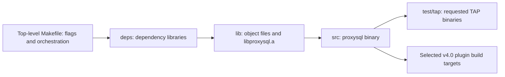

# ProxySQL project layout and build composition

Source baseline: `f8ada9117`, reviewed 2026-10-18. Paths and build relationships below come
from the checked-out source, not fixed counts of classes, dependency libraries or tests.
Use the [architecture overview](ARCHITECTURE-OVERVIEW.md) for responsibilities and the
[visual guide](VISUAL-GUIDE.md) for execution/data-flow views.

## Repository map

```text
proxysql/
  Makefile                    Top-level build orchestration and tier selection
  src/
    main.cpp                  Process supervision, runtime orchestration and watchdog
    proxysql_global.cpp       Global runtime definitions
    SQLite3_Server.cpp        Optional SQLite3 protocol server
    proxy_tls.cpp             Shared TLS setup/reload support
    Makefile                  Links the serving binary
  lib/
    *Session*                 Frontend execution and backend association
    *Protocol*                Protocol encoding/decoding and backend wire handling
    *Connection* / streams    Connection state, I/O and result progress
    *Thread*                  Worker/shared thread-handler infrastructure
    *HostGroups* / HGC / Srv  Backend resources, selection and pools
    *Monitor*                 Observations and topology/health decisions
    *Authentication*          Runtime account stores and identity support
    *Query_Processor*          Query analysis, rule evaluation and accounting
    *Query_Cache*              Cached results and expiration
    *PreparedStatement*       Statement metadata and mappings
    *Logger*                  Query events, audit and logger storage
    ProxySQL_Admin* / Admin_* Management, config installation and SQL projections
    ProxySQL_Cluster*         Configuration synchronization
    ProxySQL_Statistics.cpp   Statistics history, sampling and persistence
    ProxySQL_Plugin*          Dynamic extension integration
    ProxySQL_ManagedRuntime*  Supported managed runtime/configuration adaptation
    Makefile                  Builds libproxysql.a
  include/                    Core/module interfaces, types, templates and build variables
  plugins/
    mysqlx/                   Additional protocol listener/runtime
    duckdb/                   DuckDB integration
    genai/                    AI/MCP/RAG-related extension implementation
    mysql_router/             Router/managed configuration integration
  deps/                       Vendored dependency builds, sources and patches
  test/
    tap/                      TAP helpers, tests, units and group definitions
    infra/                    Isolated backend/ProxySQL provisioning and test runner
    pg-compat/                PostgreSQL behavior/driver compatibility coverage
  .github/workflows/          CI callers and related automation
  doc/                        Architecture, product, agent and development documentation
```

The filename families are a navigation index. They do not imply one class per file or one
thread per family. Source files also contain shared templates, platform-specific paths,
feature guards and integration logic.

## Traffic processing: source map

### Workers, sessions and transport

| Responsibility | MySQL | PostgreSQL / shared |
| --- | --- | --- |
| Event-driven worker | [MySQL_Thread.cpp](../../../lib/MySQL_Thread.cpp), [interface](../../../include/MySQL_Thread.h) | [PgSQL_Thread.cpp](../../../lib/PgSQL_Thread.cpp), [interface](../../../include/PgSQL_Thread.h), [Base_Thread](../../../include/Base_Thread.h) |
| Session orchestration | [MySQL_Session.cpp](../../../lib/MySQL_Session.cpp) | [PgSQL_Session.cpp](../../../lib/PgSQL_Session.cpp), [Base_Session](../../../include/Base_Session.h) |
| Frontend protocol | [MySQL_Protocol.cpp](../../../lib/MySQL_Protocol.cpp) | [PgSQL_Protocol.cpp](../../../lib/PgSQL_Protocol.cpp) |
| Backend connection | [mysql_connection.cpp](../../../lib/mysql_connection.cpp) | [PgSQL_Connection.cpp](../../../lib/PgSQL_Connection.cpp), [native backend protocol](../../../lib/PgSQL_Backend_Protocol.cpp) |
| Data streams | [mysql_data_stream.cpp](../../../lib/mysql_data_stream.cpp) | [PgSQL_Data_Stream.cpp](../../../lib/PgSQL_Data_Stream.cpp) |
| Framing/result support | [MySQLResultsetFramer.cpp](../../../lib/MySQLResultsetFramer.cpp), [MySQL_ResultSet.cpp](../../../lib/MySQL_ResultSet.cpp) | [PgSQLResponseFramer.cpp](../../../lib/PgSQLResponseFramer.cpp), [extended-query messages](../../../lib/PgSQL_Extended_Query_Message.cpp) |
| Session variables/transactions | [MySQL_Variables.cpp](../../../lib/MySQL_Variables.cpp), [MySQL_User_Variables.cpp](../../../lib/MySQL_User_Variables.cpp) | [PgSQL_Variables.cpp](../../../lib/PgSQL_Variables.cpp), [PgSQL_ExplicitTxnStateMgr.cpp](../../../lib/PgSQL_ExplicitTxnStateMgr.cpp), [shared transaction decisions](../../../lib/TransactionState.cpp) |

For a behavior change, start at its Session consumer and follow policy, protocol and resource
ownership from there. A class name or a policy field is not evidence that the operation is
supported on every path. The [runtime chapter](RUNTIME-ARCHITECTURE.md) provides those paths.

### Query policy, identity and reusable state

| Responsibility | Source entry points |
| --- | --- |
| Shared query analysis/rules | [Query_Processor.cpp](../../../lib/Query_Processor.cpp), [policy types](../../../include/query_processor.h), protocol specializations |
| SQL parsing/tokenization | [Query_Processor_ParserSQL.cpp](../../../lib/Query_Processor_ParserSQL.cpp), [MySQL tokenizer](../../../lib/c_tokenizer.cpp), [PostgreSQL tokenizer](../../../lib/pgsql_tokenizer.cpp) |
| Runtime accounts | [MySQL_Authentication.cpp](../../../lib/MySQL_Authentication.cpp), [PgSQL_Authentication.cpp](../../../lib/PgSQL_Authentication.cpp) |
| Backend identity policy | [MySQL_Backend_Auth.cpp](../../../lib/MySQL_Backend_Auth.cpp), [PgSQL_Backend_Auth.cpp](../../../lib/PgSQL_Backend_Auth.cpp) |
| Optional identity support | [passthrough cache](../../../lib/MySQL_Passthrough_Auth_Cache.cpp), [LDAP interface](../../../include/MySQL_LDAP_Authentication.hpp), [AWS IAM provider](../../../lib/Aws_Iam_Provider.cpp) |
| Shared result cache | [Query_Cache.cpp](../../../lib/Query_Cache.cpp), [interface](../../../include/Query_Cache.h), protocol cache adapters |
| Statement resources | [MySQL_PreparedStatement.cpp](../../../lib/MySQL_PreparedStatement.cpp), [PgSQL_PreparedStatement.cpp](../../../lib/PgSQL_PreparedStatement.cpp), protocol statement interfaces |

### Backend resources and health

| Responsibility | Source entry points |
| --- | --- |
| Shared hostgroup infrastructure | [Base_HostGroups_Manager.cpp](../../../lib/Base_HostGroups_Manager.cpp), [BaseHGC.cpp](../../../lib/BaseHGC.cpp), [BaseSrvList.cpp](../../../lib/BaseSrvList.cpp) |
| MySQL backend selection/pools | [MySQL_HostGroups_Manager.cpp](../../../lib/MySQL_HostGroups_Manager.cpp), [MyHGC.cpp](../../../lib/MyHGC.cpp), [MySrvC.cpp](../../../lib/MySrvC.cpp), [MySrvConnList.cpp](../../../lib/MySrvConnList.cpp) |
| PostgreSQL backend resources | [PgSQL_HostGroups_Manager.cpp](../../../lib/PgSQL_HostGroups_Manager.cpp) |
| Database observations/actions | [MySQL_Monitor.cpp](../../../lib/MySQL_Monitor.cpp), [PgSQL_Monitor.cpp](../../../lib/PgSQL_Monitor.cpp), protocol decision helpers |
| Names/discovery/locality | [DNS_Cache.cpp](../../../lib/DNS_Cache.cpp), [ProxySQL_ServerDiscovery.cpp](../../../lib/ProxySQL_ServerDiscovery.cpp), [Aws_Locality_Manager.cpp](../../../lib/Aws_Locality_Manager.cpp) |
| Causal position information | [GTID_Server_Data](../../../include/GTID_Server_Data.h), [proxysql_gtid.cpp](../../../lib/proxysql_gtid.cpp) |

See [backend management](BACKEND-MANAGEMENT.md) for the distinction between supported provider
interfaces, actual in-tree consumers and protocol/tier-specific resource algorithms.

## Management and statistics: source map

| Responsibility | Source entry points |
| --- | --- |
| Admin execution/control | [ProxySQL_Admin.cpp](../../../lib/ProxySQL_Admin.cpp), [Admin_Handler.cpp](../../../lib/Admin_Handler.cpp), [interface](../../../include/proxysql_admin.h) |
| Schema/bootstrap/upgrade | [Admin_Bootstrap.cpp](../../../lib/Admin_Bootstrap.cpp), [disk upgrade](../../../lib/ProxySQL_Admin_Disk_Upgrade.cpp), [table definitions](../../../include/ProxySQL_Admin_Tables_Definitions.h) |
| Variable application | [Admin_FlushVariables.cpp](../../../lib/Admin_FlushVariables.cpp), protocol thread handlers |
| Configuration inputs | [ProxySQL_Config.cpp](../../../lib/ProxySQL_Config.cpp), [configfile.cpp](../../../lib/configfile.cpp), [managed runtime](../../../lib/ProxySQL_ManagedRuntime.cpp) |
| Configuration synchronization | [ProxySQL_Cluster.cpp](../../../lib/ProxySQL_Cluster.cpp), [interface](../../../include/ProxySQL_Cluster.hpp) |
| External scheduler | [ProxySQL_Admin_Scheduler.cpp](../../../lib/ProxySQL_Admin_Scheduler.cpp), scheduler definitions in Admin interface |
| Management HTTP/REST | [ProxySQL_HTTP_Server.cpp](../../../lib/ProxySQL_HTTP_Server.cpp), [ProxySQL_RESTAPI_Server.cpp](../../../lib/ProxySQL_RESTAPI_Server.cpp), [ProxySQL_Restapi.cpp](../../../lib/ProxySQL_Restapi.cpp) |
| SQL runtime statistics | [ProxySQL_Admin_Stats.cpp](../../../lib/ProxySQL_Admin_Stats.cpp) and Admin refresh dispatch |
| Sampling/history | [ProxySQL_Statistics.cpp](../../../lib/ProxySQL_Statistics.cpp), [interface](../../../include/ProxySQL_Statistics.hpp) |
| Digest aggregation | [QP_query_digest_stats.cpp](../../../lib/QP_query_digest_stats.cpp), shared Query Processor |
| Query events/audit | [MySQL_Logger.cpp](../../../lib/MySQL_Logger.cpp), [PgSQL_Logger.cpp](../../../lib/PgSQL_Logger.cpp) |
| Optional traffic/time-series features | [MySQLFFTO.cpp](../../../lib/MySQLFFTO.cpp), [PgSQLFFTO.cpp](../../../lib/PgSQLFFTO.cpp), TSDB paths in Statistics and Admin |

The [administration/statistics chapter](ADMINISTRATION-AND-STATISTICS.md) distinguishes
producer data, projections, samples, historical storage and export. File/database names alone
do not establish which module owns the operational state.

## Process and extension composition

[main.cpp](../../../src/main.cpp) owns process/runtime orchestration. Construction, public
admission, worker readiness, extension readiness, shutdown and reload are distinct events.
[ProxySQL_StartupGate](../../../include/ProxySQL_StartupGate.h) covers specific startup
concurrency; it is not a universal lifetime protocol.

The plugin contract lives in [ProxySQL_Plugin.h](../../../include/ProxySQL_Plugin.h), with
[ProxySQL_PluginManager](../../../lib/ProxySQL_PluginManager.cpp) implementing discovery,
registration, dispatch/publication and lifecycle. Config/runtime adapters live in
[ProxySQL_PluginConfig.cpp](../../../lib/ProxySQL_PluginConfig.cpp) and related modules.
Plugin-owned implementations are under their own `plugins/<name>/` source trees and build
their own loadable artifacts. The source tree also has legacy dynamically loaded facilities;
not every `LoadPlugins()` use refers to the v4.0 chassis.

Build-time selection comes from the [top-level Makefile](../../../Makefile):

| Composition | Selection | Structural effect |
| --- | --- | --- |
| Stable core | Default | Core traffic and management implementation without the v4.0 chassis |
| Innovative | `PROXYSQL31=1` | Enables the corresponding conditional core paths and implies FFTO, TSDB and ED25519 flags |
| Plugin chassis | `PROXYSQL40=1` | Implies Innovative flags and builds/links the chassis plus the configured plugin build targets |

A runtime-disabled feature, a compiled-out feature, a loadable plugin and a reserved ABI stub
are different states. Architecture claims must name the composition being described.

## Build graph and artifacts

The project requires C++17. The main build graph is:



The top-level Makefile passes the selected build environment into recursive builds. The
`lib/` archive and `src/proxysql` are actual core artifacts; the old architecture's generic
`out/production` and `out/test` outputs are not the core build model. Core C++ object naming
includes `.oo`; inspect the relevant Makefile instead of assuming all objects end in `.o`.

`lib/Makefile` and `src/Makefile` record effective build flags so changed flags invalidate
objects. Dependency libraries do not share that full guard. Tier/debug changes affect both
compiled behavior and conditionally compiled type layouts, so build consistency is an
architectural ABI concern, not merely an optimization choice.

Detailed commands and build-tier precautions belong in [CLAUDE.md](../../../CLAUDE.md) and
the Makefiles. Keep architecture docs focused on composition rather than duplicating a
second command manual that can drift.

## Dependency roles

| Dependency family | Architectural use |
| --- | --- |
| MariaDB client library | MySQL backend client/protocol operations |
| PostgreSQL/libpq and native backend code | Supported PostgreSQL backend execution paths |
| SQLite3 | Editable/persistent configuration, projections, monitoring/history and other embedded stores |
| OpenSSL and authentication helpers | TLS, cryptographic/authentication operations |
| RE2/PCRE and tier-specific regex support | Query rule matching/rewriting |
| SQL parser/tokenizers | Supported SQL characterization and state/policy handling |
| jemalloc where enabled | Allocation infrastructure; optional according to build flags |
| libinjection | Query-level SQL-injection checks |
| Prometheus C++ support | Registry, module metrics and exposition |
| libev | Particular background event-driven work, not every traffic worker |
| HTTP/REST dependencies | Management/web interfaces and outbound integrations |
| Compression libraries | Protocol/result and feature-specific compression paths |

The authoritative library selection is in [makefile paths](../../../include/makefiles_paths.mk),
[makefile variables](../../../include/makefiles_vars.mk), [deps build](../../../deps/Makefile),
and [src link configuration](../../../src/Makefile). This table does not claim every listed
library is used by every build or every module.

## Tests, deployment and operational guides

Test structure follows product responsibilities: TAP end-to-end/regressions, unit tests,
protocol compatibility, Cluster scenarios and infrastructure self-tests. Registration and
execution use group definitions and the isolated runner. A source test is useful behavioral
evidence, but its existence is not a claim it passed in this investigation.

- [Test infrastructure](../../../test/infra/README.md): supported provisioning and execution.
- [Agent project conventions](../../agents/project-conventions.md): file/build/test conventions.
- [CI architecture](../../GH-Actions/README.md): caller/reusable workflows and integration.
- [Product invariants](../../agents/invariants.md): behavior changes that require decisions.

Deployment diagrams in the [visual guide](VISUAL-GUIDE.md) separate database replication,
client-side/load-balancer instance selection and ProxySQL configuration synchronization.
Port numbers are configuration, not topology identity. No deployment diagram alone establishes
seamless connection migration, transaction failover or globally consistent configuration.
