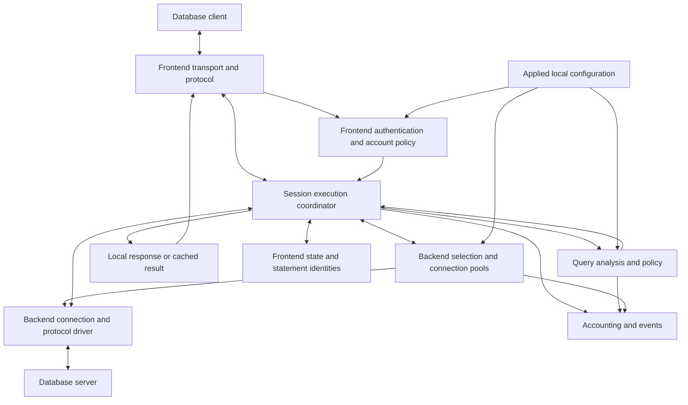
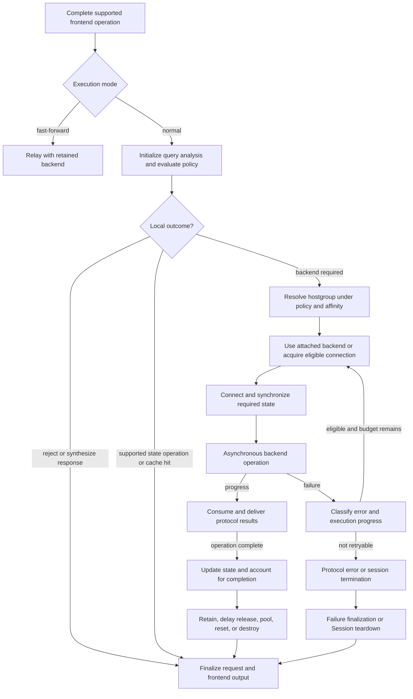

# Traffic-serving runtime architecture

> Source review: 2026-10-18, checkout `f8ada9117166`.
> This chapter describes verified implementation and architectural boundaries;
> it does not ratify new product guarantees. Build options and protocol differences
> are explicit where they change behavior. Source links are relative to this
> checkout; line anchors identify the reviewed implementation, not stable APIs.

## 1. The runtime is a set of cooperating subsystems

The traffic runtime terminates a client's database protocol, maintains that
client's session, decides how each supported operation is handled, and manages
the database connections needed to perform it. A frontend connection does not
imply a permanently corresponding database connection. Operations can complete
locally, use a previously attached backend, borrow an existing connection, or
establish a new one. The database executes database operations and owns database
transaction state; ProxySQL owns the mediation and its representation of the
frontend session.

This is substantially broader than routing. The following decomposition separates
responsibilities that are implemented together in several large translation units.

| Runtime subsystem | Responsibility | Principal implementation |
| --- | --- | --- |
| Protocol ingress and transport | Accept sockets; negotiate transport; frame packets/messages; buffer reads and writes. | Protocol `Thread`, `Data_Stream`, and `Protocol` implementations. |
| Identity and account policy | Authenticate frontend users; install account policy; supply backend identity/credentials and connection accounting. | `MySQL_Authentication`, `PgSQL_Authentication`, protocol login code, optional providers. |
| Session execution | Coordinate an operation from client input through local handling or backend execution and response completion. | `MySQL_Session`, `PgSQL_Session`. |
| Query analysis and policy | Characterize SQL; evaluate programmable rules; rewrite; admit/reject; produce execution policy; aggregate query statistics. | Shared `Query_Processor` with protocol specializations. |
| Frontend-state virtualization | Track supported settings and state dependencies; synchronize an eligible backend or retain affinity. | Session, protocol `Variables`, connection state, statement managers. |
| Backend selection and reuse | Select a server/connection under runtime policy; manage pool capacity, compatibility, release, reset, and destruction. | Hostgroup managers, worker-local pools, `Connection`. |
| Prepared/extended operations | Separate client statement identities from backend resources and preserve protocol execution state. | Statement managers, Session, backend connection driver. |
| Result caching | Store and retrieve eligible protocol results under query policy. | Protocol Query Caches and Session integration. |
| Secondary execution modes | Execute MySQL mirror work; relay fast-forward traffic; optionally observe fast-forward exchanges. | Session mirror/forward branches and FFTO. |
| Runtime accounting and event production | Publish request, connection, rule, digest, timing, and error observations. | Workers, Session, Query Processor, loggers, hostgroup managers. |

These are not ten independently scheduled services. Most request work executes
on the worker that owns the session. Shared stores and background activities
support that work. See [backend management](BACKEND-MANAGEMENT.md) for pool,
server-health, and cache-storage details, and
[administration and statistics](ADMINISTRATION-AND-STATISTICS.md) for the wider
statistics architecture.

The arrows express calls and data dependencies, not interprocess messaging.
Configuration synchronization with another ProxySQL instance is outside the
request path: applied local configuration supplies the runtime's policy.

## 2. Execution contexts and the network boundary

### 2.1 Workers drive many sessions

`MySQL_Thread` and `PgSQL_Thread` own poll registrations, session collections,
worker-local configuration, counters, and local reusable-backend caches. Their
`run()` loops wait for file-descriptor events and call `process_all_sessions()`;
the latter advances the relevant Session state machines. There is no dedicated
thread per ordinary frontend session and no dedicated Query Processor thread.
The ordinary worker event loops use `poll()`. Conditional idle-thread handling
uses `epoll`; libev appears elsewhere in the product and is not the owner of
these worker loops.

Sources: [MySQL worker loop](../../../lib/MySQL_Thread.cpp#L4250),
[MySQL session scheduling](../../../lib/MySQL_Thread.cpp#L5156),
[PostgreSQL worker loop](../../../lib/PgSQL_Thread.cpp#L3311),
[PostgreSQL session scheduling](../../../lib/PgSQL_Thread.cpp#L4134).

An accepted application connection creates a Session and frontend Data Stream,
records client/listener identities, applies process-level connection limits,
sets nonblocking I/O, and registers the client descriptor. MySQL sends a server
handshake first; PostgreSQL waits for startup/authentication input. Listener-side
host-error rejection precedes a normal session's login. MySQL's v4 listener path
also checks plugin listener readiness where a listener is plugin-gated.

Sources: [MySQL accept](../../../lib/MySQL_Thread.cpp#L5726),
[PostgreSQL accept](../../../lib/PgSQL_Thread.cpp#L4701).

Idle-thread handoff, when compiled/enabled, changes the execution context owning
an idle frontend. It does not make a frontend Session concurrently executable
by two workers. Event processing, the session handler, and backend attachment
must be understood together when changing worker ownership. The thread handler
is the process-level owner of worker configuration and thread lifecycle; an
individual worker is the executor and holder of its current local copies.

### 2.2 A Data Stream is a transport/protocol endpoint

Both protocol Data Streams hold their socket, I/O queues, incoming/outgoing
packet arrays, protocol object, Session link, connection link, and deadlines.
Their `read_from_net()`, packet framing, outgoing-array conversion, and
`write_to_net()` bridge byte transport and state-machine work. Queued response
bytes can outlive backend execution: a backend can be released after the
exchange has completed even while frontend output remains buffered.

MySQL framing additionally handles its packet sequence, multipart packets, and
compression. PostgreSQL framing handles startup packets and typed messages.
TLS is terminated at the proxy on the frontend and independently established
on the backend. The corresponding SSL/BIO lifetimes are not interchangeable.
In particular, PostgreSQL fast-forward adopts the backend connection's TLS
resources with explicit ownership bookkeeping.

Sources: [MySQL Data Stream structure](../../../include/MySQL_Data_Stream.h#L86),
[MySQL transport](../../../lib/mysql_data_stream.cpp#L682),
[PostgreSQL Data Stream structure](../../../include/PgSQL_Data_Stream.h#L72),
[PostgreSQL transport](../../../lib/PgSQL_Data_Stream.cpp#L504),
[backend TLS adoption](../../../lib/PgSQL_Data_Stream.cpp#L1217).

### 2.3 Backend execution has its own asynchronous driver

The Session chooses and prepares work; `Connection` advances connection,
authentication, command execution, result fetching, and reset states. MySQL
uses the vendored MariaDB client library's asynchronous operations. PostgreSQL
has two implementations behind `PgSQL_Connection`: libpq and a native
nonblocking wire driver. Both feed the Session's operation lifecycle, but their
capabilities differ.

Stable builds force PostgreSQL libpq mode. `PROXYSQL31` exposes
`pgsql-use_native_backend_protocol` and currently defaults it to true; v4
inherits that tier. Mode is captured by a connection when its driver is first
initialized. A setting change is not a conversion of existing pooled
connections; consumers check actual connection mode where it matters.

Sources: [MySQL asynchronous driver](../../../lib/mysql_connection.cpp#L1453),
[MySQL connect](../../../lib/mysql_connection.cpp#L1123),
[PostgreSQL driver dispatch](../../../lib/PgSQL_Connection.cpp#L358),
[tier-dependent default](../../../lib/PgSQL_Thread.cpp#L1209),
[worker setting gate](../../../lib/PgSQL_Thread.cpp#L4399).

## 3. Authentication is a subsystem, not a routing precondition

### 3.1 Credential stores and session policy

`MySQL_Authentication` and `PgSQL_Authentication` own applied runtime accounts,
credential lookup, frontend connection accounting, runtime-user snapshots, and
checksums. Admin loads populate them. The stores distinguish frontend and
backend credential scopes. On `PROXYSQL31`, Admin/stats credentials have a
separate scope; Stable retains the older frontend-scope behavior.

An account contributes more than a password: TLS requirement, default
hostgroup, transaction persistence, fast-forward choice, maximum connections,
and attributes become session policy. MySQL also supplies default schema and
schema-locking policy. A successful cryptographic exchange alone is not the
whole admission decision: the Session also enforces the relevant account and
connection constraints. Database grants remain the database server's
responsibility.

Sources: [MySQL account and store](../../../include/MySQL_Authentication.hpp#L12),
[MySQL credential scopes](../../../lib/MySQL_Authentication.cpp#L221),
[PostgreSQL account and store](../../../include/PgSQL_Authentication.h#L22),
[PostgreSQL credential scopes](../../../lib/PgSQL_Authentication.cpp#L102),
[MySQL policy installation](../../../lib/MySQL_Protocol.cpp#L2664),
[PostgreSQL policy installation](../../../lib/PgSQL_Protocol.cpp#L1038),
[PostgreSQL login completion](../../../lib/PgSQL_Session.cpp#L4037).

### 3.2 Frontend and backend authentication are separate exchanges

The protocol module performs frontend wire negotiation and verification. The
Session continues any multi-step login and installs the accepted identity and
policy. A later backend connection authenticates separately using its resolved
backend credentials and server transport configuration. An existing pooled
connection may already satisfy that backend identity; it does not authenticate
the next frontend client merely by existing.

MySQL implements native-password, clear-password, and caching-SHA2 negotiation,
with transport/secret restrictions. RSA support for unencrypted caching-SHA2
full authentication is tier-gated; snapshots retain the negotiated key across
the exchange. Optional `PROXYSQLED25519` adds its own authentication mechanism.
Certificates and configured SPIFFE identity attributes also participate in
frontend policy; `PROXYSQL31` adds the explicit `require_x509` checks and unified
certificate-policy handling across supported login contexts. Identity changes
through `COM_CHANGE_USER` have their own policy and cleanup requirements.

PostgreSQL reconciles the configured authentication-method floor with the
stored secret type, negotiates MD5/cleartext/SCRAM as applicable, and performs
SCRAM verification. Unknown or unusable credentials follow mock exchanges in
the protected paths rather than bypassing authentication. SCRAM's multi-packet
exchange retains required secret material; reload/removal behavior is explicit.
Frontend method negotiation must not be confused with native-backend SCRAM
channel-binding support.

Sources: [MySQL auth mechanisms](../../../lib/MySQL_Protocol.cpp#L71),
[MySQL certificate policy](../../../lib/MySQL_Protocol.cpp#L121),
[caching-SHA2 RSA exchange](../../../lib/MySQL_Protocol.cpp#L2106),
[PostgreSQL method reconciliation](../../../lib/PgSQL_Protocol.cpp#L392),
[PostgreSQL verification](../../../lib/PgSQL_Protocol.cpp#L999),
[SCRAM continuation and backend keys](../../../lib/PgSQL_Protocol.cpp#L1265).

### 3.3 Optional identity and credential paths have real consumers

| Path | Runtime relationship and limit |
| --- | --- |
| MySQL LDAP | Protocol login calls the installed LDAP provider; a mapped backend username can select backend credentials and policy. The public interface does not contain the external provider implementation. |
| MySQL passthrough authentication | Frontend login obtains an eligible candidate credential; Session performs a nonblocking backend-authentication probe. A dedicated verified-credential cache and failure/inflight controls support subsequent logins. This is not a general bypass of frontend account policy. |
| MySQL AWS IAM backend auth | Under `PROXYSQL40`, backend account attributes select a backend-auth policy, and Session requests a token through an installed token source before establishing the backend. Stable/Innovative do not activate this backend policy. |
| PostgreSQL stored MD5 | Backend credential construction passes the stored MD5 secret through the dedicated mechanism; treating it as a plaintext password would be incorrect. |
| PostgreSQL stored SCRAM verifier | A verified frontend SCRAM exchange can harvest ClientKey/ServerKey for backend authentication. A verifier is not a usable plaintext backend password; a connection without required keys is refused. |

Sources: [LDAP frontend/backend mapping](../../../lib/MySQL_Protocol.cpp#L2823),
[MySQL passthrough handshake](../../../lib/MySQL_Protocol.cpp#L3174),
[passthrough Session controls](../../../lib/MySQL_Session.cpp#L2592),
[backend-auth tier contract](../../../include/MySQL_Authentication.hpp#L145),
[backend-auth resolution](../../../lib/MySQL_Backend_Auth.cpp#L253),
[AWS IAM Session continuation](../../../lib/MySQL_Session.cpp#L941),
[PostgreSQL backend credentials](../../../lib/PgSQL_Connection.cpp#L1184),
[native SCRAM helpers](../../../lib/PgSQL_Backend_Auth.cpp#L149).

The identity subsystem therefore crosses configuration, wire protocol, Session,
and connection establishment. A credential-store change must be assessed
against login continuation, existing frontend sessions, and reusable backend
identity separately; it is not automatically an immediate reauthentication
of every established connection.

## 4. Session is the operation coordinator

The Session owns frontend continuity: current operation, policy output,
hostgroup selection, backend wrappers/attachments, transaction persistence,
supported frontend settings, statement state, and local error/response handling.
Its state machine connects network readiness to semantic progress. The
Query Processor does not execute the operation, and the backend pool does not
decide the complete frontend session semantics.

The common request shape below deliberately includes outcomes requiring no
database execution. Individual MySQL commands and PostgreSQL extended messages
enter different branches; this is not an asserted universal call order.

Normal mode can answer supported protocol commands, tracked-state operations,
proxy identity queries, policy-generated OK/errors, and cache hits locally.
The exact command and session conditions matter: a local completion is not
evidence that the database received the original client SQL. Conversely, an
unsupported state operation can require backend affinity rather than local
emulation. Admin/stats/SQLite session types have separate dispatch consumers;
an SQL-looking request is not necessarily application database traffic.

Sources: [MySQL command dispatch](../../../lib/MySQL_Session.cpp#L5500),
[MySQL policy consumer](../../../lib/MySQL_Session.cpp#L8399),
[MySQL local identity response](../../../lib/MySQL_Session.cpp#L9405),
[PostgreSQL frontend dispatch](../../../lib/PgSQL_Session.cpp#L1980),
[PostgreSQL policy/local handling](../../../lib/PgSQL_Session.cpp#L5385).

## 5. Query Processor: characterization, policy, and accounting

### 5.1 Query analysis is distinct from execution

The shared templated `Query_Processor` has MySQL/PostgreSQL specializations.
It produces normalized digest text/identities, extracts the first comment,
classifies commands, evaluates rules, and maintains query statistics. It does
not execute SQL or constitute a complete database semantic model. Parser mode
can select the command classifier; current code intentionally keeps digest
generation consistent across the legacy and ParserSQL paths.

Session `Query_Info`/`PgSQL_Query_Info` initiates analysis and reports completion
time, rows, affected rows, errors, and session dimensions into query accounting.
The Query Processor owns per-command counters/timing distributions and digest
aggregation/retrieval/reset/purge. Rule-hit statistics and digest statistics
are separate from event logs and from the rest of the Stats subsystem.

Sources: [query analysis initialization](../../../lib/Query_Processor.cpp#L3419),
[command/digest accounting](../../../lib/Query_Processor.cpp#L3470),
[digest update](../../../lib/Query_Processor.cpp#L3526),
[digest retrieval](../../../lib/Query_Processor.cpp#L2360),
[MySQL specialization](../../../include/MySQL_Query_Processor.h#L46),
[PostgreSQL specialization](../../../include/PgSQL_Query_Processor.h#L18).

### 5.2 Rule evaluation is a programmable policy pipeline

Rules match session identity/schema, client address, proxy listener address and
port, digest identity, normalized digest pattern, and SQL pattern. Address
matching includes configured exact/wildcard forms and supported CIDR predicates.
After a rewrite, later SQL-pattern rules can inspect the rewritten query.
Matching all required inputs matters: a missing digest is not an unconditional
match for a digest-specific rule.

Ordered active rules produce a policy object. Input/output flags support
multi-stage evaluation and bounded restarts; weighted output flags support
configured probabilistic branches. `apply` terminates normal rule evaluation.
Fast routing performs a user/schema/flag lookup when the normal rule outcome
permits it. First-comment annotations can run before, after, or around normal
rules according to configuration. Annotation parsing is an input to policy,
not an authorization to bypass execution safety.

Regex match/rewrite engines include PCRE and RE2; PCRE2 availability is
`PROXYSQL31`-gated. Compile and match resource limits are part of their actual
failure behavior. A rewrite changes the request through a Session consumer;
it does not directly write to a backend socket.

Applied rules are versioned. Workers rebuild their local active rules and
compiled representations when observing a new version; rule-hit aggregation
checks the corresponding version. Configuration publication and each worker's
active representation are therefore distinct states.

Sources: [rule predicate](../../../lib/Query_Processor.cpp#L1253),
[versioned evaluation](../../../lib/Query_Processor.cpp#L2850),
[flag and action evaluation](../../../lib/Query_Processor.cpp#L2998),
[rewrite and fast routing](../../../lib/Query_Processor.cpp#L3118),
[rule publication](../../../lib/Query_Processor.cpp#L1619),
[hit aggregation](../../../lib/Query_Processor.cpp#L3370).

### 5.3 Outputs have different enforcement owners

| Policy capability | Concrete execution consumer and qualifications |
| --- | --- |
| Destination hostgroup | Session combines it with account defaults, transaction persistence, and hostgroup locks; worker/hostgroup manager selects an eligible server/connection. |
| Rewrite | Session rebuilds MySQL query packets or PostgreSQL Query/Parse messages and updates query analysis. Prepared execution has its own policy path. |
| Local error / local OK | Session emits the protocol response and completes the operation without database execution. |
| Cache TTL / empty-result policy | Session performs eligible lookup/insertion; Query Cache owns cached values. Simple-query and prepared/extended eligibility differ. |
| Delay | Session pauses execution until its scheduled deadline; this is not a sleep inside the Query Processor. |
| Timeout | Session installs the query deadline, applying rule/default policy and supported hostgroup overrides, then initiates cancellation/kill on expiry. |
| Retry count | Session installs the retry budget. Transaction, error-class, and execution-progress checks still determine eligibility. |
| Multiplex policy / fresh-connection request | Session/connection status and pool selection consume the policy alongside existing affinity and compatibility constraints. |
| Next-query flag | Session retains input for a subsequent policy evaluation. |
| Mirror hostgroup/flag | MySQL creates independent mirror sessions under queue/concurrency limits. PostgreSQL's simple-query consumer warns and ignores mirror outputs. |
| Event logging | Session completion combines rule `log` with the configured default and calls the protocol logger. |
| Maximum lag/freshness | Session passes applicable constraints into connection selection; monitor/hostgroup state determines the eligible servers. |
| MySQL GTID policy | MySQL adds `min_gtid` annotations and `gtid_from_hostgroup`; Session and pool implement GTID-aware selection and defined writer fallback. This is not a PostgreSQL capability. |
| MySQL fast-forward switch | MySQL's specialization recognizes a supported policy transition; Session performs the actual mode switch. |

Sources: [shared output](../../../include/query_processor.h#L319),
[MySQL policy consumer](../../../lib/MySQL_Session.cpp#L8399),
[MySQL execution policy](../../../lib/MySQL_Session.cpp#L6249),
[MySQL GTID selection](../../../lib/MySQL_Session.cpp#L9894),
[PostgreSQL policy consumer](../../../lib/PgSQL_Session.cpp#L5385),
[PostgreSQL mirror limitation](../../../lib/PgSQL_Session.cpp#L2441),
[PostgreSQL backend selection](../../../lib/PgSQL_Session.cpp#L5525).

`reconnect`, `sticky_conn`, and `cache_timeout` exist in rule/output structures
and are populated by rule evaluation. The reviewed Session implementations do
not consume those fields to implement the corresponding execution effects
(`PgSQL_Session` serializes them for diagnostics). Do not advertise a runtime
capability merely because a table column or shared output field exists.

### 5.4 Admission/firewall policy is also query processing

The processor owns whitelist users, permitted digests, and SQL-injection
fingerprint exemptions. It supports detecting and protecting modes and can
produce a rejection policy. Session integrates libinjection checks and the
fingerprint whitelist. Query admission thus spans policy production and
protocol-specific response enforcement; it is neither database privilege
checking nor a feature of hostgroup routing alone.

Sources: [digest whitelist enforcement](../../../lib/Query_Processor.cpp#L3247),
[firewall lookup](../../../lib/Query_Processor.cpp#L3313),
[MySQL injection consumer](../../../lib/MySQL_Session.cpp#L5263),
[PostgreSQL injection consumer](../../../lib/PgSQL_Session.cpp#L1876).

## 6. Frontend continuity over replaceable backend connections

There are two session/state domains: the frontend's logical session and each
database connection's actual server session. ProxySQL can reproduce supported
state on another eligible backend; state it cannot safely reproduce requires
affinity or other explicitly supported handling. Matching settings can permit
direct reuse. Reset is one lifecycle operation, not a prerequisite for every
reuse.

| State | Owner / lifetime | Effect on execution |
| --- | --- | --- |
| Client identity and account policy | Frontend Session and its connection/userinfo; installed at login/change-user. | Supplies access policy and backend requirements. |
| Required tracked settings | Frontend connection's protocol-variable representation. | Compared/synchronized before backend execution. |
| Actual tracked backend settings | Backend connection. | Must describe what the database currently has, including after reset. |
| Transaction and hostgroup affinity | Session plus backend protocol status and connection state. | Retains backend context and qualifies rerouting/release/retry. |
| Database-local resources | Actual backend session; represented by connection status and Session/statement structures where supported. | Can pin ownership until dependency ends. |
| Query policy/output | Current Session operation; next-query flags can survive into a later operation. | Supplies requested behavior to execution consumers. |
| Reusable idle backend | Worker-local or shared hostgroup pool. | Can transfer sequentially to a compatible frontend under release/borrow guards. |

MySQL/PgSQL `Variables` keep client and server sides separately and choose
verification/synchronization actions. Initial connection parameters and later
session-variable commands are different ways of establishing required state.
Supported locally tracked commands need not be forwarded verbatim; unsupported
or context-sensitive commands take separate paths. Current MySQL user-variable
tracking includes post-backend-OK commit logic, and PostgreSQL transaction-local
settings have transaction-aware handling. A general claim that all `SET`
statements are either forwarded or intercepted would be inaccurate.

Sources: [MySQL variable interface](../../../include/MySQL_Variables.h#L25),
[PostgreSQL variable interface](../../../include/PgSQL_Variables.h#L20),
[MySQL state consumer](../../../lib/MySQL_Session.cpp#L8399),
[MySQL post-OK user-variable tracking](../../../lib/MySQL_Session.cpp#L7306),
[PostgreSQL special-command handling](../../../lib/PgSQL_Session.cpp#L4594),
[PostgreSQL startup/state mapping](../../../lib/PgSQL_Connection.cpp#L6133).

Both protocols distinguish usability by the current frontend from eligibility
for cross-frontend reuse. An active transaction can be usable by its owner and
remain unavailable to other clients. Transaction state, temporary objects,
locks, untracked state, protocol progress, and configured pinning/multiplex
policy contribute to release decisions; the exact mechanisms differ.
`PgSQL_Connection::is_connection_in_reusable_state()` is a driver usability
check, not a sufficient pool-return predicate. Its name must not substitute
for checking the actual consumer.

Sources: [MySQL transaction/multiplex predicates](../../../lib/mysql_connection.cpp#L2910),
[PostgreSQL transaction predicates](../../../lib/PgSQL_Connection.cpp#L4244),
[PostgreSQL usability predicate](../../../lib/PgSQL_Connection.cpp#L4304),
[PostgreSQL multiplex state](../../../lib/PgSQL_Connection.cpp#L5870),
[PostgreSQL completion/release](../../../lib/PgSQL_Session.cpp#L6493).

## 7. Prepared statements and PostgreSQL extended-query execution

### 7.1 MySQL virtualizes statement identifiers

The frontend's binary prepared-statement IDs are not database-global IDs.
The global statement manager holds shared query/metadata; frontend mappings
resolve client IDs, while each backend maps the global statement to its actual
`MYSQL_STMT`. Execution on another backend may require preparing there first.
Session handles Prepare, Execute, Reset, Close, and Send Long Data as distinct
commands. Bind types and long-data state have frontend lifetimes; backend
statement resources have connection lifetimes.

This enables supported binary prepared execution across eligible pooled
connections; it does not imply that every SQL-level prepared statement or
cursor behavior is virtualized. SQL-level session resources and status flags
must be considered independently of binary-protocol metadata.

Sources: [statement model and mappings](../../../include/MySQL_PreparedStatement.h#L8),
[Prepare consumer](../../../lib/MySQL_Session.cpp#L4811),
[Execute consumer](../../../lib/MySQL_Session.cpp#L4960),
[statement command dispatch](../../../lib/MySQL_Session.cpp#L5639).

### 7.2 PostgreSQL separates statements, binds, portals, and frames

`PgSQL_STMT_Manager` shares query metadata keyed by identity/database/query and
parameter types. Frontend statement names and backend statement names have
separate local mappings. Session queues typed Parse/Describe/Close/Bind/Execute
messages in an extended-query frame and dispatches their handlers, carrying
Flush/Sync requirements into the backend driver. Missing backend preparation
is resolved without treating a client name as a valid backend resource.

For the unnamed portal, Session can defer Bind until Execute and synthesize
BindComplete. The current unnamed Execute path forces unlimited rows (`0`),
rather than promising cursor-style `max_rows` behavior. Native mode additionally
supports named portals: Bind performs a real backend bind, the Session registry
holds its bind bytes and statement lifetime, and Execute can resume a suspended
portal using the requested row limit. Named Describe/Close use that actual
portal; libpq mode rejects named portals.

Portal lifetime is a connection/transaction property. A portal must not be
re-created on a different backend merely because its statement metadata is
shared. Session tears down its registry on transaction end and backend
detachment, retaining detached bytes long enough for request logging where
needed. Frame lifetime alone does not define portal lifetime.

Sources: [PostgreSQL statement model](../../../include/PgSQL_PreparedStatement.h#L11),
[backend operation dispatch](../../../lib/PgSQL_Session.cpp#L3091),
[frame dispatch](../../../lib/PgSQL_Session.cpp#L8166),
[Bind paths](../../../lib/PgSQL_Session.cpp#L7604),
[Execute paths and row limits](../../../lib/PgSQL_Session.cpp#L7828),
[portal lifetime/detachment](../../../lib/PgSQL_Session.cpp#L8081).

## 8. Results, caches, and alternate execution paths

### 8.1 Result handling belongs to the protocol execution path

Drivers fetch results incrementally and Session converts/transfers them to
frontend output. Buffering and frontend backpressure can suspend further
fetching; they do not establish that a statement has not executed. MySQL status,
warning, EOF/OK, and multi-result handling differ from PostgreSQL
CommandComplete/ReadyForQuery, notifications, and extended-cycle handling.
Protocol-specific output must preserve the client's expected exchange.

Sources: [MySQL asynchronous query](../../../lib/mysql_connection.cpp#L2465),
[PostgreSQL wire result consumer](../../../lib/PgSQL_Session.cpp#L5690),
[native incremental result fetch](../../../lib/PgSQL_Connection.cpp#L3475),
[PostgreSQL fetch suspension](../../../lib/PgSQL_Connection.cpp#L5235).

### 8.2 Caching is a policy-directed local outcome

Session selects cache lookup/insertion and owns operation eligibility; Query
Cache owns stored results and their expiration/storage lifetime. TTL is a policy
input, not a proof that execution can be omitted under every session condition.
Legacy/simple-query caches use identity plus SQL keys; those paths must not be
described as if they have all newer prepared-cache guards.

Under `PROXYSQL31`, MySQL binary prepared-result caching includes exact statement
identity, execution bytes/types, hostgroup, and tracked setting values in its
key and applies explicit nontransactional/locking/long-data/GTID guards.
PostgreSQL extended caching has a separate domain and includes SQL, parse types,
bind formats/values, hostgroup, tracked variables/startup values, and the
required describe shape. It rejects active or attached backend state, unsafe
frame shapes, row-limited Execute, and other disqualifying policy/state. A
simple-query cache is not evidence of support for arbitrary portal caching.

Sources: [MySQL simple lookup](../../../lib/MySQL_Session.cpp#L9637),
[MySQL prepared lookup and guards](../../../lib/MySQL_Session.cpp#L5140),
[PostgreSQL simple lookup](../../../lib/PgSQL_Session.cpp#L5470),
[PostgreSQL extended lookup and guards](../../../lib/PgSQL_Session.cpp#L7760),
[PostgreSQL insertion](../../../lib/PgSQL_Session.cpp#L5690).

The shared storage implementation is partitioned into 32 `KV_BtreeArray` instances in this
baseline. Each combines a B-tree lookup index of weak references with an owning vector of
shared entry references and a read/write lock. A caller locks the weak result into a shared
reference before using it. Replacement marks the prior value for expiry and replaces the
index entry; reclamation is distinct from making the replacement visible. This is neither
a lock-free global map nor a database-backed cache.

The base key is a 64-bit hash of caller-supplied key bytes seeded by the supplied user identity
hash. The protocol/Session constructs those bytes, explaining why simple-query and newer
prepared/extended domains can have different state coverage. Entries carry payload, creation,
expiry and last-access timestamps. Lookup checks both stored expiry and the effective requested
TTL. Supported soft-TTL handling lets one caller trigger refresh while others can still use
the unexpired old result.

Background purging handles expired/replaced entries and applies more aggressive access-age
reclamation under memory pressure. Active shared references constrain physical reclamation;
cache flush, index replacement and freeing every outstanding reader's object are different
events. Both protocol caches are maintained by the shared purge task constructed in main.

Sources: [storage and ownership](../../../include/Query_Cache.h#L65),
[replace and lookup](../../../lib/Query_Cache.cpp#L233),
[expiry/reclamation](../../../lib/Query_Cache.cpp#L131),
[key/TTL/soft refresh](../../../lib/Query_Cache.cpp#L576), and
[shared purge startup](../../../src/main.cpp#L1143).

### 8.3 Mirroring and forwarding are different execution models

MySQL mirroring creates secondary Sessions carrying a copied query and relevant
identity/schema and mirror policy, subject to queue/concurrency limits. Their
results do not become the original frontend's result. Mirroring is not a
database transaction replicated across hostgroups. PostgreSQL shared output
fields do not mean mirroring is implemented there.

Fast-forward retains a backend and relays protocol traffic through a different
Session branch, bypassing normal per-query processing. Temporary transitions
exist for supported operations; a mode change has to account for existing
protocol and connection state. FFTO, when built/enabled, observes forwarded
traffic to derive statistics/events without turning that relay into the normal
query-policy path. FFTO bounds its observational buffering and can bypass
observation for oversized exchanges.

Sources: [MySQL mirror creation](../../../lib/MySQL_Session.cpp#L2073),
[PostgreSQL forwarding transitions](../../../lib/PgSQL_Session.cpp#L6944),
[MySQL FFTO observer](../../../lib/MySQLFFTO.cpp#L34),
[PostgreSQL FFTO observer](../../../lib/PgSQLFFTO.cpp#L39).

Native PostgreSQL also supports LISTEN notification relay by retaining the
subscribed backend and delivering asynchronous messages. Libpq mode rejects
LISTEN because this path does not expose the required notification delivery.
COPY handling has its own protocol/forwarding paths; neither feature should be
treated as an ordinary single-result query followed immediately by pool return.

Sources: [LISTEN capability check](../../../lib/PgSQL_Session.cpp#L4525),
[native asynchronous messages](../../../lib/PgSQL_Connection.cpp#L2726),
[LISTEN state](../../../lib/PgSQL_Connection.cpp#L5443),
[COPY result handling](../../../lib/PgSQL_Connection.cpp#L5359).

## 9. Failures, cancellation, and transaction continuity

Backend connection failure, a database error response, and a local rejection are
different events. Session distinguishes retryable paths, frontend delivery
progress, transaction/session dependencies, and configured retry budgets.
The first operation on a freshly borrowed but dead pooled socket can be retried
when eligible. A known interrupted transaction must not be replayed as a
standalone statement on a fresh backend. Configured retries of unanswered
operations are not an exactly-once execution guarantee.

MySQL checks reusable/active-transaction/multiplex status, result transfer, and
multi-result progress in its retry handlers. PostgreSQL centralizes its guards
in `query_retry_allowed()`: it preserves transaction knowledge after disconnect,
qualifies unsynchronized/pipeline state, refuses retry after CommandComplete,
after transfer starts, or after multi-statement progress. Protocol-specific
error classes and connect/retry deadlines remain additional conditions.

Sources: [MySQL retry handler](../../../lib/MySQL_Session.cpp#L6594),
[MySQL database-error paths](../../../lib/MySQL_Session.cpp#L6660),
[PostgreSQL retry predicate](../../../lib/PgSQL_Session.cpp#L2853),
[PostgreSQL retry handlers](../../../lib/PgSQL_Session.cpp#L2909).

For PostgreSQL, an explicit transaction whose backend fails can optionally keep
the frontend alive in a poisoned transaction state. This emits an aborted
transaction response and requires supported transaction-end recovery; it does
not migrate the lost transaction. The path is separately gated by configuration
and does not apply after a streamed response has already made synthesis unsafe.

Sources: [transaction poisoning](../../../lib/PgSQL_Session.cpp#L2781),
[poisoned transaction recovery](../../../lib/PgSQL_Session.cpp#L6784),
[poisoned extended operations](../../../lib/PgSQL_Session.cpp#L6805).

Timeout/cancel paths initiate backend-specific auxiliary work; cancellation
is not equivalent to immediate successful rollback or immediate pool return.
MySQL's Session prepares a detached kill operation; PostgreSQL prepares a
cancel operation using either libpq cancel data or the native backend PID/key.
The Session continues handling completion, errors, and destruction. PostgreSQL
frontend CancelRequest keys identify a proxy session; they are distinct from
the backend's own cancellation credentials.

Sources: [MySQL kill scheduling](../../../lib/MySQL_Session.cpp#L2811),
[MySQL deadline policy](../../../lib/MySQL_Session.cpp#L6416),
[PostgreSQL cancel scheduling](../../../lib/PgSQL_Session.cpp#L1184),
[PostgreSQL timeout handling](../../../lib/PgSQL_Session.cpp#L3366),
[frontend cancel secret](../../../lib/PgSQL_Protocol.cpp#L1639).

Cleanup must preserve transaction outcomes. PostgreSQL's locally rejected
extended frame can leave a backend holding an implicit transaction whose work
was not rejected by the database. Sending the missing Sync could commit it;
the guarded path destroys that backend to force rollback. Protocol
resynchronization is therefore not a universally safe substitute for discard.
Reset success must likewise be reflected in tracked connection state before
reuse, while already-compatible connections need no mandatory reset.

Sources: [local extended-frame rejection](../../../lib/PgSQL_Session.cpp#L8049),
[PostgreSQL reset driver](../../../lib/PgSQL_Connection.cpp#L5028),
[PostgreSQL reset requirement](../../../lib/PgSQL_Connection.cpp#L5163),
[agreed reuse/retry invariants](../../agents/invariants.md#i-4-backend-sharing-preserves-session-isolation-and-exclusive-ownership).

## 10. Boundaries for implementation and review

The following are conclusions from the current decomposition, not newly
ratified rules overriding configuration or existing invariants:

1. **Locate the producer and execution consumer.** A rule column, account
   attribute, parser result, or connection status has meaning through its
   actual consumer. Shared types do not establish protocol or tier parity.
2. **Identify which session owns the state.** Frontend requirements, backend
   actual state, shared metadata, and database-local resources have different
   lifetimes. A process-global metadata cache does not globalize a server
   session's transaction or portal.
3. **Preserve local outcomes.** A successful command can be tracked, synthesized,
   cached, plugin-handled on a supported hook, or executed. Review the actual
   path before assuming every accepted request must be forwarded.
4. **Check protocol progress before recovery.** Backend execution, frontend
   delivery, and the end of a protocol cycle are distinct boundaries.
5. **Treat observability as a consumer with lifetime requirements.** Logging
   and accounting can read statement/query state during finalization; cleanup
   order cannot invalidate those bytes early.

Request completion sources:
[MySQL accounting/logging/cleanup](../../../lib/MySQL_Session.cpp#L10559),
[PostgreSQL accounting/logging/cleanup](../../../lib/PgSQL_Session.cpp#L5990).
The v4 simple-query plugin hook is dispatched from
[MySQL](../../../lib/MySQL_Session.cpp#L6162) and
[PostgreSQL](../../../lib/PgSQL_Session.cpp#L2396); that does not imply equivalent
hooks exist for binary Prepare or every extended-query operation.
The synchronous callback can allow or deny the selected request; on denial the owning
Session emits the protocol error and ends that request path before backend execution.
The [GenAI hook](../../../plugins/genai/src/plugin_hooks.cpp#L38) returns allow when
its detector is unavailable or the relevant plugin/feature gates are disabled.

### Evidence limits and remaining design decisions

This is a source-based architecture account, not a claim that every branch has
been executed during this review. Existing focused tests include
[dead-backend retry](../../../test/tap/tests/pgsql-backend_death_query_retry-t.cpp),
[named portals](../../../test/tap/tests/pgsql-native_portals-t.cpp),
[extended policy](../../../test/tap/tests/pgsql-extended_query_protocol_query_rules_test-t.cpp),
[prepared cache](../../../test/tap/tests/mysql-prepared_query_cache-t.cpp),
[extended cache](../../../test/tap/tests/pgsql-extended_query_cache-t.cpp),
[SCRAM backend material](../../../test/tap/tests/pgsql-verifier_passthrough-t.cpp),
and [frontend certificate policy](../../../test/tap/tests/test_frontend_x509_auth-t.cpp).
They identify intended verification surfaces; their presence is not a report
of tests run for this documentation change.

The implementation does not by itself settle desired future parity between
protocols, whether legacy unconsumed rule fields should be removed or gain
consumers, or which additional session state should become virtualizable.
Those are product/design decisions. This chapter records current boundaries
so a change can identify the boundary it proposes to move.
