# ProxySQL visual architecture guide

Source baseline: `f8ada9117`, refreshed 2026-10-18. These diagrams describe responsibility,
execution and data flow established by source inspection. They deliberately distinguish
logical relationships from call sequences, conceptual states from C++ enums, and configuration
synchronization from traffic availability. A diagram is not a claim of universal protocol
parity, atomic configuration visibility or a runtime test result.

Read with the [overview](ARCHITECTURE-OVERVIEW.md), [runtime chapter](RUNTIME-ARCHITECTURE.md),
[backend chapter](BACKEND-MANAGEMENT.md) and [administration/statistics chapter](ADMINISTRATION-AND-STATISTICS.md).

## 1. Deployment context: traffic and configuration are different relationships

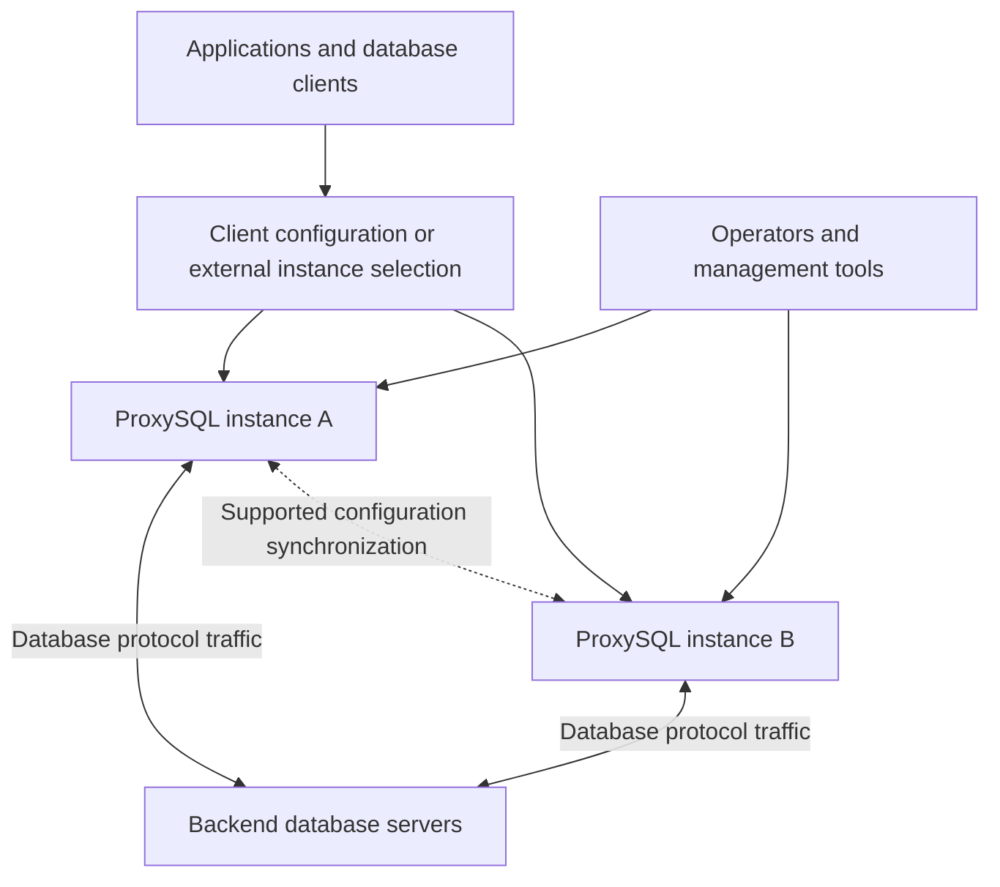

The two ProxySQL instances have independent frontend sessions and backend resources. Their
configuration-synchronization relationship does not migrate an in-flight client connection
or database transaction. External instance selection is deployment context, not a Cluster
leader-election or traffic-failover service. Database replication, if present, is a separate
relationship among the databases.

Evidence: [Cluster](../../../lib/ProxySQL_Cluster.cpp), protocol Sessions and the
[administration chapter](ADMINISTRATION-AND-STATISTICS.md).

## 2. Product modules and collaborators

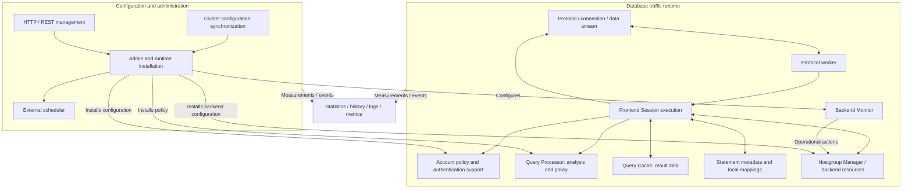

Arrows show collaboration, not one required invocation order. Query Processor outputs are
consumed by Session; the processor is not a network executor or the owner of cache/pool work.
Statistics has concrete storage/exposure modules while its producers remain distributed.

Evidence: Session consumers, [shared Query Processor](../../../lib/Query_Processor.cpp),
[Admin](../../../lib/ProxySQL_Admin.cpp) and [Statistics](../../../lib/ProxySQL_Statistics.cpp).

## 3. Execution contexts

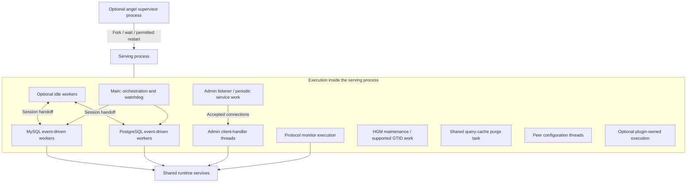

This groups contexts, not exact thread counts. Ordinary workers use `poll()`; conditional
idle handling uses `epoll`. Some other work uses libev. Statistics sampling can run from the
Admin service loop, so no generic dedicated Statistics thread is implied.

Evidence: [main](../../../src/main.cpp), [workers](../../../lib/MySQL_Thread.cpp),
[PostgreSQL workers](../../../lib/PgSQL_Thread.cpp), [Admin loop](../../../lib/ProxySQL_Admin.cpp).

## 4. Configuration representations and runtime ownership

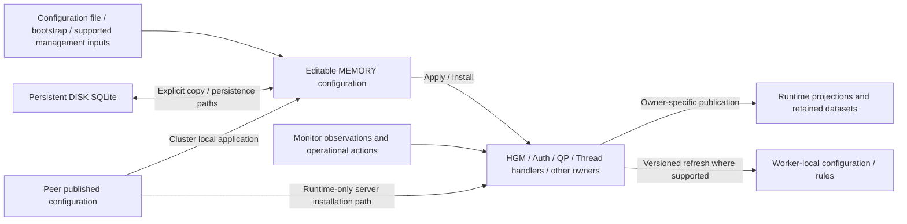

The arrows are distinct transitions. A worker-local copy, a retained resultset and an editable
table are not interchangeable sources of truth. Supported managed-runtime paths provide
additional direct installation adapters. No all-arrows-at-once transaction is asserted.
Runtime-only server synchronization can install directly in HGM, then materialize MEMORY only
for configured persistence; it does not universally traverse MEMORY before runtime.

Evidence: [bootstrap](../../../lib/Admin_Bootstrap.cpp),
[variable application](../../../lib/Admin_FlushVariables.cpp), HGM/QP/thread-handler commit
and refresh paths, [state investigation](../../internal/architecture-state-evidence.md).

## 5. Ordinary frontend login and later backend acquisition

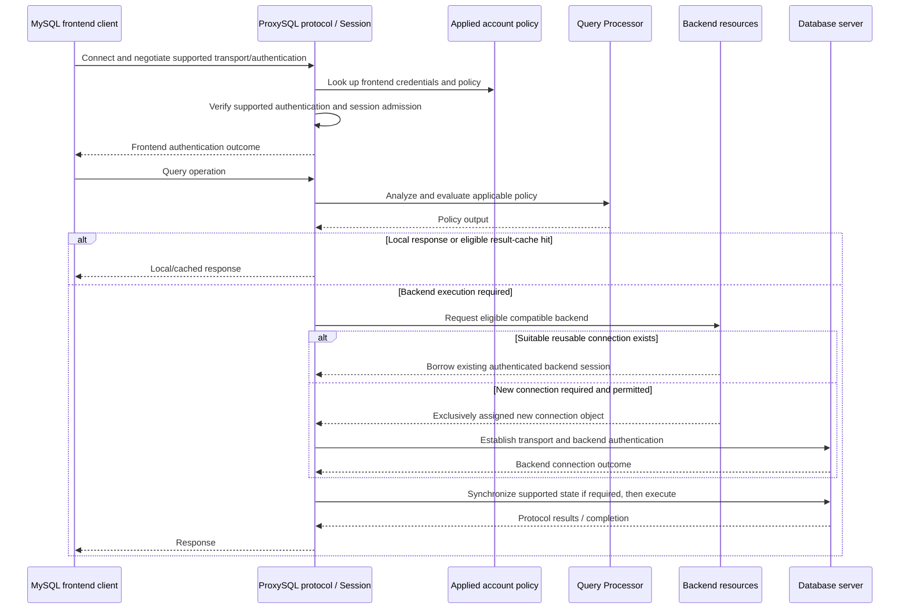

This is the ordinary account-store path, not every optional authentication mode. Passthrough
verification can require a backend probe during frontend login. Backend acquisition and
authentication must not be drawn as mandatory on every successful frontend login.

Evidence: [MySQL protocol](../../../lib/MySQL_Protocol.cpp),
[MySQL Session](../../../lib/MySQL_Session.cpp), [runtime chapter](RUNTIME-ARCHITECTURE.md).

## 6. Frontend and backend identity are separate responsibilities

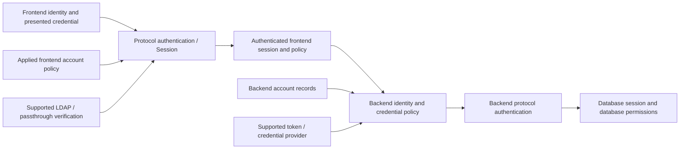

Optional integrations and mechanism support are protocol/tier-specific. This diagram does not
assert that every provider has a shipped consumer, that a certificate automatically authorizes
a database identity, or that frontend SCRAM is transparently relayed to the backend.

Evidence: runtime account stores, protocol authentication, backend-auth policy and
[runtime chapter](RUNTIME-ARCHITECTURE.md).

## 7. Query policy: analysis, rule evaluation and enforcement

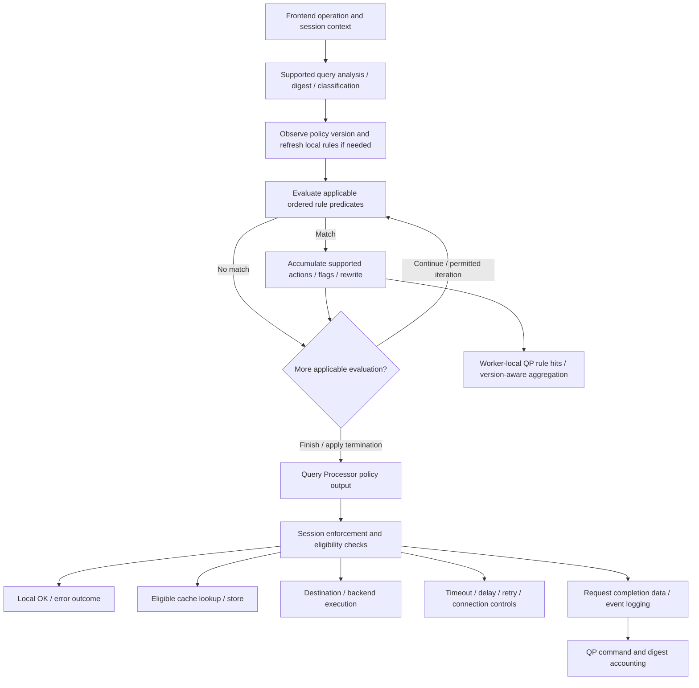

One rule can contribute several actions; they are not mutually exclusive action types. Shared
output fields do not establish support: inspect actual consumers. MySQL mirroring exists;
PostgreSQL's inspected consumer warns and ignores mirror outputs. Some populated legacy fields
lack execution consumers. Annotations and fast-routing paths have their own configured handling.

Evidence: [processor](../../../lib/Query_Processor.cpp),
[output](../../../include/query_processor.h), Session consumers and
[runtime capability matrix](RUNTIME-ARCHITECTURE.md).

## 8. Result cache execution

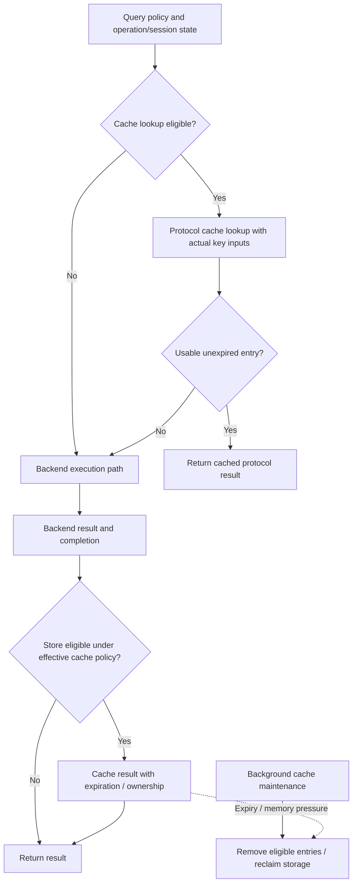

This concerns result data, not backend connection reuse or prepared-statement metadata caching.
Query-digest statistics do not prove the cache key. Prepared and extended-query cache paths,
where implemented, require their protocol-specific eligibility and key handling.

Evidence: [Query Cache](../../../lib/Query_Cache.cpp), protocol caches and Session lookup/store paths.

## 9. Backend acquisition has resource-selection and connection-fit stages

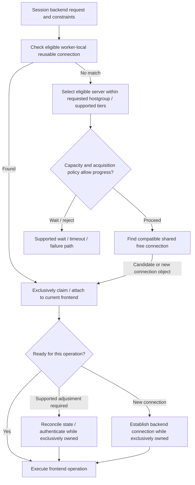

The specific ordering/heuristics and constraints differ by protocol and tier. A local cached
socket can remain accounted as HGM-used until published to the shared free pool. Local/shared
representations must not be counted as two independent resources.
Exclusive assignment precedes authentication, reset or state synchronization. The diagram's
ready-for-execution state is distinct from ownership of the connection object.

Evidence: worker local-pool paths, [MySQL selection](../../../lib/MyHGC.cpp),
[MySQL connection fit](../../../lib/MySrvConnList.cpp), HGMs and [backend chapter](BACKEND-MANAGEMENT.md).

## 10. Reuse, affinity and cleanup: conceptual connection states

```mermaid
stateDiagram-v2
    [*] --> Owned: Allocate exclusively
    Reusable --> Owned: Eligible checkout and attachment
    Owned --> Establishing: New connection
    Owned --> Synchronizing: Supported state adjustment
    Owned --> Ready: Direct compatible reuse
    Establishing --> Ready: Authentication and setup succeed
    Establishing --> Destroyed: Failure
    Synchronizing --> Ready: State established
    Synchronizing --> Destroyed: Unrecoverable failure
    Ready --> Executing: Start operation
    Executing --> Retained: Operation complete; owner still needs backend state
    Executing --> Reusable: Exchange complete and release conditions satisfied
    Retained --> Executing: Same frontend continues
    Retained --> Reusable: Dependency ended and release conditions satisfied
    Owned --> Resetting: Supported reset needed and safe
    Retained --> Resetting: Owner cleanup permits reset
    Resetting --> Reusable: Confirm success and restore tracked state
    Resetting --> Destroyed: Failure / timeout
    Executing --> Destroyed: Unsafe recovery / connection failure
    Reusable --> Destroyed: Expired / no longer eligible
    Destroyed --> [*]
```

These labels are architectural states, not a copy of C++ enums. An active or uncertain
transaction prevents cross-session reuse. A backend usable by its current owner can still
be ineligible for another frontend in either protocol. Reuse does not require reset when
all compatibility/release conditions already hold.

Evidence: Session finish/cleanup paths, connection transaction predicates and
[product invariants I-4 through I-8](../../agents/invariants.md).

## 11. PostgreSQL extended-query processing is frontend orchestration

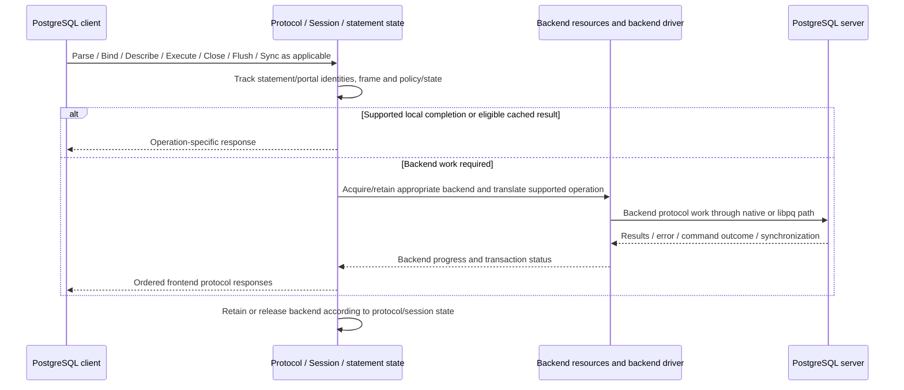

This is a responsibility sequence, not a promise that one frontend message maps one-to-one
to one forwarded backend message. Portal suspension, transaction status, asynchronous
notifications, COPY and batching have additional state. A local batch failure must not be
recovered by accidentally committing backend work through a synchronization/reset action.

Evidence: [PostgreSQL Session](../../../lib/PgSQL_Session.cpp),
[extended messages](../../../lib/PgSQL_Extended_Query_Message.cpp),
[backend connection](../../../lib/PgSQL_Connection.cpp) and [runtime chapter](RUNTIME-ARCHITECTURE.md).

## 12. Monitoring feeds the backend-resource owner

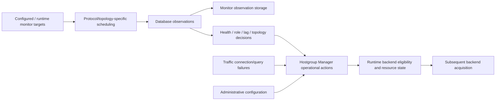

This does not require connect, ping and lag to execute as one serial check chain. MySQL
Galera/Group Replication/Aurora paths and PostgreSQL role/health paths are different. Monitor
history is not the pool, and TSDB reachability probes are not the authority for ordinary
backend role decisions.

Evidence: protocol monitors, HGM action consumers and [backend chapter](BACKEND-MANAGEMENT.md).

## 13. Statistics: producers, projections, retention and export

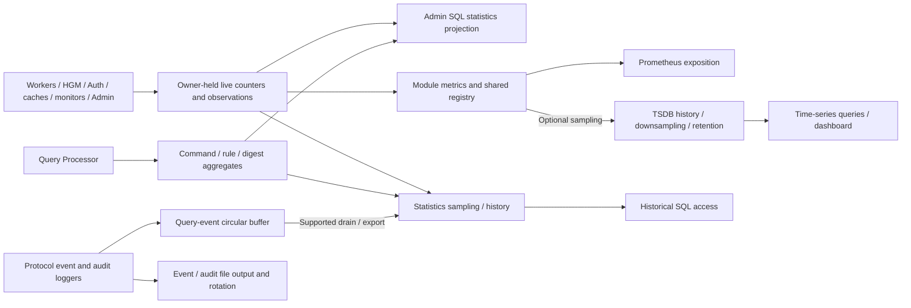

No single statistics queue or universal lock-free map is implied. Admin's service loop schedules
several sampling operations. Read/reset/drain operations have different semantics; exporting
metrics is distinct from constructing a SQL projection or retaining history.

Evidence: [Statistics](../../../lib/ProxySQL_Statistics.cpp),
[Admin stats](../../../lib/ProxySQL_Admin_Stats.cpp), loggers and
[statistics chapter](ADMINISTRATION-AND-STATISTICS.md).

## 14. Embedded storage roles

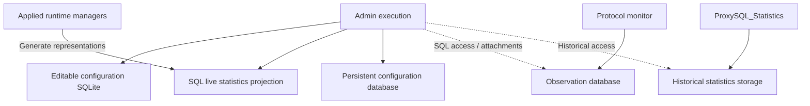

These are logical/database-access roles, not necessarily one file per arrow or one handle per
physical store. The Statistics module and Admin can have separate connections to historical
storage. Runtime structures remain distinct from the SQL rows used to configure or observe them.
No foreign-key cardinality between statistics and configuration is asserted.

Evidence: [Admin bootstrap](../../../lib/Admin_Bootstrap.cpp),
[Statistics construction/schema](../../../lib/ProxySQL_Statistics.cpp).

## 15. Cluster: local pull and installation, without a leader

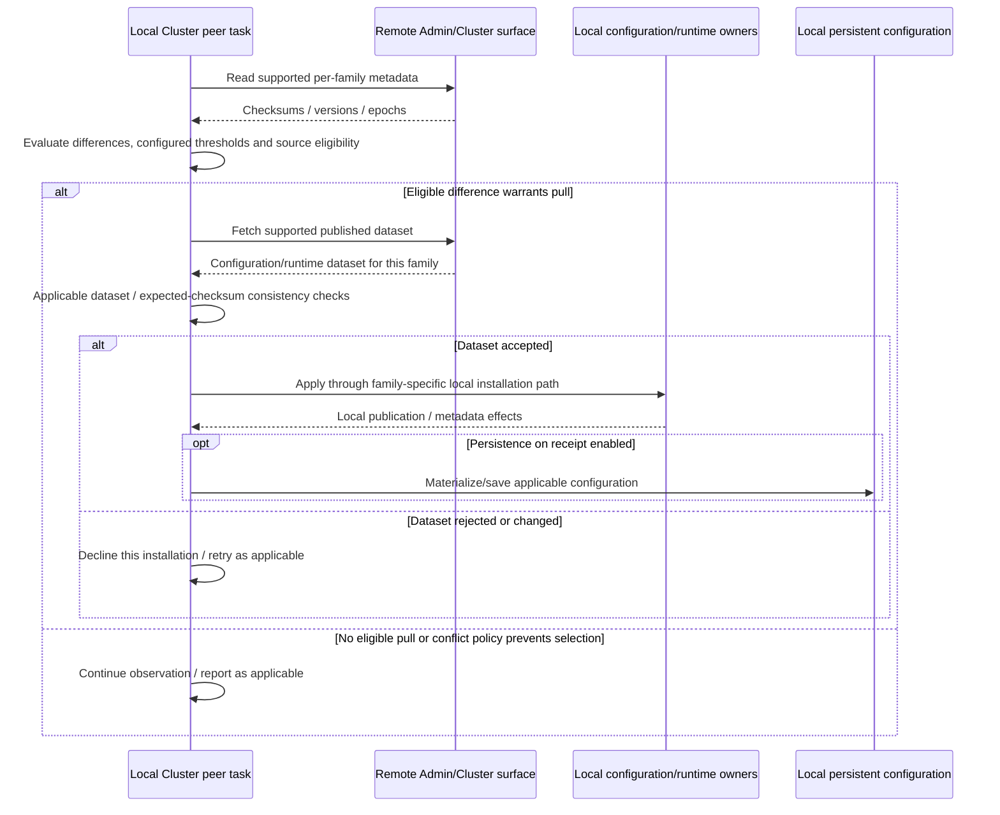

Each participant makes local synchronization decisions. This is not a remote leader pushing
query state to followers. Server datasets can distinguish last-promoted configuration from
runtime server state. Precomputation changes the data source, not the need to establish pointer
lifetime/publication synchronization.

Evidence: [Cluster](../../../lib/ProxySQL_Cluster.cpp), published HGM datasets and
[administration chapter](ADMINISTRATION-AND-STATISTICS.md).

## 16. Lifecycle dependencies and admission

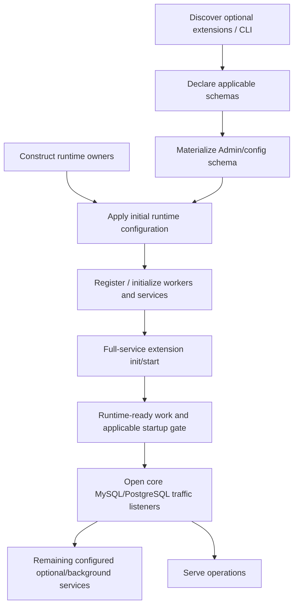

This compresses observed orchestration and justified dependencies; it is not a complete
statement-by-statement startup order. The init/start failure policy differs from the current
runtime-ready failure policy, which can log degraded readiness and continue. Other services
have distinct readiness signals. Non-null object existence is not equivalent to public readiness.

Evidence: [main startup](../../../src/main.cpp),
[startup gate](../../../include/ProxySQL_StartupGate.h), plugin lifecycle interfaces.

## 17. Shutdown, partial-start cancellation and runtime generations

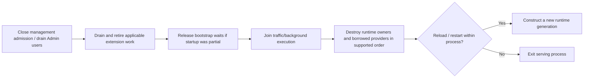

The optional supervisor process can separately restart a failed serving child. Stop and drain
are lifetime operations, not merely reverse construction order. Plugin active-manager calls
have pinning/unpublication protection before stop/unmap; provider/controller leases need their
own supported lifetime guarantees. Plugin stop pairs with successful init even if start fails.

Evidence: [main shutdown/reload](../../../src/main.cpp),
[manager retirement](../../../lib/ProxySQL_PluginManager.cpp), descriptor stop contract.

## 18. Build-time and runtime composition

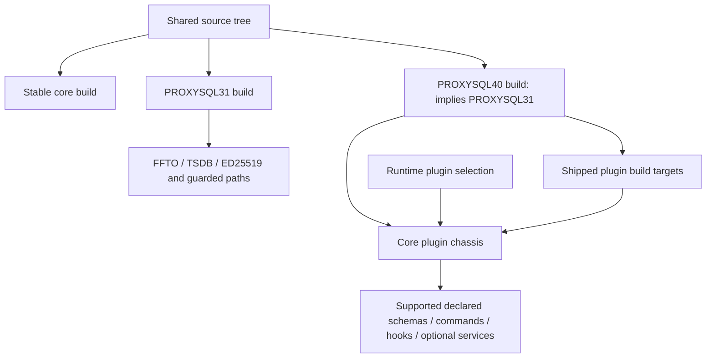

Compiled-out, runtime-disabled, loadable and reserved compatibility interfaces are different
states. The removed server-module registry is not represented as a supported extension just
because a rejecting ABI slot remains.

Evidence: [top-level Makefile](../../../Makefile),
[plugin contract](../../../include/ProxySQL_Plugin.h), plugin implementations and
[layout guide](PROJECT-LAYOUT.md).

## Replacing unsupported legacy pictures

This guide replaces the earlier 38 diagrams with 18 source-grounded views. It does not retain
every earlier diagram or its level of detail. Topic coverage is distributed as follows:

| Earlier topic | Current reference | Scope and remaining limit |
| --- | --- | --- |
| Galera and read-only management | [Backend monitoring](BACKEND-MANAGEMENT.md#63-observations-alter-specific-runtime-properties) | Probe/action ownership and protocol differences are covered; full topology-specific transition diagrams are not reproduced. |
| Group Replication bootstrap | [Router bootstrap guide](../../mysql-router-plugin.md), [legacy core bootstrap source](../../../lib/Admin_Bootstrap.cpp#L222) | The Router plugin has separate documentation. Earlier core/GR bootstrap diagrams were not reverified; legacy bootstrap coverage still needs investigation. |
| TLS and SPIFFE | [Runtime authentication](RUNTIME-ARCHITECTURE.md#32-frontend-and-backend-authentication-are-separate-exchanges), [X.509 guide](../../frontend_x509_authentication.md) | Identity/transport relationships are covered; trust-policy/resource detail remains a gap in the coverage audit. |
| Digest generation and accounting | [Runtime query analysis](RUNTIME-ARCHITECTURE.md#51-query-analysis-is-distinct-from-execution), [query statistics](ADMINISTRATION-AND-STATISTICS.md#query-statistics-are-more-than-one-counter) | Owners, consumers and lifetimes are covered; the older normalization/hash algorithm diagrams are not retained as verified descriptions. |
| Protocol, worker and pool flows | Sections 3 and 5–11 here, [runtime](RUNTIME-ARCHITECTURE.md), [backend resources](BACKEND-MANAGEMENT.md) | Replaced with current ownership and execution views, including protocol/tier qualifications. |
| Configuration, SQL storage and Cluster | Sections 4 and 13–15 here, [administration/statistics](ADMINISTRATION-AND-STATISTICS.md) | Replaced with current representations and producers; earlier detailed ERDs and proposed API/class names are not verified contracts. |
| Kubernetes and multi-region deployment | [Deployment context](#1-deployment-context-traffic-and-configuration-are-different-relationships) | External instance selection and configuration synchronization are distinguished. Earlier deployment recipes were not refreshed; no current Kubernetes recipe is supplied here. |
| Class layout and performance sketches | [Project layout](PROJECT-LAYOUT.md) and subsystem chapters | Source ownership and current mechanisms replace the old sketches; this refresh does not establish benchmark results or a complete class diagram. |

The [coverage audit](../../internal/architecture-coverage-audit.md) records further important
missing contracts and subsystem detail. Pictures asserting a universal digest thread pool,
lock-free measurement architecture, relayed frontend/backend auth, leader-driven Cluster pushes
or mandatory server-status sequences were removed rather than carried forward as current design.
