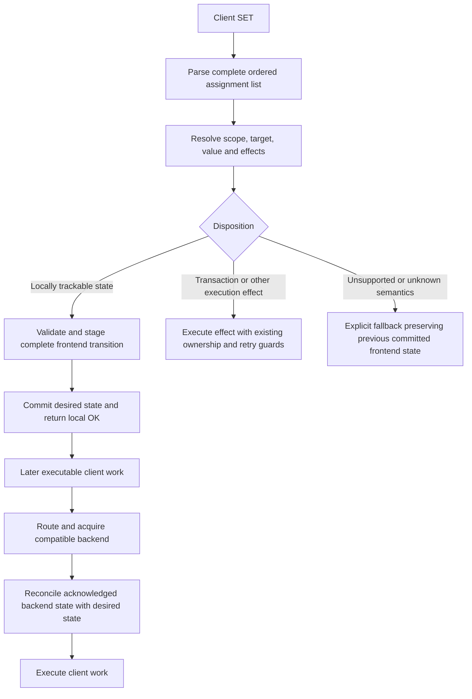

# Review of MySQL SET tracking and backend synchronization

Review date: 2026-10-18. Source baseline: `35e51765d32be27f2c6a4f25b3687142675f68ab`
on `docs/invariants-expansion`, the branch for
[PR #6491](https://github.com/sysown/proxysql/pull/6491).

This is an implementation review and a proposed direction, not a new normative
invariant or an implementation patch. It covers MySQL protocol SET handling;
PostgreSQL SET handling has not been audited here. The independent runtime
control-flow analysis is in
[set-tracking-runtime-evidence.md](set-tracking-runtime-evidence.md).

## Conclusion

The implementation has two conflicting models. Supported system SETs normally
change the frontend's desired session state and return local OK. Supported
user-variable SETs instead execute the original statement on a routed backend
and update the frontend only after backend OK. Delta replay exists, but it does
not make acceptance of a user-variable SET local.

The problem extends beyond that disagreement. Fast handlers, map-based system
parsers, frontend mutation, retry bookkeeping, and replay each enforce different
parts of the contract. The review identified source-backed paths that lose
interpretation context, pending retry state, statement validation, or assignment
order. Adding a mixed-SET allowlist would leave these ownership and lifecycle
problems in place.

The existing bounded user-variable state, exact comparisons, packet-aware delta
replay, and replay-failure retirement are useful components. They should support
a single statement-planning and session-state model.

## Controlling requirement and review method

The maintainer's clarification in this review is the controlling requirement:

* A client may intentionally have a default hostgroup with no usable backend.
* Supported, locally trackable SET assignments update that client's logical
  session without acquiring a backend or requiring that hostgroup to exist.
* Repeating a supported `SET @client_tag='web'` a thousand times must not execute
  a thousand backend SETs. The same principle already motivates local handling
  of supported system variables and `SET NAMES`.
* When subsequent work actually needs a backend, routing selects its destination
  and synchronization establishes the necessary session state before execution.
* Composition should follow the capabilities of the supported assignment
  handlers. It should not introduce a second, smaller list of variable names
  specifically for mixed SETs.

This does not authorize local evaluation of arbitrary SQL expressions or treating
transactional effects as ordinary replayable values. Unknown effects require an
explicit fallback with truthful ownership and backend state.

The review used pinned source, commit history, tests, the originating PR/issues,
and parallel Standards and Spec reviews. The history comparison starts before
the user-variable implementation, at
`a1bacf140523783e58b6b94561cc433018f9b719`. Unrelated changes in large session
files were excluded from conclusions about SET tracking.

Evidence terminology:

* **Source-confirmed:** the control flow or representation is present in the
  pinned source. A proposed SQL probe describes its predicted consequence.
* **Reproduction candidate:** the full observable consequence still requires
  execution, even though a concerning control-flow chain is present.

No ProxySQL integration test was run for this review. This fresh worktree has no
built ProxySQL, and `docker info` failed because the Docker daemon socket is
absent. No binary or dependency artifacts were imported from another worktree.

## Current implementation map

| Stage | Current owner and behavior | Source |
| --- | --- | --- |
| Early COM_QUERY handling | Special handlers run before query-processor SET handling; short `SET NAMES` and some autocommit forms can return local OK here. | [MySQL_Session.cpp](../../lib/MySQL_Session.cpp#L6096), [special handlers](../../lib/MySQL_Session.cpp#L1735) |
| General system SET parsing | Algorithms 1/2 select legacy parsers first; only the following branch tests algorithm 3 or the ParserSQL query-processor setting. All produce a map of target names to values. UDV admission has its own prerequisite check. | [parser selection](../../lib/MySQL_Session.cpp#L8671), [ParserSQL walker](../../lib/Query_Processor_ParserSQL.cpp#L984) |
| System SET interpretation | The session walks the map, validates and mutates frontend values together, handles special effects, and returns local OK when fully handled. | [map walk](../../lib/MySQL_Session.cpp#L8691), [local completion](../../lib/MySQL_Session.cpp#L9272) |
| User-variable admission | Eligible literal-only text SETs preflight a candidate state, retain assignments as pending, and go to the routing epilogue. The preflight candidate is not committed locally. | [UDV admission](../../lib/MySQL_Session.cpp#L8501) |
| Backend preparation | User/schema, initialization, autocommit, charset, system variables, then user variables are reconciled before executable work. | [preparation](../../lib/MySQL_Session.cpp#L7198) |
| Original UDV SET execution | The original SQL executes through `RunQuery`; successful completion commits assignments to both frontend and backend maps. | [execution](../../lib/MySQL_Session.cpp#L7294), [post-OK commit](../../lib/mysql_connection.cpp#L3207) |
| UDV materialization | Exact state comparison skips unchanged entries; changed entries become bounded SET batches; acknowledged batches update backend bookkeeping. | [verification](../../lib/MySQL_Session.cpp#L3174), [replay planner](../../lib/MySQL_User_Variables.cpp#L150) |
| Fallback and ownership | Unsupported/unsafe operations can lock the hostgroup and mark a backend authoritative. Ordinary system tracking is curtailed after locking. | [fallback](../../lib/MySQL_Session.cpp#L8545), [lock installation](../../lib/MySQL_Session.cpp#L6213) |
| Pool compatibility | Known extra UDV names can require CHANGE_USER/reset; compatible state can be reused and changed desired values replayed. | [compatibility](../../lib/mysql_connection.cpp#L749), [pool selection](../../lib/MySrvConnList.cpp#L132) |
| Completion and retries | Request completion clears per-query flags. Some retry paths also clear them before deciding to retry, losing information needed by later completion. | [connect failure](../../lib/MySQL_Session.cpp#L4379), [query failure](../../lib/MySQL_Session.cpp#L7420) |

The frontend state and a backend's materialized state describe different things.
A frontend accepting a locally trackable assignment must not claim that a
backend already applied it. Conversely, a backend that executed a SET must not
be represented as clean merely because pending frontend bookkeeping was lost.

## Spec findings

Severity describes the consequence under the stated conditions. Source analysis
does not substitute for an executed integration regression.

### R1 — P1: supported user-variable SETs require backend execution

**Source-confirmed.** At [admission](../../lib/MySQL_Session.cpp#L8512), `stage`
validates resource bounds into a temporary candidate. The session stores pending
assignments and takes the qpo epilogue instead of committing the candidate and
returning local OK. The caller creates/uses a backend, executes the original SQL,
and only then calls [the post-OK helper](../../lib/mysql_connection.cpp#L3207).

This directly contradicts the nonexistent-default-hostgroup requirement. It also
means identical repeated SETs still execute, even if backend replay determines
that the previously committed desired state already matches.

The test suite explicitly endorses this behavior:
[routing disposition](../../test/tap/tests/unit/parsersql_unit-t.cpp#L694) requires
forwarding, and [post-OK tests](../../test/tap/tests/unit/parsersql_unit-t.cpp#L713)
require simultaneous frontend/backend updates. Those tests validate the current
implementation's premise rather than the clarified session contract.

### R2 — P1: mixed composition is rejected before existing capabilities can apply

**Source-confirmed.** The
[UDV analyzer](../../lib/Query_Processor_ParserSQL.cpp#L716) rejects a SET with
non-user-variable targets; the session takes connection-bound fallback. Thus:

```sql
SET @client_tag='web', SESSION max_execution_time=1000,
    SESSION wait_timeout=600;
```

does not combine the existing supported handlers. Current trunk rejects all
mixed user/system SETs. The narrow two-variable exception belonged to closed
PR [#6480](https://github.com/sysown/proxysql/pull/6480); it is not present in the
reviewed trunk. The
[integration fallback table](../../test/tap/tests/mysql-user-variable-tracking-t.cpp#L937)
currently expects a mixed statement to bind.

A shared planner must distinguish assignment capabilities, scopes, and effects.
It must not equate a heterogeneous assignment list with an inherently unsafe
statement, or equate parser success with local evaluability.

### R3 — P1: allowed retry can execute a SET after dropping its tracking state

**Source-confirmed lifecycle defect; isolation consequence not reproduced.**
Both [connection failure](../../lib/MySQL_Session.cpp#L4379) and
[query failure](../../lib/MySQL_Session.cpp#L7420) clear pending assignments and
the user-variable disposition flags before the code decides whether to reconnect
and retry. An allowed retry resumes backend processing rather than reparsing the
frontend packet. Successful completion therefore cannot take the pending-SET
commit path.

For an eligible, initially unlocked literal SET, this can leave the actual
backend value absent from both tracking maps. With
`mysql-set_query_lock_on_hostgroup=1`, the legacy
[SET status classifier](../../lib/mysql_connection.cpp#L3128) sets the
USER_VARIABLE status only when the session was locked. The originally supported
SET did not acquire that lock. An otherwise reusable, transaction-free backend
can consequently reach [pool return](../../lib/MySQL_Session.cpp#L10932) with
unrepresented user-variable state. Known-extra-name checks cannot detect a name
missing from the backend map itself.

Reproduce separately for connect retry before first execution and query retry
after a recoverable transport/server error. The ordinary retry guards for active
transactions, multiplexing, retry budgets, and partial results still apply; this
finding does not claim retries bypass those guards.

### R4 — P1: plain SET NAMES bypasses user-variable interpretation safeguards

**Source-confirmed gap; resulting metadata difference not reproduced.** The short
plain [SET NAMES handler](../../lib/MySQL_Session.cpp#L1879) changes frontend
charset and returns local OK before the qpo context-change guard runs. The
[UDV entry](../../include/MySQL_User_Variables.h#L46) retains a raw literal, kind,
target, and hash, without its assignment-time charset/collation context.

For a deterministic probe, enable user-variable tracking and its parser
prerequisite, start without a hostgroup lock/backend-authority flag, and disable
backend system-variable session notifications. Use two destinations and a
backend that lacks the variable:

```sql
SET NAMES utf8mb4;
SET @context_value='value';
SET NAMES latin1;
-- Route the following executable query to the other destination:
SELECT CHARSET(@context_value), COLLATION(@context_value);
```

Backend preparation applies the current charset
[before replay](../../lib/MySQL_Session.cpp#L7231). Replaying the old raw string
under latin1 changes its metadata instead of preserving the utf8mb4 value's
metadata. Even ASCII text exposes this through `CHARSET`/`COLLATION`; the issue
does not require guessing how non-ASCII bytes will convert.

The existing
[context regression](../../test/tap/tests/mysql-user-variable-tracking-t.cpp#L1111)
uses `/* uv_hg_b */ SET NAMES latin1`. Its leading comment bypasses the short
plain fast path and reaches the qpo binding safeguard. That test cannot validate
the plain form. The tracking latch preserves classification across configuration
changes; it does not reconstruct missing value context.

### R5 — P1: system SET validation can leak staged state into backend execution

**Source-confirmed mutation path; SQL probe not executed.** Start with a fresh,
unlocked frontend, ordinary default fallback locking, and max_execution_time
different from 1. Consider:

```sql
SET sql_safe_updates='INVALID',max_execution_time=1;
```

The map walk handles `max_execution_time` first and
[mutates frontend state](../../lib/MySQL_Variables.cpp#L676). The boolean parser
then rejects the other value and requests fallback. The caller locks the
hostgroup, but first-time variable synchronization still runs while
`locked_on_hostgroup_and_all_variables_set` is false. Consequently, the premature
frontend update can become an internal backend SET before the original failing
statement is sent.

MySQL documents that a failed variable assignment makes the whole SET fail
without changing variables. A separate internal SET sent beforehand is outside
that protection. The predicted observable consequence is that a subsequent
`SELECT @@max_execution_time` reports the prematurely applied value despite the
client receiving an error. See
[MySQL SET error handling](https://dev.mysql.com/doc/refman/8.4/en/set-variable.html).

The source also intentionally keeps tracking known targets when another target
is unknown, before [falling back](../../lib/MySQL_Session.cpp#L9180). Therefore
the underlying issue is not limited to this invalid boolean. Frontend values,
autocommit, status flags, timeout policy, and coupled-variable updates all belong
in the staging boundary.

### R6 — P1: autocommit fast handling can accept a prefix and discard the tail

**Source-confirmed.** In an unlocked session whose autocommit is already enabled
and whose sql_safe_updates has first been set to 1:

```sql
SET autocommit=1 ,sql_safe_updates=0;
```

The [fast scanner](../../lib/MySQL_Session.cpp#L1548) stops at whitespace after
its first value. It does not establish that the rest of the statement is empty
before [returning OK](../../lib/MySQL_Session.cpp#L1601). The second assignment
never reaches the general SET parser. An invalid tail can be hidden by the same
prefix acceptance.

Full-statement validation must be shared by fast and general paths. Merely
changing which parser the qpo path uses cannot fix an earlier return.

### R7 — P1: map conversion destroys validation and assignment semantics

**Source-confirmed representation loss.** The legacy parsers overwrite repeated
keys ([parse1](../../lib/MySQL_Set_Stmt_Parser.cpp#L147),
[parse1v2](../../lib/MySQL_Set_Stmt_Parser.cpp#L430));
[ParserSQL](../../lib/Query_Processor_ParserSQL.cpp#L1137) does so too, after
canonicalizing aliases. The session subsequently walks keys alphabetically.

For example:

```sql
SET sql_safe_updates='INVALID',sql_safe_updates=1;
```

loses the invalid occurrence before semantic validation, allowing the remaining
valid occurrence to receive local OK. Last-assignment-wins is not permission to
skip validation of earlier assignments.

Distinct keys can also interact. Start with max_join_size different from 1, so
the tracked-value change and its side effect both execute:

```sql
SET sql_big_selects=1,max_join_size=1;
```

The source processes `max_join_size` first, applies its
[sql_big_selects side effect](../../lib/MySQL_Variables.cpp#L682), then sets
`sql_big_selects` back to ON. That reverses the effect implied by the SQL source
order. MySQL documents the coupling between these variables in
[server system variables](https://dev.mysql.com/doc/refman/8.4/en/server-system-variables.html#sysvar_max_join_size).
Charset/collation assignments have similar coupling and need ordered coverage.

Use an ordered assignment representation through validation and semantic
application. Only after those steps may pure final state be coalesced for delta
replay. Map-based tests alone cannot expose information already discarded by
the parser interface.

### R8 — P2: the qpo context guard also binds assignments that change nothing

**Source-confirmed conservative behavior; optimization/design issue.** For forms
that reach qpo, the
[context classifier](../../lib/Query_Processor_ParserSQL.cpp#L951) recognizes
target names rather than comparing current and proposed context. Once a UDV is
tracked, assigning an already-current sql_mode, or an already-current charset
through a commented SET NAMES, still triggers fallback and backend ownership.

The plain short SET NAMES form has the separate R4 bypass; it must not be cited
as an example of this binding behavior. The planner needs a semantic context
delta, plus a way to preserve already-created values when a real change occurs.

## Conditional reproduction candidate: failed SET followed by ROLLBACK

**C1 — possible unintended commit when hostgroup locking is disabled, not
established by execution.** With `mysql-set_query_lock_on_hostgroup=0`, or a
query rule that prevents the fallback lock, and active writes under
autocommit=0, inspect:

```sql
SET autocommit=1,sql_safe_updates='INVALID';
ROLLBACK;
```

There is deliberately no space before the comma in the SET, so this reaches the
general parser rather than R6's prefix fast path. The general walker changes
frontend autocommit and `sending_set_autocommit`
[before later validation fails](../../lib/MySQL_Session.cpp#L8884). The first
forwarding skips internal autocommit synchronization because of that flag. The
original statement should fail; the locked-session autocommit refresh at
[successful completion](../../lib/MySQL_Session.cpp#L7355) does not execute on
that error path.

In this explicitly unlocked case, subsequent input invokes the fast autocommit
handler and resets the sending flag. Backend
[autocommit verification](../../lib/MySQL_Session.cpp#L3299) can then schedule
an internal autocommit=1 before the client's rollback. If the active transaction
survives the error and is retained on that connection, this would commit it.
Backend error-status handling, transaction uncertainty, and retention must be
verified with an executed test before claiming transaction loss.

The initially suspected default-policy version of this chain was withdrawn
during independent fact checking. Default fallback installs a hostgroup lock,
and [the special-handler gate](../../lib/MySQL_Session.cpp#L1751) then skips the
autocommit handler on the following ROLLBACK. The sending flag therefore stays
set and the hypothesized internal autocommit operation does not follow from
that trace. This candidate is not counted among the source-confirmed findings.

This candidate reinforces R5's staging requirement. It is not a reason to remove
the legitimate execution of autocommit=1 when a valid statement must commit an
active transaction.

## Standards review

The independent Standards review found two maintenance concerns, rather than a
proven formatting violation:

1. [CONTRIBUTING.md](../../CONTRIBUTING.md#L50) asks for focused, maintainable
   functions. SET admission, classification, fallback, completion, reset, and
   retry state span large session handlers plus public per-query fields. A new
   case requires coordinated edits at several lifecycle points. This is an
   application of a broad standard, not an objective function-size limit.
2. The repository's
   [repeated-fix guidance](../agents/common-mistakes.md#L366) calls for
   design review after repeated fixes to one mechanism. UDV admission/completion
   received multiple such fixes after introduction. That history supports
   reviewing the mechanism now; it does not prove earlier reviews or maintainer
   approval were absent.

Additional design judgments: system-variable name/type classification is
duplicated between session-local sets and `mysql_tracked_variables` descriptors,
and user-variable handling adds a parallel state lifecycle. These are reasons
to consolidate semantic ownership. They are not separate runtime bug claims.

## What a generic solution must own

The useful abstraction is a frontend session-state transition with explicit
execution effects. It is larger than a parser helper and smaller than rewriting
the whole session engine.



The design needs the following responsibilities in one auditable contract:

1. **Complete syntax and ordered semantics.** Retain every assignment and scope,
   canonicalize identities without discarding occurrences, validate all values,
   and apply coupled-variable effects in source order. Prefix fast paths must
   use the same statement eligibility decision.
2. **Capability-driven composition.** Resolve existing system-variable handlers,
   UDV handlers, frontend-only policy variables such as wait_timeout, and
   deliberately ignored targets through explicit capabilities. Supporting mixed
   lists must not require copying supported names into a new allowlist.
3. **Atomic local acceptance.** Stage the complete desired-state transition,
   including frontend flags and policy values. Commit only when the statement's
   local semantics are fully known. A fallback must not synchronize partially
   accepted new values ahead of the original SQL.
4. **Stable value meaning.** A tracked UDV must retain its value, type, and
   relevant interpretation metadata across charset/sql_mode changes and backend
   migration. Keeping raw SQL spelling alone does not establish this. Choosing
   typed values, context-aware encoding, or another representation needs a
   deliberate design; this review does not prescribe an unverified encoding.
5. **Separate desired state and acknowledged materialization.** Local SET
   acceptance changes the frontend. Backend metadata changes when internal
   application is acknowledged, or becomes unknown/retired on failure. System
   variable bookkeeping currently written ahead of asynchronous application
   also needs an explicit in-flight-state contract during implementation.
6. **Explicit execution effects.** Autocommit transitions that close a live
   transaction, next-transaction characteristics, GLOBAL/PERSIST operations,
   server-evaluated expressions, hidden writes, prepared statements, and
   unknown/untracked state need classified handling. A syntactically valid SET
   is not automatically safe for local acceptance or arbitrary reordering.
7. **Query-lifetime retry state.** Preserve a statement's disposition and required
   bookkeeping across an allowed attempt retry, while discarding attempt-local
   backend state. Distinguish retry from terminal failure and client completion.
8. **Compatible reuse without mandatory reset.** Matching settings can share a
   backend. Known extra state, unknown state, active/uncertain transactions,
   exclusive resources, and reset truthfulness remain separate compatibility
   and ownership constraints. An implementation fix must not replace this with
   reset-on-every-borrow.

These requirements preserve the existing safety rules: no lending exclusive
state to another owner; no migrating an active or uncertain transaction; no
cleanup that accidentally commits work; no claim of clean reset without the
corresponding operation; and no retry after a forbidden transaction/result
boundary.

## Acceptance and regression matrix

The tests should observe client semantics, backend work, and ownership. A unit
test that only mirrors a disposition helper is insufficient.

| Scenario | Required observation |
| --- | --- |
| Default hostgroup deliberately has no servers | Supported system, UDV, and mixed pure-state SETs receive local OK without backend acquisition. A later routed query succeeds with their values. |
| A thousand identical SETs before executable work | Zero client-SET forwards and no backend acquisition attributable to those SETs; desired state stays bounded. |
| Matching backend already has desired state | No redundant internal SET; direct compatible reuse is allowed. |
| Backend differs in one desired value | Only required changes materialize before executable work. |
| Mixed targets across all existing supported categories | Composition follows their capabilities; no special two-variable mixed list. Frontend-only policy targets retain their policy behavior. |
| Duplicate targets and aliases | Every occurrence is validated; valid ordered final state and coupled side effects agree with the reference server. |
| Invalid first/middle/last assignment | No partial frontend values/flags/policy leak into fallback synchronization. Compare backend values after the client error. |
| Plain, commented, rewritten, long, and scoped forms | Equivalent semantics across fast and general paths; no unexamined tail or context-guard bypass. |
| Charset/collation/sql_mode changes after UDV assignment | HEX, type, CHARSET, and COLLATION remain correct after reuse/migration; test plain SET NAMES as well as commented variants. |
| Autocommit and live transaction | Valid effects happen on the owning backend; rejected SET followed by ROLLBACK cannot commit earlier work. Include savepoint/uncertainty cases. |
| Connect retry and eligible query retry | Desired state and bookkeeping survive allowed retry; no unrepresented state returns to the pool. Ineligible retries remain forbidden. |
| Replay batch failure or packet/resource bound | Client work does not execute against incomplete state; partial/unknown backend state is retired or otherwise excluded safely. |
| Client reset, CHANGE_USER, and backend reset | Frontend and backend state clear at their proper boundaries, with accurate ownership and tracking metadata. |
| Two clients with equal/different/extra UDV names | Compatible reuse works; another client cannot observe extra or unrepresented variable state. |
| Tracking mode/parser setting changes mid-session | Existing tracked state drains or remains classified safely; changing settings cannot silently erase responsibility. |
| Query rewrite, rejection, caching, and prepared paths | Disposition is based on the statement actually handled; local acceptance preserves the established query-policy contract and unsupported effects remain explicit. |

## Why the existing review process accepted the wrong model

The original user-variable work in
[PR #6043](https://github.com/sysown/proxysql/pull/6043) explicitly chose
forward-first/post-OK tracking.
[Issue #6479](https://github.com/sysown/proxysql/issues/6479) likewise requested
forwarding the original mixed statement unchanged and committing frontend and
backend maps after OK. It proposed broader existing-system-variable support
than the two-variable subset in #6480, but still used the wrong acceptance
model under the maintainer's clarification.

The relevant history includes these successive changes to the same
admission/completion/fallback mechanism:

| Commit | Date | Commit subject |
| --- | --- | --- |
| [6781e4b36](https://github.com/sysown/proxysql/commit/6781e4b36) | 2026-08-12 | feat: commit literal user-variable SETs on backend OK |
| [07b24298d](https://github.com/sysown/proxysql/commit/07b24298d) | 2026-08-12 | fix: harden literal user-variable SET tracking |
| [2556c2a75](https://github.com/sysown/proxysql/commit/2556c2a75) | 2026-08-12 | fix: harden user-variable fallback lifecycle |
| [764080c80](https://github.com/sysown/proxysql/commit/764080c80) | 2026-08-13 | fix: address user variable review findings |
| [4013773cb](https://github.com/sysown/proxysql/commit/4013773cb) | 2026-08-13 | fix: harden user variable replay state |

The titles and sequence are historical evidence of repeated adjustments; the
current source traces above establish the present defects. This review does
not infer that every historical fix was unnecessary or that no design review
occurred.

A review against that issue could therefore approve forwarding, staged
post-backend commits, and tests asserting those operations while missing the
architectural error. The intended session-state ownership model must be an
explicit review input. Existing documentation that describes post-OK tracking
is evidence of current behavior, not independent justification for it.

## Recommended implementation sequence

1. Reproduce R3/R4/R5/R6/R7 and C1 using current-source builds and the existing
   isolated test infrastructure; preserve the failing probes as behavior tests.
   The unavailable Docker daemon is the current local execution limitation.
2. Define and implement the ordered statement plan, assignment capabilities,
   and complete frontend staging boundary. Adapt existing handlers into that
   interface instead of creating another mixed parser/variable list.
3. Make eligible UDV and mixed pure-state SETs locally accepted. Keep backend
   reconciliation separate, preserving value interpretation and acknowledged
   state across retries and context changes.
4. Exercise the matrix above and review ownership, transactions, errors, and
   reuse independently. Only then promote the agreed contract into normative
   invariants and specialist documentation, updating tests that currently
   mandate forwarding and post-OK frontend acceptance.

This SET review is maintained with the architecture and invariant documentation
in PR #6491. Its changes are limited to these two review documents.

## Review validation

The consolidated findings received independent source fact checks from both
reviewers. Corrections included parser-selection precedence, the plain versus
commented SET NAMES paths, probe initial-state requirements, and withdrawal of
C1's default-lock variant. Across the two review documents, 244 local links and
242 numeric source anchors were checked for canonical file paths and valid line
bounds. The proposed flow diagram rendered successfully with Mermaid CLI.
Whitespace checks passed. These are documentation checks, not executed
validation of the SQL probes or production behavior.
