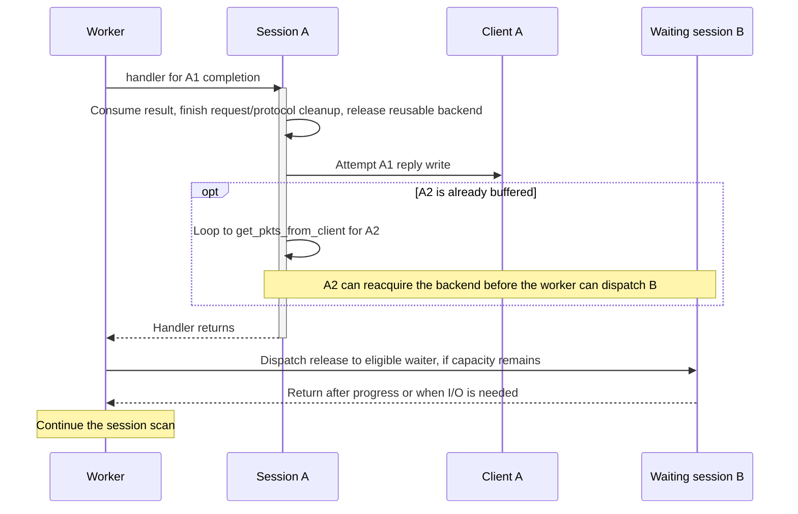
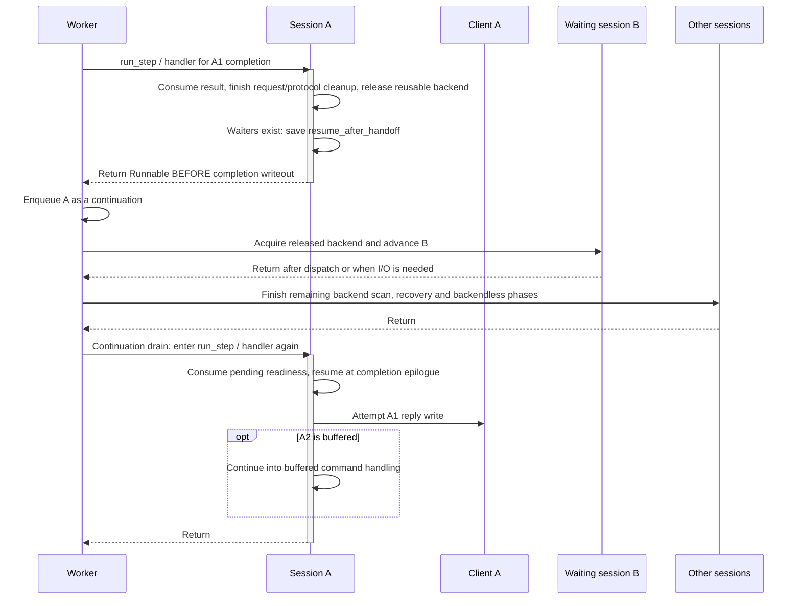
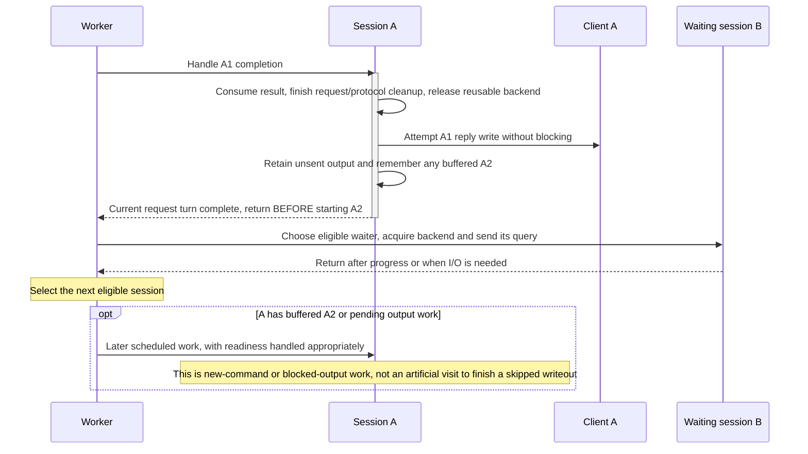

# PostgreSQL session scheduling: previous order, current order, and the completion boundary

**Status:** the request-boundary correction is implemented in `4facb95bf`. The diagrams distinguish the older phased scheduler, the superseded pre-write continuation design, and the current implementation. The diagnostic yield switch used during the investigation is not in the PR.

The current handler finishes request/protocol cleanup and attempts the nonblocking client reply write **before returning to the worker**. If releasing the backend found waiters, another buffered command from the same client is retained as runnable work rather than started immediately. The worker then dispatches released capacity to an eligible waiter.

A client with no buffered next request needs no artificial continuation to finish its reply. Unsent output after a short write remains normal `POLLOUT` work.

## What “finish a session” means here

A session is a long-lived client connection; finishing its current turn does not close that connection. A handler advances that session until it reaches a scheduling boundary or needs I/O. A backend query that is still running cannot be completed synchronously by waiting inside the worker.

For the completed simple-query case discussed here, there are three different boundaries:

| Boundary | What is finished | What can remain |
|---|---|---|
| Backend completion and cleanup | The result has been consumed; protocol/transaction bookkeeping is settled; a reusable backend can be detached | Client output and another buffered client command |
| Current request's completion work | Cleanup plus the normal nonblocking output attempt | Unsent bytes if the socket is full; another buffered client command |
| End of the old handler invocation | Work the handler chose to advance before returning | It may already have started the client's next buffered request |

`writeout()` is nonblocking. “Attempt the client write” does not mean wait for the client to receive every byte. Retained output resumes through `POLLOUT`; a slow client must not block other sessions. Large responses may also have forwarded earlier chunks before the final completion writeout.

## Which previous implementation?

“Previous” must name a revision because the PR already changed scheduling before the recent continuation patch.

| Version | Revision | Scheduling distinction |
|---|---|---|
| Upstream base of this PR | `f02fbf1bb` | After-poll socket processing performs reads. Backend-session scan precedes a separate waiter retry scan and the remaining backendless sessions. |
| Previous phased implementation used as the benchmark control | `9dfe548bc` | Reads are deferred into handlers. Initial waiter service and early frontend dispatch precede backend-session processing. Releases dispatch waiters after a handler returns. No completion-continuation queue. |
| Superseded completion split | `c94fbe056` | Keeps those phases, adds explicit step/checkout outcomes, and can return before completion writeout. A continuation queue finishes that work later. |
| Current request boundary | `4facb95bf` | Complete the current request's response work, return before another buffered request, then select the next eligible session. |

These are the development scheduling paths compiled with `PROXYSQL31`; the diagrams do not describe the stable build without that define.

## Worker processing order: upstream, previous phased, and current

These diagrams show normal scheduling phases, not every authentication, maintenance, cancellation or error branch. Eligibility, pauses and deadlines still determine whether a session can run. Partitioning affects scan order when enabled; session names below do not imply permanent array positions.

```mermaid
flowchart LR
    subgraph U["Upstream base f02fbf1bb"]
        direction TB
        U0["poll returns"] --> U1["AfterPoll walks sockets and performs reads / packet framing"]
        U1 --> U2["Scan sessions with backends, each handler runs until it returns"]
        U2 --> U3["Separate retry scan of backend waiters"]
        U3 --> U4["Process remaining backendless sessions"]
        U4 --> U5["Remaining outer-loop work, next poll"]
    end
    subgraph P["Previous phased 9dfe548bc"]
        direction TB
        P0["poll returns"] --> P1["Capture readiness, defer socket reads to handlers"]
        P1 --> P2["Retry existing waiters using available capacity"]
        P2 --> P3["Early frontend dispatch, stop at first established-backend miss"]
        P3 --> P4["Scan backend sessions, AFTER each handler returns, dispatch releases to waiters"]
        P4 --> P5["Waiter recovery / deadlines, remaining backendless sessions"]
        P5 --> P6["Remaining outer-loop work, next poll"]
    end
    subgraph C["Current request boundary"]
        direction TB
        C0["poll returns"] --> C1["Capture readiness, defer socket reads to handlers"]
        C1 --> C2["Retry existing waiters using established-only checkout"]
        C2 --> C3["Early frontend dispatch, stop at first established-backend miss"]
        C3 --> C4["Scan backend sessions, finish cleanup and attempt reply write, return before buffered A2, dispatch waiter B"]
        C4 --> C5["Waiter recovery / deadlines, remaining backendless sessions"]
        C5 --> C6["Drain bounded buffered-next-command queue, respect pauses"]
        C6 --> C7["Remaining outer-loop work, poll cannot block with eligible buffered work"]
    end
```



All phased versions interleave waiter dispatch with backend-session processing. The boundary correction changes **where A returns**: its current reply write is attempted before B runs. A later queue visit is necessary only for an already-buffered next command. Release dispatch is also checked after initial waiter service, early frontend handlers, recovery, remaining backendless handlers and queued steps.

## Previous phased order: finish the handler, then dispatch a waiter

In a single worker, assume A has just received the result for query A1, B is waiting for a compatible backend in the same hostgroup, and A may already have another query A2 buffered. The backend is reusable after A1. This example describes a successful normal completion; pinned transactions and other non-reusable backends do not take this release path.



There are two cases:

- **No A2 buffered:** A's completion writeout is attempted, the handler returns, and B can be dispatched. A needs no extra visit merely to perform that writeout.
- **A2 buffered:** the handler's tail can jump back to `get_pkts_from_client()` before returning. A2 may consume the released backend ahead of B. Moving to “the next session after handler return” alone did not fix this because the handler could start another request before that return.

This is the distinction between finishing the **current request** and allowing the current handler to drain more work from the same client.

## Superseded order at c94fbe056: split A's completion around other sessions

The release notification guard, retained in the current implementation, is:

```cpp
if (scheduler_managed && thread && thread->waiter_lists.head(hostgroup))
    yield_after_release = true;
```

It checks for waiters, not for a buffered A2. **In the superseded implementation**, the handler later reached its completion label with `status == WAITING_CLIENT_DATA`, set `resume_after_handoff`, and returned before the normal `writeout()` call. `run_step()` reported `Runnable`, and the worker queued A once. The current code removes that resume flag and pre-write return.



“Yield” here is an ordinary function return with saved session state. It is not an operating-system thread yield, coroutine stack switch, or recursive call from A into B. A's handler stack has unwound before B is called. **Nevertheless, it is a logical interruption of A's completion work**, because its completion writeout is still pending.

The pending reply belongs to A; it is not handed to B. The continuation preserves A's unfinished work even if A receives no new socket event. It also adds another handler entry and defers that writeout. New continuations created while draining the bounded snapshot remain for the next iteration, whose poll timeout is forced to zero. Teardown cancels queued entries; idle-thread migration is blocked while a continuation belongs to this worker.

For the small `SELECT 1` response, this postpones the reply itself. For a response that already streamed data, it postpones the completion writeout rather than necessarily the entire response.

## Current order: switch after current response work, before the next request

The handler now reaches `writeout()` before deciding whether to return `Runnable`. It returns that outcome only when it is back in `WAITING_CLIENT_DATA`, has buffered packets in `PSarrayIN`, and the request's backend release found waiters. Without buffered packets, it returns normally and the worker dispatches the release without scheduling another completion visit.



This separates two decisions that the superseded patch coupled:

1. **End A's current request turn at the proper boundary.** Cleanup and the normal output attempt belong to that turn. Another buffered command must not silently extend it past an eligible waiter.
2. **Choose the right session next.** The worker can prefer B using the released connection's hostgroup and eligibility. It need not simply advance to the next array element.

The existing deduplicated queue now holds buffered next-command work. Its bounded drain enters the normal handler, not a special completion epilogue. This work survives `to_process` resets and does not depend on another `POLLIN`. A pause introduced by reply throttling keeps the entry queued until its deadline; poll sleeps until that deadline unless another entry is eligible. Killed/unhealthy entries are eligible for immediate cleanup. Teardown cancels entries and idle migration remains blocked while queued.

A short write retains its normal writable-event path. It does not queue a completion-only handler visit. The scheduler never waits for the client to drain its socket before serving other sessions.

This boundary must be defined at a completed protocol operation. Extended-query Sync/portal bookkeeping, transaction pinning, cancellation and error cleanup cannot be bypassed by treating every PostgreSQL message as a completed request. The change leaves those cleanup paths in place and moves only the scheduling decision at the existing completed-operation tail.

## What the measurements establish

The initial fresh-instance control/candidate comparison reported 43,346 versus 42,703 TPS. A reversed-order pair changed the sign, so that single pair did not establish the exact net cost of the complete branch.

A later diagnostic used the **same proxy process, client connections and ten established backends**, with only the request-to-yield guard switched ON / OFF / OFF / ON. The workload remained `SELECT 1`, no TLS, five hundred clients, sixteen pgbench jobs, one proxy worker, and native backend protocol.

| Average metric | Yield ON | Yield OFF |
|---|---:|---:|
| TPS | 43,261 | 43,962 |
| CPU cycles/query | 55,248 | 54,378 |
| CPU microseconds/query | 23.045 | 22.684 |
| Full handler entries/query, separate call trace | 4.100 | 3.100 |
| Continuation enqueues/query, separate call trace | 1.000 | 0 |

Both ON windows were slower than both OFF windows; cycles/query increased about 1.60% with yielding, and observed CPU frequency stayed effectively unchanged. All pool snapshots retained ten backends, ConnOK stayed at ten, and no transactions failed. Call probes were attached only after the throughput/cycle windows and are used for call counts, not throughput.

This isolates the cost of the **whole yield path**, including queueing, handler reentry and changed client-write timing. It does not assign all extra CPU time to the queue container. Turning yielding off in a diagnostic is not a complete production fix: the buffered-A2 ordering case still needs the proper request boundary.

## Other implemented contracts

`run_step()` reports waiting for I/O, waiting for a backend, an established-only miss, runnable buffered work, or close. Consumed work clears `to_process`; an established-only miss remains eligible for ordinary recovery. The previous dispatched-session vector and its linear membership searches were removed.

Established-only checkout can acquire a compatible, connected, idle backend. It cannot create, warm or evict a connection, park the session, impose a retry delay, or account an ordinary checkout failure. Initial and inline waiter dispatch use this policy; recovery/deadline processing retains normal acquisition. Early frontend dispatch retains its global stop on the first established-only miss.

Retryable plaintext send errors (`EINTR`, `EAGAIN`, `EWOULDBLOCK`) preserve unsent output, including after `POLLOUT`: readiness is not a reservation of socket capacity. Fatal send errors still close the stream.

Allocation ownership is a separate change. Native result-buffer failure remains terminal. Libpq notice callbacks return normally for C cleanup; sticky failure propagates at C++ parser boundaries before successful dispatch or reuse. COPY buffers have scoped cleanup.

## Source map and verification scope

| Behavior | Source |
|---|---|
| Upstream reads and waiter-after-backend scan | [`PgSQL_Thread.cpp` at `f02fbf1bb`](https://github.com/sysown/proxysql/blob/f02fbf1bb/lib/PgSQL_Thread.cpp#L3805) |
| Previous handler writeout then buffered-command loop | [`PgSQL_Session.cpp` at `9dfe548bc`](https://github.com/sysown/proxysql/blob/9dfe548bc/lib/PgSQL_Session.cpp#L4160) |
| Previous release dispatch after handler return | [`PgSQL_Thread.cpp` at `9dfe548bc`](https://github.com/sysown/proxysql/blob/9dfe548bc/lib/PgSQL_Thread.cpp#L4450) |
| Current step outcome and waiter-based release guard | [`PgSQL_Session.cpp` at `c94fbe056`](https://github.com/sysown/proxysql/blob/c94fbe056/lib/PgSQL_Session.cpp#L3251) |
| Superseded resume before completion epilogue | [`PgSQL_Session.cpp` at `c94fbe056`](https://github.com/sysown/proxysql/blob/c94fbe056/lib/PgSQL_Session.cpp#L3315) |
| Superseded yield before writeout, then buffered-input loop | [`PgSQL_Session.cpp` at `c94fbe056`](https://github.com/sysown/proxysql/blob/c94fbe056/lib/PgSQL_Session.cpp#L4207) |
| Superseded phases and completion-continuation drain | [`PgSQL_Thread.cpp` at `c94fbe056`](https://github.com/sysown/proxysql/blob/c94fbe056/lib/PgSQL_Thread.cpp#L4227) |
| Current writeout before buffered-command return | [`PgSQL_Session.cpp`](https://github.com/sysown/proxysql/blob/4facb95bf/lib/PgSQL_Session.cpp#L4200) |
| Current buffered-work deadlines and drain | [`PgSQL_Thread.cpp`](https://github.com/sysown/proxysql/blob/4facb95bf/lib/PgSQL_Thread.cpp#L3288) |
| Nonblocking output implementation | [`Base_Session.cpp` at `c94fbe056`](https://github.com/sysown/proxysql/blob/c94fbe056/lib/Base_Session.cpp#L192) |

The existing [implementation/benchmark report](../../benchmarks/2026-10-25-pgsql-scheduler-contract.md) records the release build, focused scheduler/allocation/worker checks, native/libpq buffered-request ordering tests and initial comparison. The newer [request-boundary report](../../benchmarks/2026-10-25-pgsql-request-boundary.md) records verification and performance for the current boundary.

The causal investigation and raw artifacts are retained on lon104 under `/home/rene/pg-network-bench/scheduler-regression-root-cause.md`, `scheduler-regression-causal-summary.json`, and `scheduler-regression-evidence.tar.gz`.
