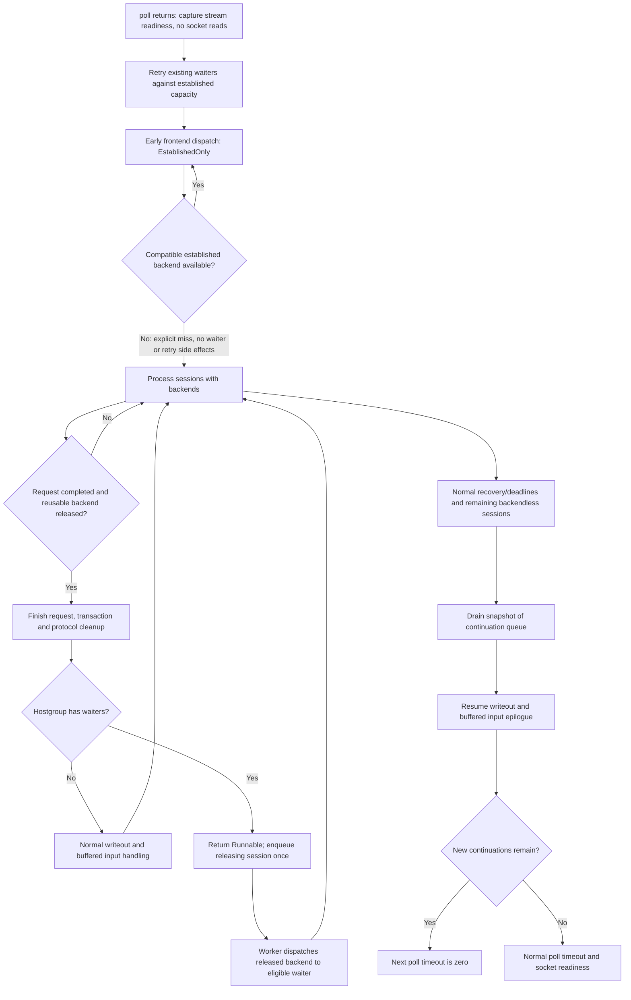

# PostgreSQL phased scheduler contract

The scheduler keeps its phased ordering and deferred socket I/O. This change makes a session's reason for stopping explicit and gives a released backend to existing waiters before the releasing session starts another buffered request. It does not replace the phased scheduler with a unified event queue.

## Execution boundary

A scheduled session step returns one of: waiting for I/O, waiting for a backend, established connection unavailable, runnable continuation, or close. Consumed work clears the per-pass runnable flag. An explicit continuation survives the next poll/reset cycle independently of socket readiness.

After a request completes, protocol bookkeeping, transaction state, result ownership, and backend detachment finish before yielding. If its released hostgroup has waiters, the session yields before client writeout and before processing another queued command. The worker services release notifications after that handler has returned. It then resumes the releasing session through its output/next-command epilogue. No handler is entered recursively from the pool manager.

Yielded sessions enter a worker-owned continuation list once. Teardown removes a queued session. A bounded snapshot of that list is drained after the normal phases; any remaining continuation forces a nonblocking poll on the next iteration. Partial writes retain the normal POLLOUT path. Readiness remains attached to streams and is cleared before consumption or connection reassignment.

`run_step()` owns clearing consumed `to_process` work. An established-only miss remains runnable for ordinary recovery; a safe yield is represented by the continuation queue. The old dispatched-session vector and its linear membership searches are removed. Release dispatch is bounded and happens after the handler returns, avoiding recursive entry from pool code.

The partial-write regression also exposed an existing plaintext error path: after a writable event, one send can consume socket capacity and a subsequent send can return `EAGAIN`. Writable readiness is not a capacity reservation. The development path now retains output on `EINTR`, `EAGAIN`, or `EWOULDBLOCK`, including after `POLLOUT`, while other send errors still close the stream.

## Pool policy

Checkout explicitly accepts normal or established-only policy. Established-only checkout can remove a compatible, connected, idle backend but cannot create, warm, evict, park the session, impose retry delay, or record an ordinary checkout failure. A speculative miss is a returned outcome, not a normal failure followed by rollback. Both initial waiter service and inline release service use this policy. The recovery/deadline phase uses normal policy and remains responsible for reconnecting and timeout errors. The existing global early-dispatch stop is retained.

## Allocation failure ownership

Native result-buffer failure remains terminal for the session and its incomplete backend response. A libpq notice callback must return normally to libpq so borrowed results and temporary error buffers are cleaned up. A sticky connection failure is surfaced at audited C++ parser boundaries before successful result dispatch or reuse. Owned COPY buffers use scoped cleanup across serialization and deferred-error propagation. This is a separate change from scheduling.

## Alternatives and choice

Replacing linear dispatch membership alone corrects lookup complexity but leaves handler outcomes implicit. A unified scheduler changes the ordering already investigated and is outside this work. The selected approach preserves phases, introduces explicit stop reasons and continuations, and removes the need for the dispatched-session vector where consumed work is represented directly.

## Verification

Exercise real session/worker/pool behavior for release with buffered input, waiter priority, partial output, speculative pool miss without side effects, incompatible free connections, timeout/recovery, continuation teardown, and allocation failures in libpq notice/COPY handling. Preserve the existing worker timeout assertions and both backend protocols.

Benchmark only SELECT 1 without TLS, localhost, five hundred clients, ten pre-established backends, sixteen pgbench jobs, and one proxy worker. Use the immutable committed control build and the final candidate with matching release flags. Reject a run if backend connection creation occurs during warmup or measurement. Collect TPS, p95/p99, CPU per query, and pool snapshots every second. Scheduling timing, if needed, is a separate diagnostic run rather than a hook in the throughput binary.

## Boundaries

Do not change TLS, command classification, DataRow batching, digest settings, the branch name, or existing commit history. Commit meaningful changes separately with detailed messages and the repository identity. No performance improvement is assumed before measurement.
