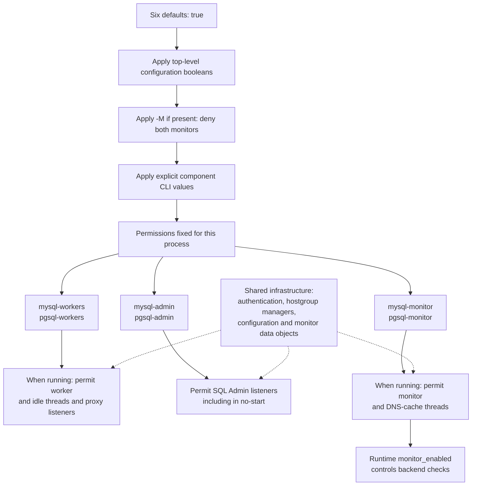
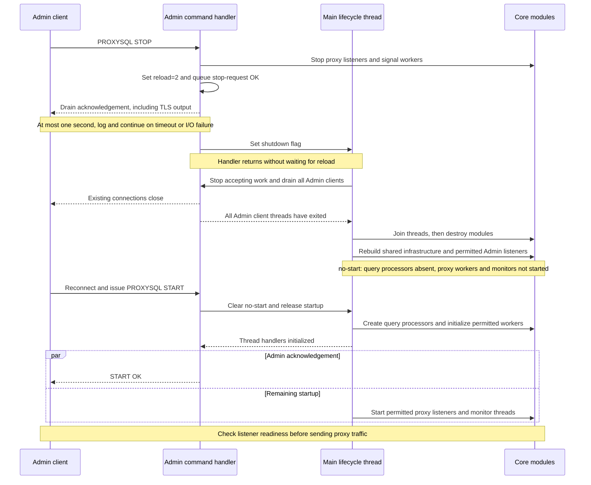

# Refresh STOP/START safety and selective module startup

## Intent and authorization

Resume the ideas in PRs #5217 and #4960 on current `v3.0`, as requested on
2026-10-28. The maintainer accepted the proposed order (lifecycle safety, then
selective startup) and explicitly requested a proper plan and implementation.
The old PRs remain references; do not merge, close, or rewrite them as part of
local implementation. Also preserve relevant coverage from #5222 / issue #5218.

## Approach

Use one combined replacement, #6559, against `v3.0`, as subsequently approved
by the maintainer to reduce duplicate CI work. The original two-PR review plan
is superseded: #6558 is closed and its lifecycle fixes are included in #6559.
Keep the lifecycle fix and optional startup feature distinguishable in commits
and verification. Rebasing the old branches would carry outdated lifecycle
assumptions and, in #5217, an unconditional disabled statistics-refresh block.

1. Reproduce STOP/START and stopped-state Admin failures on the exact current
   commit, then fix the proven lifecycle defects while retaining normal runtime
   statistics refresh. Extend coverage to both Admin protocols, repeated cycles,
   concurrent clients, and initial `--no-start`.
2. Add startup-only per-protocol worker/Admin/monitor controls from #4960,
   defaulting to enabled. Authentication and hostgroup managers remain available;
   disabling workers means no worker threads, not merely no listening sockets.
   Test mixed configurations through the lifecycle established by change 1.

## Contracts

- Preserve `doc/agents/invariants.md`: in particular, core LOAD SERVERS commands
  remain successful and cannot be vetoed by disabled modules or plugin state.
- Preserve the default all-enabled behavior and the existing `--no-monitor` and
  `--no-start` switches. Command-line options override configuration settings.
- Support MySQL and PostgreSQL equally. Do not add fake empty results with the
  wrong schema, disable normal statistics refresh, or use timeout expiry as
  permission to destroy objects still used by Admin threads.
- Do not reuse or duplicate the old STOP state machine without reproducing its
  necessity. Reuse current Admin-client draining and TLS ownership mechanisms.
- Run tests against private daemons with temporary datadirs and dynamically
  allocated loopback ports; never issue STOP against an existing service.
- Keep lifecycle and startup production changes and regression coverage
  distinguishable in git within the single combined replacement PR.

## Decisions to confirm through reproduction

Current STOP waits for main-thread reload, but the newer teardown waits for all
Admin clients; inspect and reproduce any resulting circular wait. The old Admin
object is destroyed on reload, so any fix must avoid dereferencing it afterward
and must define response/session lifetime explicitly in the tests and change log.

Stopped-state queries must never access missing processors. Preserve usable Admin
configuration operations; retain existing errors for operations that already
require a running processor. Explicit SAVE QUERY RULES/FIREWALL FROM RUNTIME
(and TO MEMORY aliases) must report unavailable runtime state instead of silently
returning success; safe snapshot SELECTs still use the actual empty schemas.
Digest maintenance is idempotent: absent processors retain no digest maps after
teardown, so PURGE/TRUNCATE correctly acknowledge zero deletions. These commands
do not purge persistent digest-history tables. Do not introduce a blanket LOAD
rejection.

STOP drains its queued response, including partial packets and TLS ciphertext,
before setting shutdown. The drain is bounded to one second for an unresponsive
reader; teardown continues after a warning on timeout or disconnect. STOP remains
an acknowledgement of the request, not a wait for the reload to finish.

Selective controls are `--mysql-workers`, `--pgsql-workers`, `--mysql-admin`,
`--pgsql-admin`, `--mysql-monitor`, `--pgsql-monitor`, with corresponding top-level
boolean configuration entries. Reject invalid explicit values rather than silently
accepting misspellings. Monitor startup permission remains distinct from the
persisted runtime `monitor_enabled` setting; do not overwrite a saved false with
true during startup. Worker permission likewise must not replace configured
positive thread counts with zero during runtime serialization or SAVE; actual
worker status counts remain zero when permission is denied.

## Architecture diagrams

These diagrams describe the combined implementation in #6559. They focus on the
core MySQL/PostgreSQL lifecycle; tier-specific plugin callbacks and unrelated
listeners are omitted. For option syntax and examples, see the
[operator guide](../../../doc/features/module-startup-controls.md).

### Startup permissions and shared infrastructure

Resolve the six permissions once when the process launches. Each defaults to
true; configuration supplies initial overrides, `-M` denies both monitors, and
explicit component CLI values take precedence. Every CLI occurrence is validated;
the last valid occurrence wins. The resulting permissions survive internal
STOP/START and RESTART reloads. Changing them requires a new process launch.

The three permissions for each protocol are independent. Denying workers does
not deny its Admin interface or monitor. An enabled Admin protocol can configure
both backend protocols. Shared objects remain available even when a permission
denies their associated threads or listeners. Query processors are created on
START, including when workers are denied; they are absent in `--no-start`.

Worker permission also differs from configured worker count: denying workers
gives an effective count of zero, while the configured positive `mysql-threads`
or `pgsql-threads` value survives SAVE and a later process launch. Likewise,
allowing a monitor does not overwrite a persisted `monitor_enabled=false`, and
setting `monitor_enabled=true` cannot override denied startup permission.

### STOP acknowledgement, teardown and START

The sequence shows a successful STOP from the running state and a subsequent
START through an enabled Admin protocol. The main thread and Admin clients run
concurrently; the required ordering is that clients finish before their module
dependencies are destroyed.

STOP OK acknowledges the request; it does not certify that reload is complete.
The one-second bound covers sending the reply, not total shutdown time, and a
disconnected or stalled client may never receive it. Teardown still waits for
Admin clients before destroying the objects they can access. This removes the
old circular wait: the issuing client waited for reload while reload waited for
that client to exit. START OK follows thread-handler initialization; listener
and monitor startup can still be in progress.

While stopped, safe snapshots retain their real schemas and return empty runtime
query-rule tables. Configuration remains editable and LOAD MYSQL/PGSQL SERVERS
continues to apply and reply OK. SAVE QUERY RULES/FIREWALL from unavailable
runtime returns an error and preserves configuration. Normal statistics refresh
resumes after START. If both Admin protocols are denied, SQL START is unavailable.

### Implementation references

| Diagram element | Implementation |
| --- | --- |
| Permission defaults and CLI precedence/validation | `lib/ProxySQL_GloVars.cpp`: constructor and `process_opts_post()` |
| Configuration permissions and lifecycle phases | `src/main.cpp`: configuration parsing, `ProxySQL_Main_init_phase2___not_started()`, `ProxySQL_Main_init_phase3___start_all()`, `ProxySQL_Main_init_phase4___shutdown()` |
| Worker permission and configured/effective counts | `lib/MySQL_Thread.cpp`, `lib/PgSQL_Thread.cpp`: thread-handler `init()`, variable access and `start_listeners()` |
| Admin listener permissions and client draining | `lib/ProxySQL_Admin.cpp`: `admin_main_loop()` and `shutdown_threads()` |
| STOP/START command ordering | `lib/Admin_Handler.cpp`: `admin_handler_command_proxysql()` |
| Bounded reply drain, including partial packets and TLS | `include/AdminResponseDrain.h`: `proxysql_drain_admin_response()` |

## Verification

Build a fresh DEBUG v3.1 daemon and run isolated lifecycle probes before and after
each fix. Compile changed core paths in Stable and v4.0 as resources permit.
Use focused unit coverage for option parsing and no-worker behavior where needed,
plus process-level tests proving listener/thread state and lifecycle progress.
Record exact commands, outcomes, and any limitations in the implementation plan.
