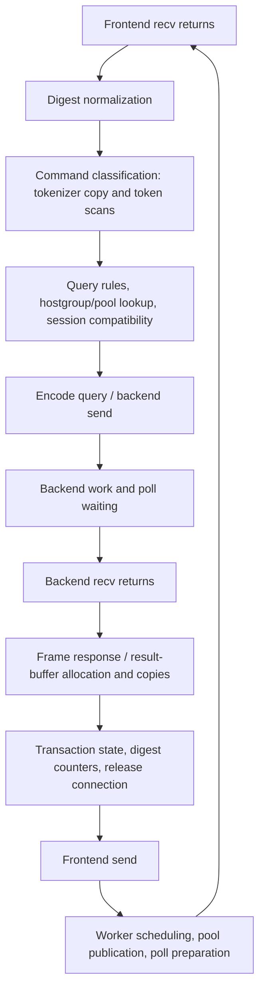

# ProxySQL forwarding CPU investigation

The final bounded tokenizer copy (`4699f3175`) averaged **10,597.80 TPS versus 10,291.39 TPS (+2.98%)**, with process userspace CPU/query **-4.79%** in the final matched, unprofiled batch. This is a preliminary result from two runs per build, not a general performance guarantee. The earlier unprofiled baseline ranged from 10,536 to 10,627 TPS, illustrating why these modest gains must be qualified. The concrete change removes printf formatting from a per-query text copy.

## Controlled workload

lon104, bare metal processes, PostgreSQL on localhost TCP; `SELECT 1`, simple query protocol, one pgbench client and one pgbench thread. One ProxySQL worker pinned to CPU 0; pgbench affinity CPUs 2,4,6,8,10,12,14,16; performance governor. Native backend protocol, TLS disabled on both hops, query digests enabled. All 64 backend connections are created before the 20-second warmup; each measurement lasts 60 seconds and asserts unchanged ConnOK/ConnERR plus a pool total of 64 every second. No repository test was changed.

Baseline: deferred I/O `b17a986f3`, binary SHA-256 `961419b9503186758a2d7d772429f0bc36d6f2127422be3784bac3002acc0f82`. First prototype: `73f822839`, binary SHA-256 `2b8476839d5ce8c1943d72aee23651f3143573872ec3eb7a70080c00bc16884c`. Source differs only in `lib/c_tokenizer.cpp`. Branch: `optimization/pgsql-forwarding-hotpath`.

## Final bounded-copy validation

Final commit: `4699f3175` (on top of `73f822839`); binary SHA-256 `9a3e63ec57d69f5033891ecd7147a0e1f8301f7ebe280f3c51a3c0049a977479`. Run order: bounded copy → original → original → bounded copy. No perf collection or source timing was active.

| Build | TPS run 1 | TPS run 2 | Mean TPS | Mean process user µs/query |
|---|---:|---:|---:|---:|
| Original deferred I/O | 10,247.71 | 10,335.07 | 10,291.39 | 16.976 |
| Final bounded copy | 10,607.23 | 10,588.38 | 10,597.80 | 16.162 |

The final copy clamps the number of bytes to the destination capacity and writes the NUL terminator explicitly, preserving the original snprintf behavior even when the size_t input length narrows to the legacy int field. It passed the 31,694 ordinary differential cases and 16 additional forced-length cases. It received its own build and measurements: the CPU counters and traced forwarding intervals below belong to the earlier `73f822839` prototype, not this final binary.

This change addresses one measured per-query cost. It does not resolve the whole ProxySQL/PgBouncer gap, establish a stable percentage for every forwarding phase, or explain the intermediate prototype’s unprofiled regression.

## Where the work occurs

These are measured function locations plus verified source behavior. Self samples do not include callees. Very short phase percentages varied between captures, so they are not presented as exact steady-state time allocations. Full sample counts and per-function tables are preserved in the capture directories and [sampling details](sampling-details.md).

| Path | Functions / source | Work done |
|---|---|---|
| Request normalization | `pgsql_query_digest_and_first_comment`, `lib/pgsql_tokenizer.cpp:2830` | Multiple normalization/compression passes, character classification and case folding. Largest named request hotspot in all four captures. |
| Request classification | `legacy_command_type` → `tokenizer`, `lib/c_tokenizer.cpp:24` | Copy digest/prefix into mutable storage, split tokens and classify the SQL command. The short-input copy unnecessarily invokes printf formatting. |
| Query rules and backend acquisition | `Query_Processor::process_query`, `get_MyConn_from_pool`, `MyHGC_find`, `get_random_MySrvC` | Rule/default processing, hostgroup lookup, pool selection and session-state compatibility checks. |
| Response buffering | `PgSQL_Query_Result::add_native_backend_message` and `buffer_to_PSarrayOut`, `lib/PgSQL_Protocol.cpp:3119` | Build client-wire messages. For a small result, shrink the 16 KiB accumulation buffer with realloc, hand it to the output queue, then allocate another 16 KiB buffer. Allocator functions are prominent response samples. |
| Response state/accounting | `PgSQL_TxnCmdParser::parse`, `ProcessQueryAndSetStatusFlags`, `sync_txn_tracker_with_backend`, `query_parser_update_counters`, `QP_query_digest_stats::add_time` | Transaction/multiplexing state, digest accounting, hash lookup and synchronization. |
| Worker work outside forwarding intervals | `process_all_sessions`, `run`, `ProcessAllMyDS_BeforePoll`, local-pool publication | Scheduling/scanning, poll setup, connection publication and housekeeping. The disabled `pgsql_loop_timing_point` hook still incurs calls and environment-gate checks; it is visible in samples. |

## The code change

`tokenizer()` already knows the input length. For inputs at most 127 bytes, it used `snprintf(buffer, 128, "%.*s", length, input)`. The first prototype copied `length + 1` bytes into that buffer. The final version instead copies a bounded prefix and writes its NUL explicitly, retaining the original snprintf truncation semantics. Longer inputs retain the existing `strdup` path. This is shared tokenizer code, not a SELECT 1 special case. Digest generation, routing, transaction tracking and the scheduler are unchanged.

The original call-stack capture identifies snprintf below `legacy_command_type → tokenizer`; disassembly verifies the call changes to memcpy. Formatted-copy symbols disappear from both patched phase captures. An isolated differential check of the actual original and patched tokenizer implementations matched 31,694 cases, including NULL input, embedded terminators, both empty-token modes, varied delimiters and the 127/128-byte allocation boundary. The optimized build completed.

## Intermediate prototype: counting-only CPU comparison

`perf stat` counted only the worker, for the central 40 seconds. Four events were enabled/disabled through an acknowledged control FIFO; all ran without multiplexing. No syscall tracing, sampled interrupts, source timers or call stacks were enabled in these runs. Query counts bracket the acknowledged counter window; the exact boundary slack is retained in `counter-summary.json`. This reduces profiling intrusion but does not imply zero overhead: per-thread hardware counters can affect context-switch work. The counting runs delivered 9,811 versus 9,746 TPS, below the unprofiled runs; they are used for CPU attribution, not production throughput estimates.

| Metric | Original | Copy patch | Change |
|---|---:|---:|---:|
| Retired userspace instructions/query | 17,923.41 | 17,334.06 | -3.29% |
| Userspace cycles/query | 36,886.78 | 34,785.04 | -5.70% |
| Userspace branch misses/query | 9.29 | 8.10 | -12.81% |
| Userspace L1 instruction-cache misses/query | 1,142.10 | 1,079.09 | -5.52% |

IPC: 0.486 → 0.498. Counted worker userspace time: 16.866 → 16.311 µs/query. These counters do **not** support blaming the patched regression on more instruction-cache misses; misses fell in this pair. The cause of the unprofiled regression is not established.

## Intermediate prototype: unprofiled throughput

Run order: original → copy → copy → original. No perf process or source timing was active.

| Build | TPS run 1 | TPS run 2 | Mean TPS | Mean process user µs/query |
|---|---:|---:|---:|---:|
| Original deferred I/O | 10,627.11 | 10,536.55 | 10,581.83 | 16.243 |
| Tokenizer copy | 10,487.27 | 10,304.24 | 10,395.76 | 17.525 |

**Intermediate result:** the first copy implementation was a measured CPU experiment without an end-to-end performance win. It was superseded by the separately measured bounded copy above. Lower instructions and cycles in an instrumented pair do not override the negative unprofiled result. No further scheduling or protocol change was made to chase TPS.

## Forwarding intervals and sampling limits

Precise-sampling captures measured frontend recv return → backend send entry at **8.230 → 6.931 µs**, and backend recv return → frontend send entry at **4.910 → 4.973 µs**. The ordinary-sampling pair similarly measured **8.196 → 7.017 µs** on the request path. These are traced wall-time syscall-boundary intervals; they include return/entry work and scheduling delay, not just userspace execution. Tracing perturbs the workload, so these are not uninstrumented latency claims.

All phase captures lost zero samples. Nevertheless the original binary’s sampled request/response/outside split moved from 57.8/12.0/30.2% with ordinary sampling to 42.8/20.1/37.1% with precise sampling. The earlier 58/12/30 split is therefore **not a stable cost allocation**. Precise IP sampling alone does not establish stable attribution at these short boundaries. Function locations identify concrete work; the counting-only instruction/cycle totals and separate unprofiled runs provide independent checks.

libc samples were resolved with debuginfo build ID `93ac61ec5a8eb1396f9fbd350e3169a558528a40`, matching the installed library. Apparent nearest-export labels such as `__nss_database_lookup` were not interpreted as actual work. No new backend connections occurred in any measured window; TCP_NODELAY=1 and TCP_CORK=0 were read from the live frontend and all 64 backend sockets in each phase capture.

## Artifacts and state

- [Audit of settings, per-second pool samples and failures](audit.txt).
- [Counter comparison](counter-comparison.json) and [unprofiled repetitions](unprofiled-summary.json).
- [Tokenizer differential validation](tokenizer-validation.txt).
- [Final cumulative source patch](tokenizer-bounded.patch), [initial implementation commit](73f822839.patch), and [bounded-copy refinement commit](4699f3175.patch).
- Raw large perf captures remain under `/home/rene/pg-network-bench/results/` on lon104, losslessly compressed as `phase.data.gz` and `trace.txt.gz`; exported metadata records original SHA-256 hashes. No raw perf binary is committed to git.
- The previous runtime was restored after every run. The final restoration check confirms no pgbench process remains and the earlier inline-handoff binary is active again. The experimental binary is preserved separately.
- The pre-existing staged `tools/benchmarks/pgsql-deferred-io-cost` files were left untouched.
