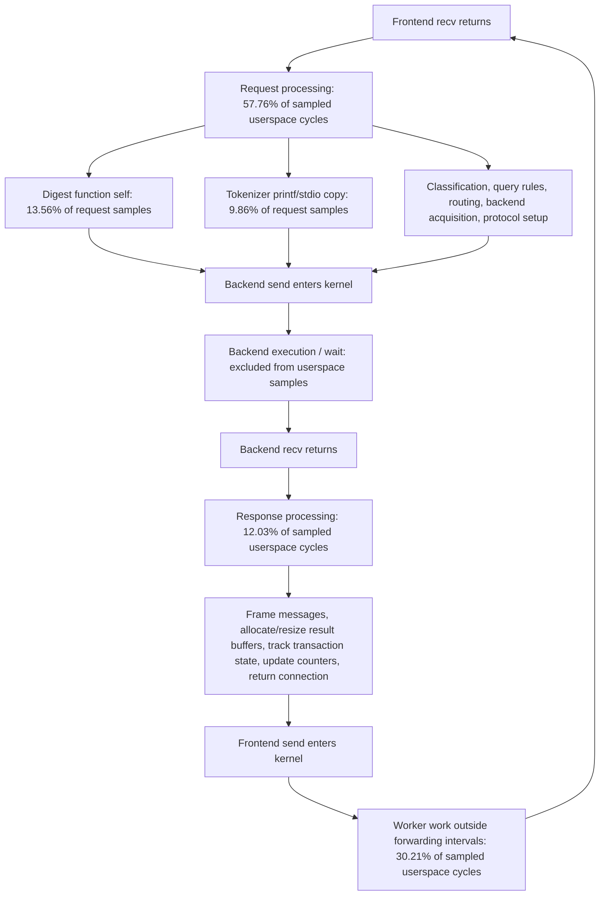

# Forwarding hot-path investigation

Workload: one pgbench client, one pgbench thread, simple `SELECT 1`, localhost TCP, no TLS on either hop, one ProxySQL worker pinned to CPU 0, native backend protocol, query digests enabled. All 64 backends are established before warmup and retained; measurements reject backend creation or errors.

## Initial sampling capture — phase percentages are not stable

**Do not treat the initial phase percentages below as a stable cost split.** Repeating with precise instruction-pointer sampling moved the baseline split from 57.8/12.0/30.2% to 42.8/20.1/37.1%. Function locations and the existence of the formatting work are supported; precise proportions on these very short intervals need stronger validation. The counting-only comparison below is intended to avoid sampled interrupts and syscall tracing.

A 20-second capture combines fixed-period userspace cycle sampling with three syscall tracepoints. Samples are labeled using live socket roles: successful frontend receive return to backend send entry is request processing; successful backend receive return to frontend send entry is response processing; everything else is outside those intervals.

This capture contains 190,843 completed responses and 38,158 userspace samples. Percentages below are shares of sampled **userspace cycles**, not shares of total query latency or kernel CPU.

| Interval | Userspace samples | Share of userspace cycles |
|---|---:|---:|
| Request: frontend recv return → backend send entry | 22,040 | 57.76% |
| Response: backend recv return → frontend send entry | 4,592 | 12.03% |
| Worker processing outside these intervals | 11,526 | 30.21% |

### Request path

Self samples: callees are listed separately, so these are not inclusive call-tree costs. The executable statically links libraries; allocator and hashing functions are not ProxySQL scheduler code.

| Function | Samples | Share within this interval |
|---|---:|---:|
| `pgsql_query_digest_and_first_comment` | 2,989 | 13.56% |
| `PgSQL_Session::get_pkts_from_client` | 973 | 4.41% |
| `__vfprintf_internal` | 906 | 4.11% |
| `Query_Processor<PgSQL_Query_Processor>::process_query` | 793 | 3.60% |
| `PgSQL_Session::handler` | 724 | 3.28% |
| `__GI_tolower` | 712 | 3.23% |
| `__strncasecmp_l_avx2_rtm` | 623 | 2.83% |
| `PgSQL_HGC::get_random_MySrvC` | 449 | 2.04% |
| `PgSQL_Session::handler___client_DSS_QUERY_SENT___server_DSS_NOT_INITIALIZED__get_connection` | 425 | 1.93% |
| `__strlen_avx2_rtm` | 422 | 1.91% |
| `__strcasecmp_l_avx2_rtm` | 398 | 1.81% |
| `legacy_command_type` | 371 | 1.68% |
| `Base_HostGroups_Manager<PgSQL_HGC>::MyHGC_find` | 327 | 1.48% |
| `__strnlen_avx2_rtm` | 325 | 1.47% |
| `Query_Processor<PgSQL_Query_Processor>::query_parser_init` | 303 | 1.37% |
| `PgSQL_Query_Info::begin` | 276 | 1.25% |
| `PgSQL_Session::handler___status_WAITING_CLIENT_DATA___STATE_SLEEP___PGSQL_QUERY_qpo` | 271 | 1.23% |
| `__GI___snprintf` | 270 | 1.23% |
| `SpookyHash::Short` | 264 | 1.20% |
| `__strpbrk_sse42` | 253 | 1.15% |

### Response path

Self samples: callees are listed separately, so these are not inclusive call-tree costs. The executable statically links libraries; allocator and hashing functions are not ProxySQL scheduler code.

| Function | Samples | Share within this interval |
|---|---:|---:|
| `je_arena_ralloc` | 257 | 5.60% |
| `PgSQL_Query_Result::add_native_backend_message` | 204 | 4.44% |
| `__strlen_avx2_rtm` | 158 | 3.44% |
| `__strncasecmp_l_avx2_rtm` | 158 | 3.44% |
| `PgSQL_Session::handler` | 156 | 3.40% |
| `__memcpy_avx_unaligned_erms_rtm` | 150 | 3.27% |
| `realloc` | 139 | 3.03% |
| `je_malloc_default` | 137 | 2.98% |
| `PgSQL_TxnCmdParser::parse` | 119 | 2.59% |
| `isspace` | 118 | 2.57% |
| `Base_Session<PgSQL_Session, PgSQL_Data_Stream, PgSQL_Backend, PgSQL_Thread>::NumActiveTransactions` | 109 | 2.37% |
| `PgSQL_Session::PgSQL_Result_to_PgSQL_wire` | 99 | 2.16% |
| `PgSQL_Connection::native_fetch_result_cont` | 97 | 2.11% |
| `je_arena_ralloc_no_move` | 96 | 2.09% |
| `free` | 89 | 1.94% |
| `PgSQL_Session::RequestEnd` | 87 | 1.89% |
| `PgSQL_Connection::ProcessQueryAndSetStatusFlags` | 87 | 1.89% |
| `PgSQL_Session::finishQuery` | 84 | 1.83% |
| `PgSQL_Connection::handler` | 83 | 1.81% |
| `PgSQL_Session::sync_txn_tracker_with_backend` | 81 | 1.76% |

### Worker processing outside forwarding intervals

Self samples: callees are listed separately, so these are not inclusive call-tree costs. The executable statically links libraries; allocator and hashing functions are not ProxySQL scheduler code.

| Function | Samples | Share within this interval |
|---|---:|---:|
| `PgSQL_Thread::process_all_sessions` | 1,099 | 9.53% |
| `PgSQL_Thread::run` | 953 | 8.27% |
| `pgsql_loop_timing_point` | 663 | 5.75% |
| `___pthread_mutex_lock` | 535 | 4.64% |
| `PgSQL_Session::handler` | 474 | 4.11% |
| `Base_Thread::ProcessAllMyDS_BeforePoll<PgSQL_Thread>` | 448 | 3.89% |
| `__GI___poll` | 344 | 2.98% |
| `__GI___pthread_disable_asynccancel` | 330 | 2.86% |
| `__vdso_clock_gettime` | 328 | 2.85% |
| `PgSQL_HostGroups_Manager::push_MyConn_to_pool` | 294 | 2.55% |
| `__libc_recv` | 287 | 2.49% |
| `__GI___clock_gettime` | 282 | 2.45% |
| `___pthread_mutex_unlock` | 222 | 1.93% |
| `PgSQL_Thread::process_data_on_data_stream` | 217 | 1.88% |
| `PgSQL_Logger::is_events_logfile_open` | 215 | 1.87% |
| `Base_Session<PgSQL_Session, PgSQL_Data_Stream, PgSQL_Backend, PgSQL_Thread>::writeout` | 214 | 1.86% |
| `PgSQL_Thread::ProcessAllMyDS_AfterPoll` | 192 | 1.67% |
| `PgSQL_Connection::async_query` | 181 | 1.57% |
| `PgSQL_Thread::return_local_connections` | 177 | 1.54% |
| `Base_Thread::check_for_invalid_fd<PgSQL_Thread>` | 173 | 1.50% |

The parallel request boxes identify categories of work, not parallel execution. Percentages on the digest and formatting boxes use the request interval as their denominator. Kernel execution and off-CPU waiting have no share in this userspace-only diagram.

## First targeted change

`73f822839` replaces the short-input `snprintf("%.*s", ...)` in `tokenizer()` with a copy of the already known length plus its NUL terminator. Input is at most 127 bytes in this branch, and the buffer is 128 bytes. Longer inputs retain the existing heap path. Query digests, classification, routing, protocol handling and the deferred-I/O scheduler remain enabled and unchanged. This shared tokenizer is also used by MySQL; it is not a SELECT 1 special case.

Before the change, printf/stdio formatting functions accounted for 2,173 request samples: **9.86% of request userspace samples, or 5.69% of all userspace samples**. The earlier call-stack capture places the snprintf call under `legacy_command_type → tokenizer`. This is a measured removable cost, not a prediction that total TPS will improve by 5.69%: most total worker CPU was kernel CPU in the previous all-cycle profile.

The build succeeded. An isolated differential check matched 31,694 cases against the original implementation, including NULL input, embedded terminators, both empty-token modes, varied delimiters and lengths around the 127/128-byte allocation boundary. Repository tests were not changed.

## Unprofiled validation

Four matching runs, in original → copy → copy → original order, produced:

| Build | TPS, run 1 | TPS, run 2 | Mean TPS | Mean userspace µs/query |
|---|---:|---:|---:|---:|
| Original deferred I/O | 10,627.11 | 10,536.55 | 10,581.83 | 16.243 |
| Tokenizer copy | 10,487.27 | 10,304.24 | 10,395.76 | 17.525 |

**The change regressed mean throughput by 1.76%; it is not a demonstrated throughput optimization.** All settings and the workload were unchanged; all four runs retained 64 established backends throughout warmup and measurement and had zero failed transactions.

Traced request-forwarding intervals improved in both sampling modes (ordinary: 8.196 → 7.017 µs; precise: 8.230 → 6.931 µs). Response intervals stayed around 4.9 µs. This does not override the unprofiled result: instrumented runs perturb the workload. The formatting symbols disappear from the patched capture, but that alone is insufficient evidence of an end-to-end improvement.

A counting-only comparison of worker cycles, retired instructions, branch misses and instruction-cache misses is in progress to investigate the unprofiled CPU regression.

## Measurement limits

The phase trace adds overhead. Its syscall-boundary intervals include kernel return/entry work and any scheduling delay; they are not pure userspace time. Fixed-period CPU samples locate actual userspace work without adding source timers. Do not multiply phase percentages by the earlier traced wall-time intervals. Library addresses were resolved against libc debuginfo with the matching build ID `93ac61ec5a8eb1396f9fbd350e3169a558528a40`; misleading nearest-export names such as `__nss_database_lookup` were not treated as actual work.

Raw captures and hashes are recorded alongside the exported samples. On lon104, large raw files were losslessly gzip-compressed after copying and checking matching SHA-256 hashes.
