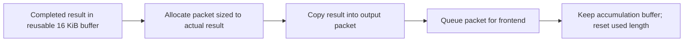

# Remaining ProxySQL userspace hotspots

The next concrete optimization target is **small-result buffer reuse**. A fresh profile of the current bounded-tokenizer build attributes **4.47% of sampled worker userspace cycles** to `PgSQL_Query_Result::buffer_to_PSarrayOut()` and its callees. Most of that path is allocator work. The response object is reused, but its 16 KiB accumulation buffer is shrunk and replaced for each small result.

This investigation changed no ProxySQL source and ran only the existing one-client, plaintext `SELECT 1` condition. It identifies measured costs and proposed optimizations; it does not claim another throughput improvement.

## Configuration and capture validity

- Host: lon104; bare metal, localhost TCP; native PostgreSQL backend protocol.
- Binary: `proxysql-head-tokenizer-bounded`, source commit `4699f3175`, SHA-256 `9a3e63ec57d69f5033891ecd7147a0e1f8301f7ebe280f3c51a3c0049a977479`.
- One pgbench client and one pgbench thread; simple protocol; `SELECT 1`; TLS disabled on both hops.
- One ProxySQL worker, CPU 0; pgbench affinity CPUs 2,4,6,8,10,12,14,16; performance governor.
- 64 backend connections established before the 20-second warmup. Each run then lasts 60 seconds, with profiling enabled for the central approximately 40 seconds.
- Query digests remain enabled. Source timers and unified scheduling are disabled.
- Both runs: ConnOK stayed **64**, ConnERR stayed **0**, and ConnUsed + ConnFree stayed **64** in every one-second snapshot. ConnUsed ranged 0–1 and ConnFree 63–64, consistent with this single-client workload. Zero failed transactions.
- Both captures lost **zero samples**. The prior runtime was restored after each run, and no pgbench process remains.

[Audited settings and pool summary](audit.json), [restoration verification](restoration.json).

## Measured targets

Percentages below use **all sampled worker userspace cycles** as the denominator, including libraries. They exclude kernel execution, backend execution and waiting. They are not percentages of query latency or predicted TPS gains. Except where marked self, each row includes callees recovered in the DWARF stack capture; parent/child rows elsewhere in the exports must not be added together.

| Target | Samples / 13,344 | Userspace share | Verified work and optimization direction |
|---|---:|---:|---|
| Digest normalization | 831 | 6.23% | `pgsql_query_digest_and_first_comment`: initializes several parser states, runs four stages plus final cleanup, and calls character-classification/case-folding routines. Investigate avoiding compression passes when their prerequisites are absent, while preserving digest output. |
| Command classification, after the copy fix | 619 | 4.64% | `legacy_command_type`: still copies/tokenizes text, finds token boundaries, and performs string comparisons. A bounded, non-owning token scanner could remove copying and repeated length scans while preserving command classification. |
| Backend pool acquisition | 603 | 4.52% | `get_MyConn_from_pool`: hostgroup lookup, server selection, candidate search and connection compatibility checks. These are established-connection reuse costs; no backend connections were created during measurement. |
| Small-result buffer flush | 597 | **4.47%** | `buffer_to_PSarrayOut`: shrink allocation, publish output packet, allocate another accumulation buffer. Retain the large buffer and allocate/copy only the small queued packet. |
| Completion-time connection flags | 523 | **3.92%** | `ProcessQueryAndSetStatusFlags`: repeated case-insensitive prefix comparisons and scans for session/transaction features. Derive reusable query properties once and use them here, retaining all pinning semantics. |
| Digest statistics accounting | 464 | **3.48%** | `query_parser_update_counters`: rebuild a composite hash, acquire the shared read lock, look up the digest entry, update counters. Reuse stable hash inputs/composite keys before considering more intrusive statistics-cache changes. |
| Explicit transaction command tracking | 152 | 1.14% | `handle_transaction`: parses the first word again, then returns UNKNOWN for this SELECT. Reusing an adequate classification could avoid this scan; backend transaction-state reconciliation must remain. |
| Disabled outer-loop timing hook — self | 220 | **1.65%** | `pgsql_loop_timing_point` is still called at the loop's diagnostic boundaries although timing is disabled. Move a cheap enable check into an inline caller-side gate, keeping timestamp/report work out of line. |

These targeted paths are only part of the worker's cost. For context, `process_all_sessions` and `run` together account for another **6.82% self samples**, and `PgSQL_Session::handler` for **4.17% self samples** in the DWARF capture. These broad functions are less useful optimization targets until their particular operations are isolated. Full self-symbol and source-line distributions are retained in the capture directories.

## Why buffer reuse comes first

The source path is explicit (`lib/PgSQL_Protocol.cpp:3119`):

```cpp
if (buffer_used < PGSQL_RESULTSET_BUFLEN / 2) {
    buffer = (unsigned char*)realloc(buffer, buffer_used);
}
PSarrayOUT.add(buffer, buffer_used);
buffer = (unsigned char*)malloc(PGSQL_RESULTSET_BUFLEN);
buffer_used = 0;
```

`PGSQL_RESULTSET_BUFLEN` is 16 KiB. The ordinary `SELECT 1` response is approximately 66 wire bytes. Native ReadyForQuery processing flushes the completed result through this function. `init_query_result()` reuses the result object on subsequent queries, but the code above still replaces the buffer.

The DWARF stacks connect **575 of the 597 buffer-flush samples** to allocator functions, including `je_arena_ralloc`, `realloc`, `je_malloc_default` and related helpers. Across the entire worker, allocator self samples account for **5.42%** in this capture and **5.56%** in the independent precise-IP capture. Thus the allocation cost is not merely an unexplained symbol somewhere inside the process: a substantial part is located on this particular result-flush path.

Proposed small-result behavior:



Keep the existing buffer-handoff behavior for large/full buffers. This preserves independent ownership of queued output while avoiding the repeated large-to-small realloc and large replacement allocation. It still needs one small allocation and a copy; **4.47% is the cost of the current path, not the guaranteed removable cost**. No implementation or gain is claimed here.

## Other actionable details

**Connection flags:** this is not duplicate invocation of the explicit transaction tracker. The source already prevents that older double-call bug. Instead, separate completion code checks SET/custom variables, prepared statements, temporary tables, advisory locks, holdable cursors, sequences and savepoints. In this workload, most checks reject the query after scanning/comparing text. Native LISTEN handling already has an early exit for a connection never subscribed; that optimization exists and should not be proposed again. A safe improvement would reuse parsed facts, rather than skip state tracking merely because a query begins with SELECT.

**Command classification:** fixing the formatted copy removed one operation, not the remaining classifier work. SELECT classification also checks intercepted cancellation/termination functions. Any non-owning scanner must preserve those checks, leading parentheses, delimiters and fallback behavior; this should be a general implementation improvement, not a SELECT 1 special case.

**Digest statistics:** `lib/Query_Processor.cpp:3476` initializes a new SpookyHash and feeds username, digest, database, hostgroup and optionally client address on every completion. The established-entry path already uses a **read** lock and atomic counters, not an exclusive write lock. Hash/key reuse is the less invasive starting point. Caching pointers to shared entries would additionally need correct lifetime handling across stats resets.

**Disabled hooks:** the source contains 16 outer-loop timing call sites. The disabled path returns without clock reads, but still pays call/prologue and gate-check costs. Its self share is similar in both captures: **1.76% precise-IP**, **1.65% DWARF**. This is overhead introduced by experimental diagnostics, not a claim about the upstream worker.

## Measurement method and limits

1. Precise userspace-cycle sampling: `cycles/period=400003/upp`, frame-pointer call graphs; **33,420 samples**. Useful for self-symbol costs, but allocator stacks were often truncated.
2. A second capture of the **same binary and workload**, using `cycles/period=1000003/u` and DWARF stacks with 8 KiB stack snapshots; **13,344 samples**. This recovered the allocator callers and supplies the inclusive percentages above.

The fixed period makes sample proportions proportional to sampled cycles within each capture. Ordinary sampling can skid; stack recovery and attribution are not perfect. The percentages identify priorities and should not be treated as exact, universal CPU budgets. Matching libc debuginfo was used to resolve stripped internal functions instead of assigning their samples to the nearest exported symbol.

The first automatic DWARF report export spent excessive time resolving inline source frames. It was stopped and re-exported with `--no-inline`; source addresses were resolved separately in bulk. No workload rerun was needed for that export change. The analysis uses the event's sampled instruction pointer for self costs, rather than assuming the first printed call-chain address is identical.

The measured run TPS was 9,728.79 with the first profiler and 10,008.60 with the second. These are **instrumented capture rates**, not a new performance comparison. No new unprofiled benchmark matrix was run, no TLS conditions or client counts were added, and no repository tests were modified.

## Evidence

- [Source excerpts with original line numbers](source-excerpts.md).
- [DWARF function/path/line counts](remaining-hotspots-dwarf-bounded-20261022T223507Z/hotspots.json), [self report](remaining-hotspots-dwarf-bounded-20261022T223507Z/perf-self.txt), [inclusive report](remaining-hotspots-dwarf-bounded-20261022T223507Z/perf-inclusive.txt).
- [Precise-IP function/path/line counts](remaining-hotspots-bounded-20261022T223141Z/hotspots.json).
- [Raw capture locations and SHA-256 hashes](raw-artifacts.json). Large perf binaries remain losslessly compressed on lon104; expanded stack text is kept locally and remotely but excluded from the git report commit.
- Capture harnesses, profiler commands, window boundaries, settings and one-second pool snapshots accompany the reports.
